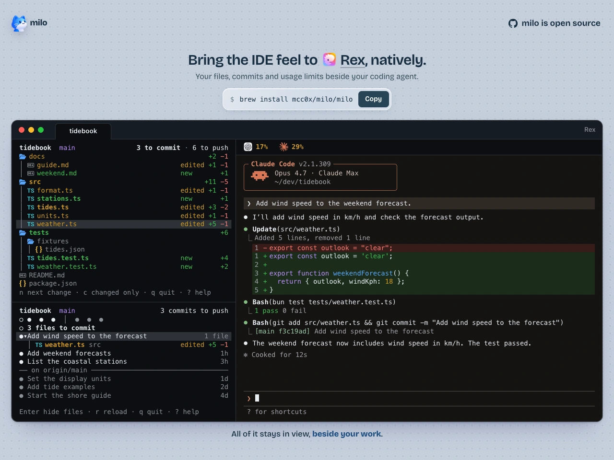

<p align="center"></p>

<h1 align="center">milo</h1>

<p align="center">A Git-aware file tree, commit history, diff reader and usage limits in native panes for <a href="https://www.superlogical.com/rex">Superlogical’s Rex terminal</a>.</p>

<p align="center">
  <a href="https://site-production-ad7e256b.up.railway.app">
    <picture>
      <source media="(max-width: 600px)" srcset="docs/img/web-demo-mobile.webp">
      
    </picture>
  </a>
  <br><sub><a href="https://site-production-ad7e256b.up.railway.app">Watch the demo</a> cycle through Claude Code, Codex and omp. The project and usage figures are examples.</sub>
</p>

## Install

The v0.1.0 release is available for Apple Silicon Macs. Install it with Homebrew:

```sh
brew install mcc0x/tap/milo
```

Without Homebrew, download and run the installer from the release tag:

```sh
curl -fsSLo milo-install.sh https://raw.githubusercontent.com/mcc0x/milo/v0.1.0/site/public/install.sh &&
  sh milo-install.sh
```

The script verifies the release binary against its SHA-256 checksum and installs it to `~/.local/bin` by default. It does not need Rust or Git. See [setup and removal](docs/setup.md) for source installation and uninstall instructions.

In [Rex](https://www.superlogical.com/rex), run `milo setup` to choose your panes. Check **On save:** and press `s` to save. Turn on **Arrange new shell tabs** to use the layout in new shell tabs and new sessions.

You can also run each pane on its own.

## Outline

<p align="center">
  
</p>

See changed files in the project tree as you work. Bold colours mark changes to commit; regular colours mark changes to push. Press `Enter` on a file to read it.

## History

<p align="center">
  
</p>

See recent commits and, when the branch tracks a remote branch, how many still need to be pushed. Press `Enter` on a commit to see the files it touched, then on a file to read that version.

## Usage

<p align="center">
  
</p>

See how much of each reported limit you have left. Milo reads local reports saved by oh-my-pi, Codex and Claude Code. Where the terminal can show pictures, such as in Rex, the pane can draw the logos and large figures as pictures.

## Reader

<p align="center">
  
</p>

Read a file with added and removed lines marked, or open it as it was at a commit. Press `n` or `N` to jump between changed blocks.

## Commands

| Command | Opens |
| --- | --- |
| `milo outline [PATH]` | File tree |
| `milo history [PATH]` | Recent commits |
| `milo usage` | Usage limits |
| `milo view FILE [--commit ID]` | File reader |
| `milo setup` | Setup screen |

`PATH` defaults to the current directory. Bare `milo` opens the outline and can offer setup the first time in Rex. Use `milo --help` for all commands or `?` for help when a pane has room.

## Documentation

[Setup and removal](docs/setup.md) · [Keys and marks](docs/keys.md) · [Usage limits](docs/usage.md) · [Pane behaviour](docs/panes.md) · [How it works](docs/internals.md)

[Contributing](CONTRIBUTING.md) · [MIT licence](LICENSE)
