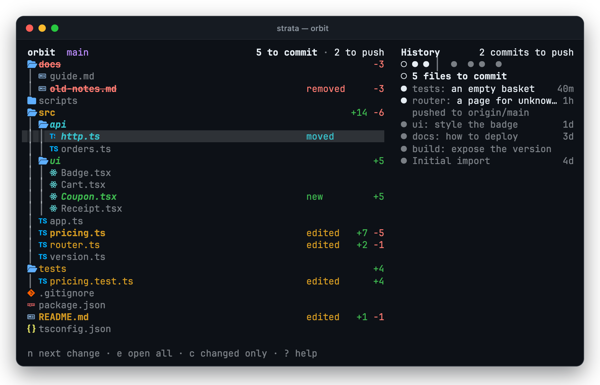
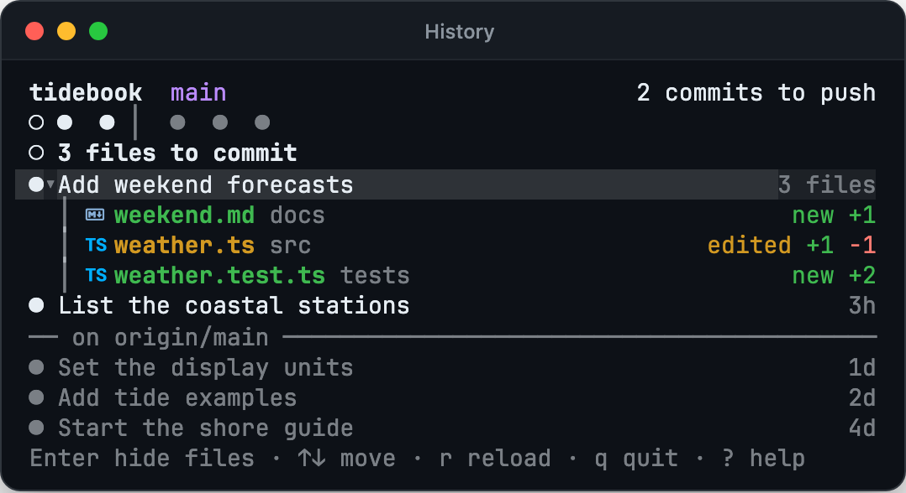

<p align="center">
  <a href="https://usemilo.net">
    
  </a>
</p>

<p align="center">
  <a href="https://github.com/mcc0x/milo/releases/latest"></a>
  <a href="https://github.com/mcc0x/milo/stargazers"></a>
  <a href="Cargo.toml"></a>
  <a href="LICENSE"></a>
</p>

## Install

The [v0.1.7 release](docs/releases/v0.1.7.md) is available for Apple Silicon Macs running macOS 13 or later. Install it with Homebrew:

```sh
brew install mcc0x/milo/milo
```

Without Homebrew, download and run the installer from the release tag:

```sh
curl -fsSLo milo-install.sh https://github.com/mcc0x/milo/releases/download/v0.1.7/install.sh &&
  sh milo-install.sh
```

The script verifies the release binary against its SHA-256 checksum and installs it to `~/.local/bin` by default. It does not need Rust or Git. If you already installed with Homebrew, run `brew upgrade mcc0x/milo/milo`. If you use the Rex integration, run `milo setup --repair` after upgrading. See [setup and removal](docs/setup.md) for source installation and uninstall instructions.

From a shell in your project, run `milo` to pick a local pane, or `milo outline` to go straight to the file tree. Press `Enter` on a file to read it, `e` to edit working text, `Ctrl-S` to save, and `q` while reading to go back. No Rex installation, browser, account or setup is needed. In Rex, use `milo setup` if you want the panes arranged beside your shell.

## Workspace settings

Run `milo web` in your project to open the [settings dashboard](docs/setup.md#browser-editor). It’s built into the CLI and uses the same settings as `milo setup`. No account, Node.js, or separate install is needed.

Choose a pane layout for one worktree or set a global default. Under **Integrations**, you can have Rex arrange new shell tabs, forward alerts to Discord or Telegram, or show Discord presence. To configure [another Rex host](docs/setup.md#several-rex-hosts), run `milo web --host HOST`.

[Alert forwarding](docs/setup.md#mirror-rex-alerts) reconnects when Rex returns, but an explicit pause stays paused. Lifecycle notices are optional for each destination. A separate opt-in adds a verified Rex session label to ordinary alerts. Both choices are off by default.

<p align="center"></p>

## Outline

<p align="center">
  
</p>

See changed files in the project tree as you work. Bold colours mark changes to commit; regular colours mark changes to push. Press `/` to find a file by name or path, and `Enter` to read it.

## History

<p align="center">
  
</p>

See recent commits and, when the branch tracks a remote branch, how many still need to be pushed. Press `Enter` on a commit to see the files it touched, then on a file to read that version.

## Usage

<p align="center">
  
</p>

See how much of each reported limit you have left. Milo reads local reports saved by oh-my-pi, Codex and Claude Code, and the tokens and estimated cost OpenCode recorded today. It shows the tools that have a figure on this Mac, so there is no empty place for one you do not use, and setup can always show or hide each tool. Where the terminal can show pictures, such as in Rex, the pane can draw the logos and large figures as pictures.

### In the macOS menu bar

Keep an eye on usage without switching to Rex. **Milo** shows the mascot beside your lowest fresh remaining percentage by default. Click it for reset times, switch to **CPU** or **Memory** under **More options → Menu bar indicator**, or choose **Browser settings…** to open the browser editor. Turn on **More options → Needs you** to also list the Rex panes whose agent is waiting for you, failed or finished, and click one to go to it; it is off until you choose it.

<p align="center"></p>

On an Apple Silicon Mac running macOS 13 or later, run `milo menubar install`. The Homebrew and release binaries include the app; it only runs if you install it. See [menu bar setup and removal](docs/usage.md#macos-menu-bar).

## Discord presence

Optionally show **In a Rex session** on your Discord profile, under Milo's name and icon, while a Rex app has a session open. It is off until you turn it on with `milo presence enable`, in Settings or in the browser editor, and each of them says what becomes public first. Nothing about your sessions, projects, files or commands is sent unless you also choose to show the name of the session in front, its Git project's folder name, or both. No bot, token or sign-in is involved, and you can use a Discord application of your own instead of Milo's. See [Discord presence](docs/presence.md) for setup, privacy and limits.

## Reader

<p align="center">
  
</p>

Read a file with added and removed lines marked, or open it as it was at a commit. Press `n` or `N` to jump between changed blocks, or `c` to fold unchanged stretches. In Rex, files opened from the same Outline or History pane share one floating reader as [tabs](docs/panes.md#tabs-in-the-floating-reader). The reader colours [about thirty languages](docs/panes.md#languages), from Rust and TypeScript to Markdown, HTML and CSS.

The working-file Reader can also [view pictures, play supported MP4s, and render Markdown](docs/panes.md#reading-pictures-video-and-markdown). On a verified local Mac, press `Ctrl-O` on a working document in Outline, Find or Reader to open it in its default app, or `Ctrl-R` to [reveal it in Finder](docs/panes.md#opening-a-file-outside-milo-on-a-mac).

Press `e` to edit a working text file where you are reading it. The edit is a draft until you save with `Ctrl-S`, and a save never replaces a file that changed on disk without asking. `Ctrl-F` formats the draft with a [formatter you have installed](docs/panes.md#formatting); `Ctrl-Z` takes it back. See [editing files](docs/panes.md#editing-files).

To review an agent’s edits without mixing in your own uncommitted work, have it hand you its recorded patch and run `milo review PATCH`. In Rex, `--float` opens that [read-only review](docs/panes.md#reviewing-an-agents-edits) over the current tab. Milo checks that the patch still fits, not who wrote it. Press `i` to [write notes on its lines](docs/panes.md#notes-on-the-patchs-lines) and copy them, one now or all together, to paste back to the agent.

## Agent tasks

In Rex, start a coding agent on a task without leaving your pane. `milo task new --branch fix/login --base origin/main --agent claude --prompt "Fix the login redirect"` adds a Git worktree for the branch and opens Claude Code, Codex, oh-my-pi or OpenCode there, in a new Rex session that starts in the background with the agent's full interactive screen. **Milo: New Agent Task…** in the command palette asks the same questions. Milo starts only the agent you name, never switches your checkout, and never pushes, merges or cleans up. See [starting an agent task](docs/setup.md#start-an-agent-task). This is on `main` and not in the v0.1.7 release.

## What works in each terminal

| Command or feature | Ordinary terminal, no Rex | What Rex adds |
| --- | --- | --- |
| `milo` (Home) | Choose Outline, History, Usage or settings. No first-run guide on this path. Quit a pane to return to Home. | The existing settings and maintenance Home, with a first-run guide. |
| `milo outline [DIR]` or `milo DIR` | Browse and search a plain folder or Git worktree; open a file in place. | Managed sidebar, floating reader tabs, optional shell-following and temporary outline peek. |
| `milo history [DIR]` | Browse Git commits, expand a commit and read its file at that revision in place. | Managed sidebar and floating reader tabs. |
| `milo view FILE` / `--edit` / `--line LINE` / `--commit ID` | Read in the current terminal, at a line if you name one. Edit a working text file; save explicitly. A commit is read-only. | [Open a file named in a pane's output](docs/panes.md#opening-a-file-from-a-terminals-output), at its line, from the command palette. |
| `milo review PATCH [--from NAME]` | Read a handed-over patch in place. | `--float` can open the review from a non-interactive caller in a Rex pane. |
| `milo tabs [--last]` | Preview and reopen the tabs the reader last had open in this worktree, or a set of tabs you saved under a name. | **Milo: Reopen Last Reader Tabs…** and **Milo: Open a Reader Tab Set…** open the same lists in a floating pane. |
| `milo usage` / `usage --menu-stream` | Show available local figures in a pane, or emit a stream for the menu app. No provider sign-in required. | Optional compact Usage rail. |
| `milo setup` | Terminal settings, including icon, Git mark and usage choices. The explicit command offers a skippable first-run guide. | Try, save, repair or remove managed layouts. |
| `milo web [--no-open]` | Local settings dashboard. `--no-open` prints a private loopback link instead of opening the browser. | `--host HOST` uses Rex to forward **another** host’s editor. |
| `milo settings export GROUPS` / `import FILE [--apply]` / `undo` | Transfer selected settings as a file. Import previews unless you ask to apply. | Saved rail geometry can be used by a Rex layout. |
| `milo task new --agent AGENT …` | Not a standalone feature: the agent opens in a Rex session. | Adds or uses a Git worktree and starts the agent there in a background session. |
| `milo doctor`, `--help`, `--version` | Plain output; no TTY needed. Doctor distinguishes local preferences from optional integrations. | Reports Rex host and integration health. |
| `milo alerts`, `milo presence` | Inspect the settings without a running session. | Actual event mirroring and activity presence require Rex and explicit opt-in. |
| `milo listen`, arrange/remember rails, title tabs | Not standalone features. Run a direct pane command instead. | Managed by the Rex integration. |
| `milo menubar install` / `uninstall` / `indicator` / `attention` | Optional on macOS with a menu-enabled build; choosing an indicator or what the menu lists does not install the app. | The opt-in **Needs you** section lists Rex panes that wait for you and jumps to them. |
| `milo claude-status` | Status-line helper for an explicitly configured Claude Code profile, not an interactive pane. | Not Rex-dependent. |

`milo setup --skip-onboarding` records a skip without opening a TUI or applying settings. Direct pane commands never run the guide. See [Using the panes](docs/panes.md) for input and display fallbacks, and [terminal checks and measurements](docs/evidence/terminal-portability/README.md) for the environments actually exercised.

## Documentation

[Integrations](docs/integrations.md) · [Setup and removal](docs/setup.md) · [Keys and marks](docs/keys.md) · [Usage limits](docs/usage.md) · [Discord presence](docs/presence.md) · [Pane behaviour](docs/panes.md) · [How it works](docs/internals.md)

[Contributing](CONTRIBUTING.md) · [MIT licence](LICENSE)
