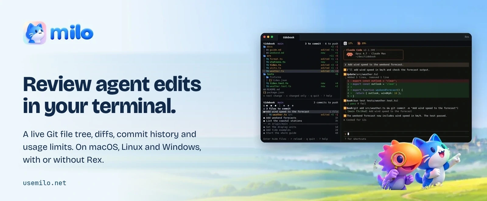
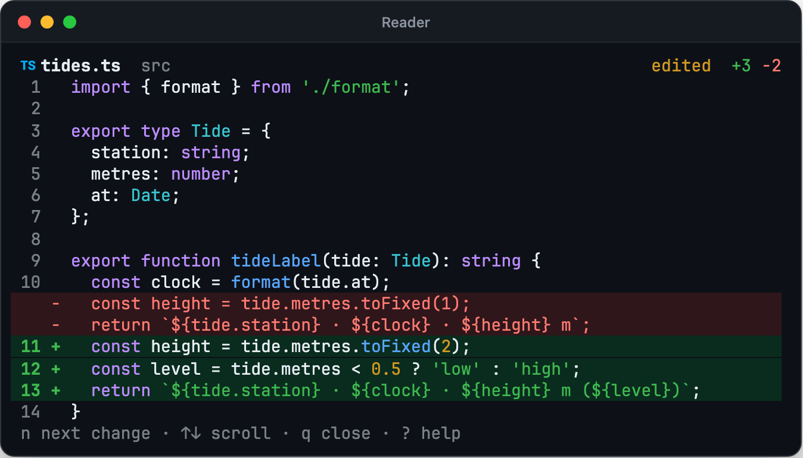

<p align="center">
  <a href="https://usemilo.net">
    
  </a>
</p>

<p align="center">
  <a href="https://github.com/mcc0x/milo/releases/latest"></a>
  <a href="https://github.com/mcc0x/milo/stargazers"></a>
  <a href="Cargo.toml"></a>
  <a href="LICENSE"></a>
</p>

## Install

The v0.1.5 release is available for Apple Silicon Macs running macOS 13 or later. Install it with Homebrew:

```sh
brew install mcc0x/milo/milo
```

Without Homebrew, download and run the installer from the release tag:

```sh
curl -fsSLo milo-install.sh https://github.com/mcc0x/milo/releases/download/v0.1.5/install.sh &&
  sh milo-install.sh
```

The script verifies the release binary against its SHA-256 checksum and installs it to `~/.local/bin` by default. It does not need Rust or Git. See [setup and removal](docs/setup.md) for source installation and uninstall instructions.

Run `milo` inside Rex to choose your panes and save your workspace preferences.

## Workspace settings

Choose a tree or a project sidebar, try it in this tab, then save it globally or just for this Git worktree. Drag a divider in an installed Milo sidebar and Milo remembers the proportions for that worktree. With **Arrange new shell tabs** enabled, the next shell tab restores them; command tabs and existing layouts are left alone. With **Title Rex tabs** enabled, tabs you have not named show their project, worktree and agent.

Prefer a browser? Run `milo web` in your project. It opens the [local settings editor](docs/setup.md#browser-editor) built into the CLI. It shares settings with `milo setup`; no account or separate install is needed.

<p align="center"></p>

## Outline

<p align="center">
  
</p>

See changed files in the project tree as you work. Bold colours mark changes to commit; regular colours mark changes to push. Press `Enter` on a file to read it.

## History

<p align="center">
  
</p>

See recent commits and, when the branch tracks a remote branch, how many still need to be pushed. Press `Enter` on a commit to see the files it touched, then on a file to read that version.

## Usage

<p align="center">
  
</p>

See how much of each reported limit you have left. Milo reads local reports saved by oh-my-pi, Codex and Claude Code, and the tokens and estimated cost OpenCode recorded today. It shows the tools that have a figure on this Mac, so there is no empty place for one you do not use, and setup can always show or hide each tool. Where the terminal can show pictures, such as in Rex, the pane can draw the logos and large figures as pictures.

### In the macOS menu bar

Keep an eye on usage without switching to Rex. **Milo** shows the mascot beside your lowest fresh remaining percentage. Click it for reset times, or choose **Browser settings…** to open the browser editor.

<p align="center"></p>

On an Apple Silicon Mac running macOS 13 or later, run `milo menubar install`. The Homebrew and release binaries include the app; it only runs if you install it. See [menu bar setup and removal](docs/usage.md#macos-menu-bar).

## Discord presence

Optionally show **In a Rex session** on your Discord profile, under Milo's name and icon, while a Rex app has a session open. It is off until you turn it on with `milo presence enable`, in Settings or in the browser editor, and each of them says what becomes public first. Nothing about your sessions, projects, files or commands is sent unless you also choose to show the name of the session in front, its Git project's folder name, or both. No bot, token or sign-in is involved, and you can use a Discord application of your own instead of Milo's. See [Discord presence](docs/presence.md) for setup, privacy and limits.

## Reader

<p align="center">
  
</p>

Read a file with added and removed lines marked, or open it as it was at a commit. Press `n` or `N` to jump between changed blocks. The reader colours [about thirty languages](docs/panes.md#languages), from Rust and TypeScript to Markdown, HTML and CSS.

Press `e` to edit a working text file where you are reading it. The edit is a draft until you save with `Ctrl-S`, and a save never replaces a file that changed on disk without asking. `Ctrl-F` formats the draft with a [formatter you have installed](docs/panes.md#formatting); `Ctrl-Z` takes it back. See [editing files](docs/panes.md#editing-files).

## Commands

| Command | Opens |
| --- | --- |
| `milo` | Milo Home: Browser settings, Terminal settings, Doctor and Uninstall |
| `milo outline [PATH]` | File tree |
| `milo history [PATH]` | Recent commits |
| `milo usage` | Usage limits |
| `milo view FILE [--commit ID \| --edit]` | File reader, or its editor with `--edit` |
| `milo setup` | Setup screen |
| `milo web [--port PORT] [--no-open]` | [Local browser settings editor](docs/setup.md#browser-editor) |
| `milo web --host HOST` | [Another Rex host’s settings](docs/setup.md#open-another-hosts-settings) through a loopback Rex forward (source builds; not in v0.1.5) |
| `milo settings export GROUPS` / `import FILE` / `undo` | [Copy chosen pane settings](docs/setup.md#copy-settings-to-another-host), preview the import, and take it back (source builds; not in v0.1.5) |
| `milo menubar install` / `uninstall` | Install or remove the optional menu app (menu-enabled builds only) |
| `milo doctor` | Read-only preference and integration report |
| `milo alerts` | [Mirror Rex alerts](docs/setup.md#mirror-rex-alerts) to a Telegram chat or Discord channel; off until you turn it on |
| `milo presence [status]` / `enable` / `details` / `application` / `disable` | Show or change the optional [Discord presence](docs/presence.md) |

`milo PATH` opens Outline at that path. On a fresh install, `milo` and `milo setup` share a short welcome guide. For unattended installs, `milo setup --skip-onboarding` dismisses it and exits without opening a TUI or applying settings. Direct pane commands never start the guide.

## Documentation

[Setup and removal](docs/setup.md) · [Keys and marks](docs/keys.md) · [Usage limits](docs/usage.md) · [Discord presence](docs/presence.md) · [Pane behaviour](docs/panes.md) · [How it works](docs/internals.md)

[Contributing](CONTRIBUTING.md) · [MIT licence](LICENSE)
