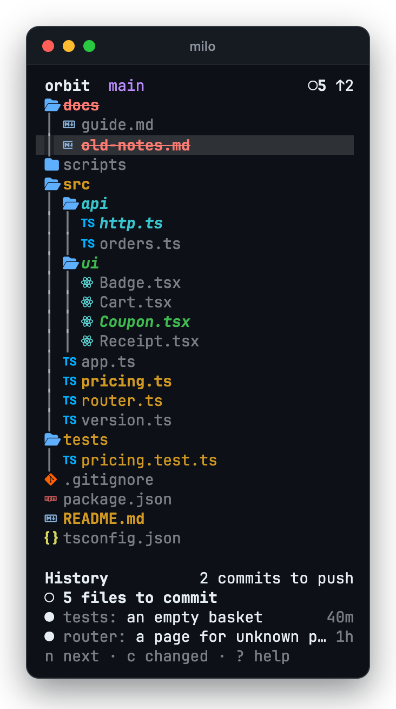
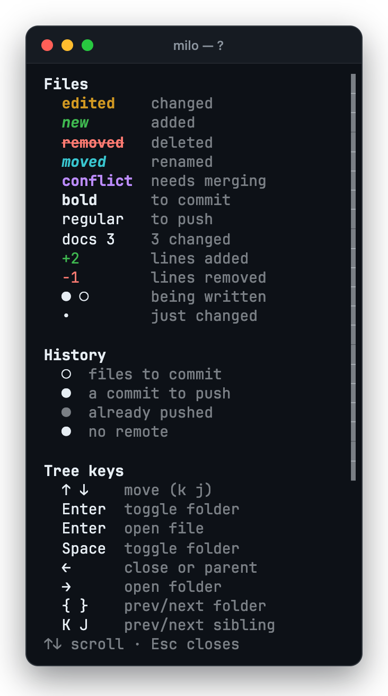
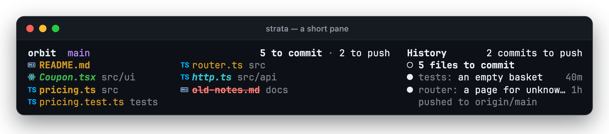
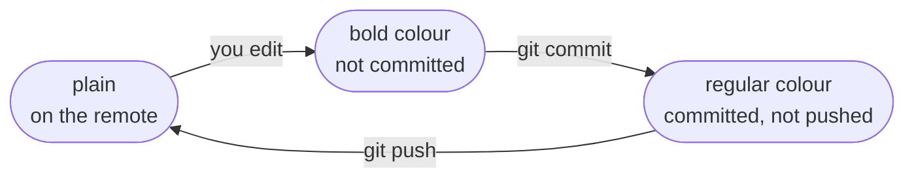
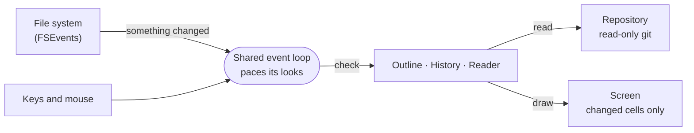

<h1 align="center">milo</h1>

<p align="center">
  <b>Your project's files, coloured by what you haven't committed or pushed yet.</b><br>
  Terminal panes that sit beside your work and stay up to date by themselves.
</p>

<p align="center"><a href="https://usemilo.net">usemilo.net</a></p>

<p align="center">
  
</p>

<p align="center">
  <code>one dependency</code> ·
  <code>570 KB binary</code> ·
  <code>first frame in ~55 ms</code> ·
  <code>does not write to projects</code> ·
  <code>MIT</code>
</p>

---

## Set it up in Rex

1. In your Rex shell, run `milo setup`.
2. Choose your panes and press `s` to save. Press `a` to try them in this tab.

```text
┌─────────┬────────────────────┐
│         │ Usage (two rows)   │
│ Outline ├────────────────────┤
│         │                    │
├─────────┤ Your work          │
│ History │                    │
└─────────┴────────────────────┘
```

Your shell keeps the keyboard. The Rex command palette gets **Milo: Arrange This Tab** (`milo_layout`), **Milo: Add the Outline** (`milo_outline`), **Milo: Add the History** (`milo_history`), **Milo: Add the Usage Strip** (`milo_usage`), and **Milo: Close Panes in This Tab** (`milo_close`). You can bind any of them in your own `init.lua`, for example `rex.bind("cmd+shift+m", "milo_layout")`.

Turn on **Arrange every new tab** to lay out new shells automatically. Tabs opened to run a command and tabs with their own layout are left alone. Turn the same switch off and save to stop arranging new tabs. Switch all three panes and the new-tab switch off and save to remove the Rex setup.

Setup adds two marked lines to Rex's `init.lua`, then asks Rex to reload. It keeps the layout and new-tab script in `~/.config/milo/rex.lua` and `~/.config/milo/listener.lua` (or under `$XDG_CONFIG_HOME/milo`), and remembers setup and listener state in `~/.local/state/milo` (or `$XDG_STATE_HOME/milo`). It does not change your existing actions or keys. **Show Claude Code limits** is optional: it adds a status line to `~/.claude/settings.json` only if there is none. Milo removes that line when you turn the option back off, but never replaces someone else's status line.

Outside Rex, the panes can still be run by themselves and setup can still enable Claude Code limits.

## Why

When an editor, a script or a coding agent is changing files for you, the question is always the same: *what has been touched, and where does it stand?* `git status` answers once, as a list. milo answers all the time, in place:

- **The whole tree, not a list.** You see changed files where they live, among the ones that did not change.
- **Two states at a glance.** Bold is work you have not committed. Regular weight is committed but not pushed. Plain is safe on the remote.
- **Live.** Save a file and its row lights up a moment later. Nothing to refresh.
- **A pane for commits.** See what is still to push, and press Enter on a commit to see the files it touched.
- **A reader built in.** Press Enter on a file to read it, with the lines it gained and lost marked and its code coloured.

## A look around

### The reader

<p align="center">
  
</p>

The whole file, not just the hunks: added lines carry a green wash and keep their code colours, removed lines sit in place in red, and the part of an edited line that actually changed is picked out. `n` and `N` step through the changes.

### It fits the pane you give it

<table>
  <tr>
    <td align="center" width="50%">
      <br>
      <sub><b>A narrow column</b> beside your editor: the tree and a compact count.</sub>
    </td>
    <td align="center" width="50%">
      <br>
      <sub><b><code>?</code></b> explains every colour, mark and key without leaving the pane.</sub>
    </td>
  </tr>
</table>

<p align="center">
  <br>
  <sub><b>A short pane</b> under your terminal: only the changed files, most recently written first.</sub>
</p>

| Pane | Size | What changes |
| --- | --- | --- |
| Outline | 7 rows or fewer | a strip of changed files in a git project, flowed across the width |
| Outline | 52 columns or more | what happened to each file and how many lines it gained and lost |
| Outline and history | 12 rows or more | room for a key hint |
| History | 3 rows or fewer | the newest commits without the heading, dots or divider |
| History | 52 columns and 8 rows or more | a row of dots above the commit list when there are several commits |
| History | narrow | a compact count such as `↑2` for two commits to push |

## Reading it



| Colour | The file was… |   | Mark | Means |
| --- | --- | --- | --- | --- |
| Yellow | edited | | `●` `○` pulsing at the left edge | being written right now |
| Green | added (italic if git does not track it yet) | | `•` at the left edge | changed since you last looked |
| Red, struck through | removed | | `docs 3` | a closed folder with 3 changed files inside |
| Cyan, italic | moved | | `+7 −5` | lines gained and lost |
| Magenta | left in conflict by a merge | | `○5 ↑2` | 5 files to commit, 2 to push (narrow panes) |

In history, a hollow dot is work not committed yet, a bold dot is a commit still to push, and a faint dot is already on the remote. A `•` beside a commit means it arrived while the pane was open. Open a commit to see its files in the same colours as the outline, with the type and size of each change.

While the keyboard is in another pane, milo moves its cursor to whatever file is being written and says so (`following Cart.tsx`). It never moves while you are using it, and it leaves folders you closed closed.

## Install

You need Rust 1.91 or later and git.

```sh
git clone <this repository> && cd milo
cargo build --release
cp target/release/milo ~/.local/bin/     # or anywhere on your PATH
```

## Use

```sh
milo                     # the outline; offers setup once in an unconfigured Rex
milo outline ~/code/app   # the file tree
milo history [PATH]      # recent commits
milo usage               # usage at a glance
milo setup               # choose a Rex layout and optionally show Claude Code limits
milo view FILE           # read one file
milo listen [--stop]     # start or stop the Rex new-tab listener
milo claude-status       # the status line command called by Claude Code
```

Outline and history default to the current directory and use the project root inside a git repository. In a plain folder the outline shows the files and history says there is no history. To outline a directory named like a command, give its path explicitly: `milo ./history`.

Icons need a [Nerd Font](https://www.nerdfonts.com). Without one, set `MILO_ICONS=plain` for ordinary symbols or `MILO_ICONS=off` for none.

### Keys

The essentials:

| Key | In the outline | In history | In the reader |
| --- | --- | --- | --- |
| `↑` `↓` or `k` `j` | move | move | scroll |
| `Enter` | open a folder, or read a file | show or hide a commit's files | |
| `n` `N` | next, previous changed file | | next, previous change |
| `c` | changed files only | | |
| `e` | open every folder; again to go back | | |
| `?` | help | help | help |
| `q` | quit | quit | close |

<details>
<summary><b>Every key</b></summary>

#### Outline

| Key | Action |
| --- | --- |
| `↑` / `↓` or `k` / `j` | Move the cursor |
| `Page Up` / `Page Down` or `Ctrl-B` / `Ctrl-F` | Move by a page |
| `Ctrl-U` / `Ctrl-D` | Move by half a page |
| `Home` / `End` or `g` / `G` | Go to the first or last row |
| `Enter` | Open or close a folder, or read a file |
| `Space` | Open or close a folder |
| `←` or `h` | Close an open folder, or go to the parent |
| `→` or `l` | Open a closed folder |
| `{` / `}` | Previous or next visible folder |
| `K` / `J` | Previous or next item in the same folder, over anything nested |
| `p` | Go to the parent folder |
| `e` | Open every folder, or go back to how they were |
| `n` / `N` | Next or previous changed file, including inside closed folders |
| `c` | Switch between all files and changed files only |
| `r` | Reload |
| `?` | Help |
| `q` | Quit |

Click a folder to open or close it, click a file to select it, double-click a file to read it. The wheel scrolls. In the strip there is no cursor: `←` / `→` or `h` / `l` move a column at a time, `Home` / `End` or `g` / `G` go to either end.

#### History

| Key | Action |
| --- | --- |
| `↑` / `↓` or `k` / `j` | Move the cursor |
| `Page Up` / `Page Down` or `Ctrl-B` / `Ctrl-F` | Move by a page |
| `Ctrl-U` / `Ctrl-D` | Move by half a page |
| `Home` / `End` or `g` / `G` | Go to the first or last commit or file |
| `Enter` | Show or hide the selected commit's files |
| `r` | Reload |
| `?` | Help |
| `q` | Quit |

The mouse wheel also moves through the list. A merge shows what changed compared with its first parent.

#### Reader

| Key | Action |
| --- | --- |
| `↑` / `↓` or `k` / `j` | Scroll one line |
| `Page Up` / `Page Down`, `b` / `Space` or `Ctrl-B` / `Ctrl-F` | Scroll by a page |
| `Ctrl-U` / `Ctrl-D` | Scroll by half a page |
| `Home` / `End` or `g` / `G` | Go to the top or bottom |
| `←` / `→` or `h` / `l` | Scroll sideways |
| `n` / `N` | Next or previous block of added or removed lines |
| `?` | Help |
| `q` or `Esc` | Close |

`Ctrl-C` quits from anywhere.

</details>

### Code colouring

The reader colours Rust, Python, JavaScript, TypeScript (with JSX and TSX), Go, Java, C, C++, C#, PHP, shell, JSON, YAML and TOML. It is a small scanner, not a parser: it knows comments, strings, numbers and reserved words, and guesses types and calls from how a name is written. Now and then it will colour something subtle wrongly; it will never get in the way of reading.

### Pictures

Enter on a picture shows the picture: PNG, JPEG, GIF, WebP, HEIC, TIFF, BMP, icons, SVG, and the first page of a PDF. It is drawn at its own size where that fits, and otherwise as large as the pane allows with its proportions kept.

This needs a terminal that speaks the kitty graphics protocol (kitty, Ghostty, WezTerm, Rex); milo asks at start and says so plainly where the answer is no. Formats other than PNG are converted with `sips`, which comes with macOS; elsewhere only PNG files are shown.

### With Rex

Inside the Rex terminal multiplexer, Enter or a double-click opens the reader in a floating window over your work, so the outline stays where it is. Everywhere else the reader takes over the pane and `q` brings the outline back.

## How it works



One terminal loop runs every pane: it handles terminal replies, help and when to check for changes. Each pane keeps what it shows and asks git, and only git, what state the project is in. A few decisions keep that cheap:

- **It waits to be told.** On macOS the file system reports changes as they happen, so an idle milo does nothing: no wake-ups, and one `git status` every thirty seconds as a safety net. Directories git ignores are left out of the watch, so a build churning in `target/` does not wake it at all. On other systems it looks every two seconds.
- **It never looks more than a fifth of the time.** After a look that took a while, the next one waits four times as long, however fast changes arrive.
- **It remembers what cannot have changed.** The list of tracked files is kept until the index changes; what is committed but not pushed is kept until the branch moves. Once opened, a commit's files are read from the cache.
- **It repaints only what differs.** Each frame is compared with the last, and only the cells that changed are written, inside a synchronized update so the terminal never shows half a frame.
- **It mixes its shades from your theme.** At start it asks the terminal for its background colour and derives the cursor bar and the green and red washes from that, so it sits naturally in a light or a dark theme.

| | A normal project | 50,000 files |
| --- | --- | --- |
| Launch to first frame | ~55 ms | ~160 ms |
| Memory | 6 MB | 20 MB |
| Time spent in git, of all that | over 90% | over 90% |

Colouring 2 MB of Rust takes about 10 ms. Measured on an Apple Silicon laptop; almost all of the time is git itself.

<details>
<summary><b>Source map</b></summary>

The Rust modules and their tests live under `src/`:

| Module | Its one job |
| --- | --- |
| `main.rs` | command selection, help overlay and the shared event loop |
| `outline.rs` | what the outline knows and how it stays current |
| `outline/draw.rs` | layout and drawing for the tree, the strip and the header |
| `outline/input.rs` | what keys and clicks do in the outline |
| `outline/attention.rs` | focus, following work, and how long a mark stays |
| `reader.rs` | the read-only file screen |
| `diff.rs` | a whole-file diff as numbered lines, and the changed part of an edited line |
| `syntax.rs` | the scanner that finds what to colour |
| `syntax/langs.rs` | each language's rules, as data |
| `history.rs` | the live commit list and the files a commit touched |
| `usage.rs`, `usage/` | the usage strip and the Claude Code status-line command |
| `setup.rs` | setup choices, sketch, keys and help |
| `setup/install.rs`, `setup/files.rs` | generated files and safe installation or removal |
| `setup/actions.lua`, `setup/listener.lua` | Rex action and new-tab script templates |
| `setup/settings.rs`, `setup/lock.rs` | editing Claude's status line and keeping one Rex listener |
| `paths.rs` | where milo's configuration and state live |
| `help.rs` | the help pages |
| `git.rs` | what is known about a repository, and when to ask again |
| `git/run.rs` | running git safely: read-only, hardened, with a deadline |
| `git/parse.rs` | reading what git prints |
| `tree.rs` | tree nodes, which folders are open, and moving between rows |
| `walk.rs` | listing a folder that is not a repository |
| `watch.rs` | file-system notifications on macOS |
| `screen.rs` | styled cells and drawing only what changed |
| `keys.rs` | keyboard and mouse input |
| `term.rs` | entering, waiting on and restoring the terminal |
| `width.rs` | how many columns text takes |
| `ui.rs` | the `Pane` trait and shared drawing helpers |
| `icons.rs` | file and folder symbols |
| `read.rs` | reading a file without being fooled by what it is |
| `picture.rs` | turning a picture file into something the terminal can show |
| `rex.rs` | calling Rex to open the reader, install actions, and listen for new tabs |
| `when.rs` | calendar days and short ages |
| `fixture.rs` | throwaway repositories for tests |

</details>

## Safe to point at code you have not read

Looking at a project should never run anything from it. A repository's own configuration can name programs for git to start: hooks, content filters, an external diff tool, a file-system monitor, a transport for fetching missing objects. milo switches each of them off for every git command it runs, gives every command a deadline, and caps what it will read back.

It also never follows a symbolic link to show you a file from outside the project, never opens a device or a pipe as if it were a file, and strips control characters from file names, branch names and commit messages before they reach your terminal. Milo does not change a repository.

Saving in setup changes only milo's configuration and state, the marked block in Rex's `init.lua`, and, if you opt in, the status line in Claude Code's settings. It does not rewrite your other settings or key bindings. The Claude Code status-line command saves the usage limits that Claude Code sends it, not prompts or replies.

## Requirements

- git, and a Unix terminal with 256 colours.
- macOS for instant updates. On Linux it works by checking every two seconds.
- A Nerd Font for icons, or `MILO_ICONS=plain`.

## Contributing

Bug reports and pull requests are welcome. [CONTRIBUTING.md](CONTRIBUTING.md) covers how to build and test, what a good change looks like, and where things live.

## Licence

[MIT](LICENSE)
