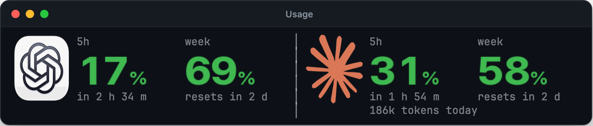

<p align="center"></p>

<h1 align="center">milo</h1>

<p align="center">milo puts your files, commits, and coding tool limits in terminal panes beside your work.</p>

<p align="center">
  
  <br><sub>A Rex layout with sample usage figures.</sub>
</p>

## Install

You need Git and Rust 1.91 or later. The repository is private, so you need access to clone it.

```sh
git clone https://github.com/mcc0x/milo.git
cd milo
sh install.sh
```

In [Rex](https://www.superlogical.com/rex), run `milo setup` to choose your panes, then press `s` to save. Setup installs Rex actions and can arrange new shell tabs for you. You can also run each pane on its own.

## Outline

<p align="center">
  
</p>

See changed files in the project tree as you work. Bold colours mark changes to commit; regular colours mark changes to push. Press `Enter` on a file to read it.

## History

<p align="center">
  
</p>

See recent commits and which still need to be pushed. Press `Enter` on a commit to see the files it touched, then on a file to read that version.

## Usage

<p align="center">
  
</p>

See how much of your Codex and Claude Code limits you have used. milo reads reports saved by oh-my-pi, Codex and Claude Code. In Rex, the strip can show the Codex and Claude logos and large numbers.

## Reader

<p align="center">
  
</p>

Read a whole file with added and removed lines marked, or open it as it was at a commit. Press `n` or `N` to jump between changes.

## Commands

| Command | Opens |
| --- | --- |
| `milo outline [PATH]` | File tree |
| `milo history [PATH]` | Recent commits |
| `milo usage` | Usage strip |
| `milo view FILE [--commit ID]` | File reader |
| `milo setup` | Setup screen |

`PATH` defaults to the current directory. Use `milo --help` for all commands or `?` for help in a pane.

## Documentation

[Setup and removal](docs/setup.md) · [Keys and marks](docs/keys.md) · [Usage limits](docs/usage.md) · [Pane behaviour](docs/panes.md) · [How it works](docs/internals.md)

[Contributing](CONTRIBUTING.md) · [MIT licence](LICENSE)
