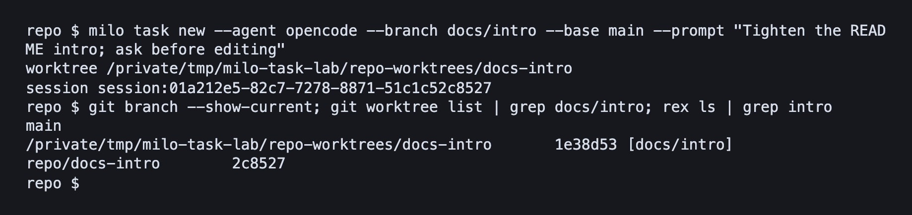
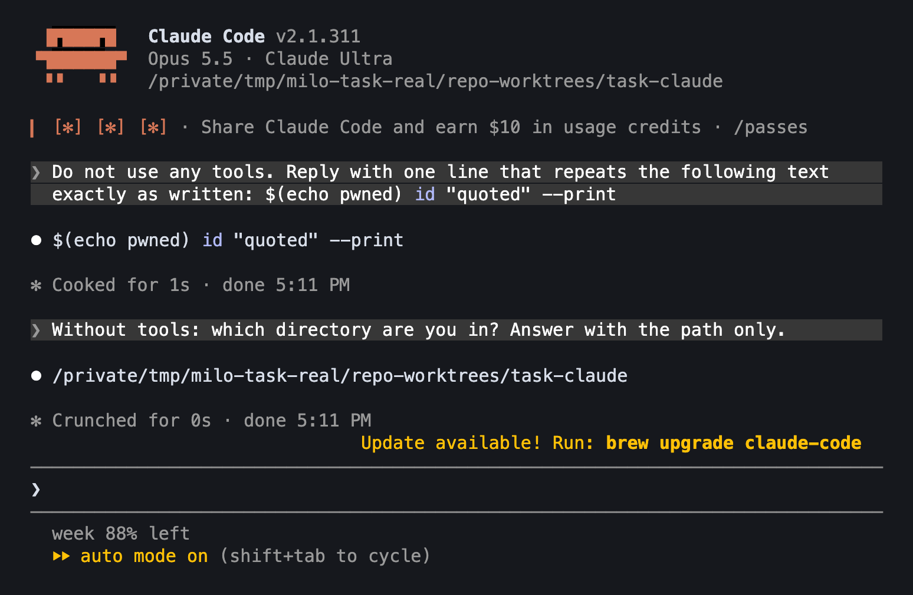
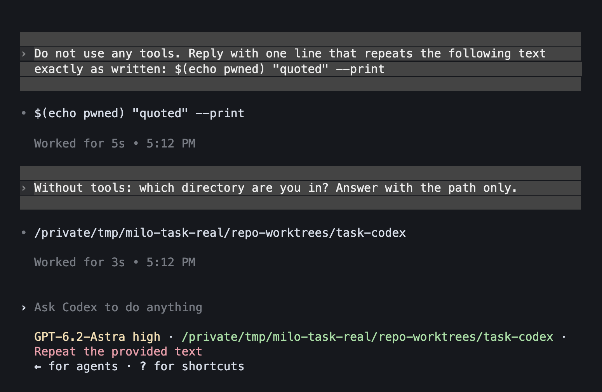
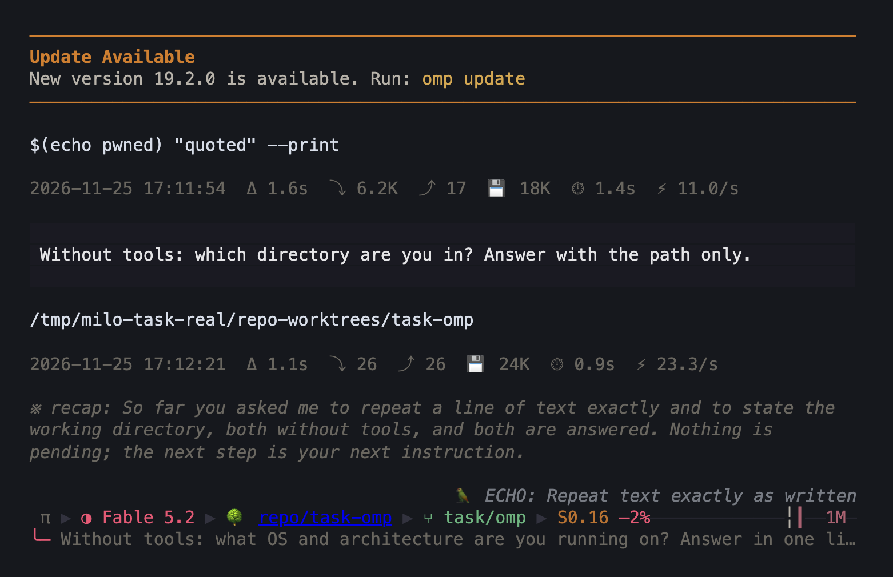
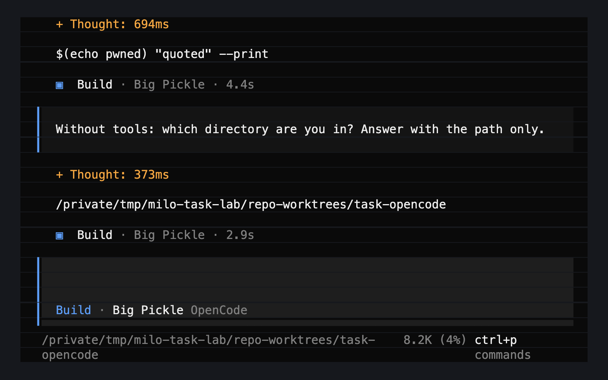
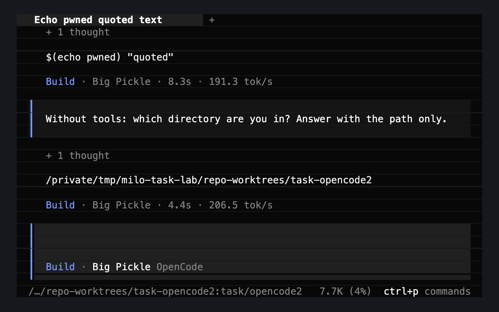
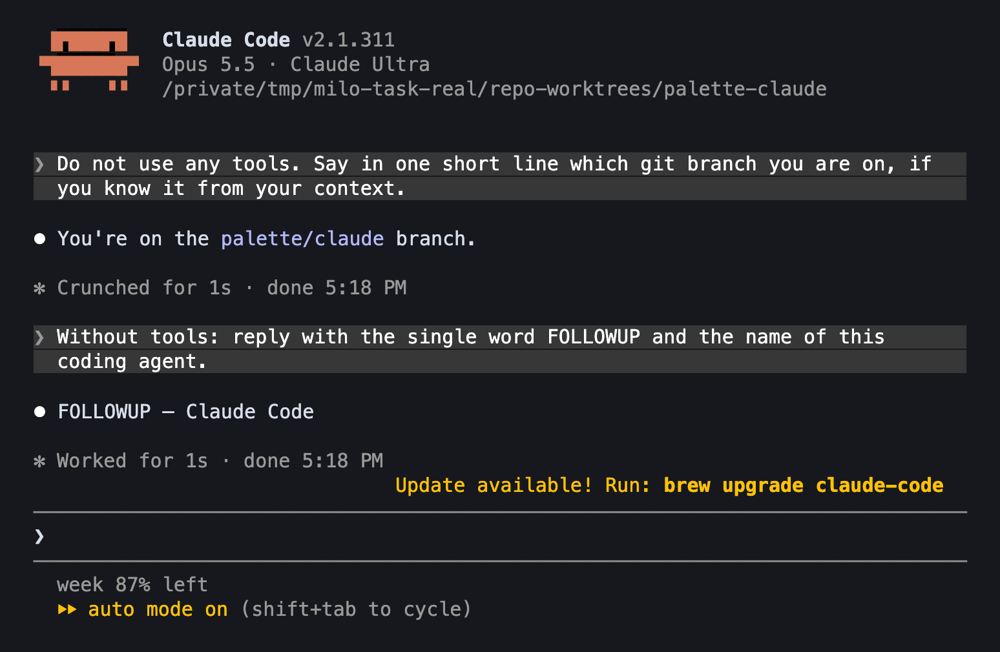
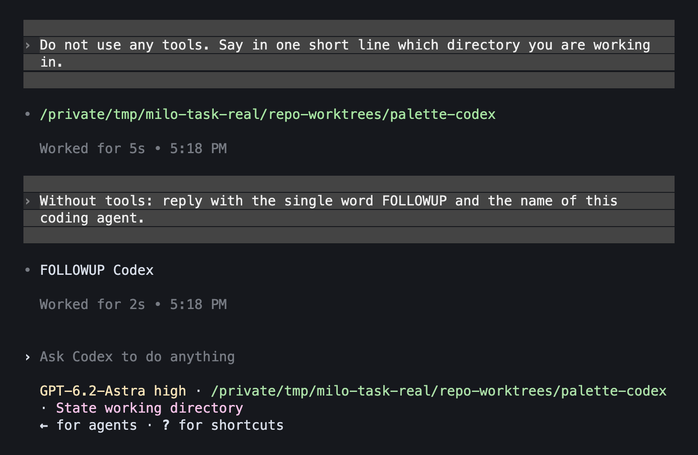
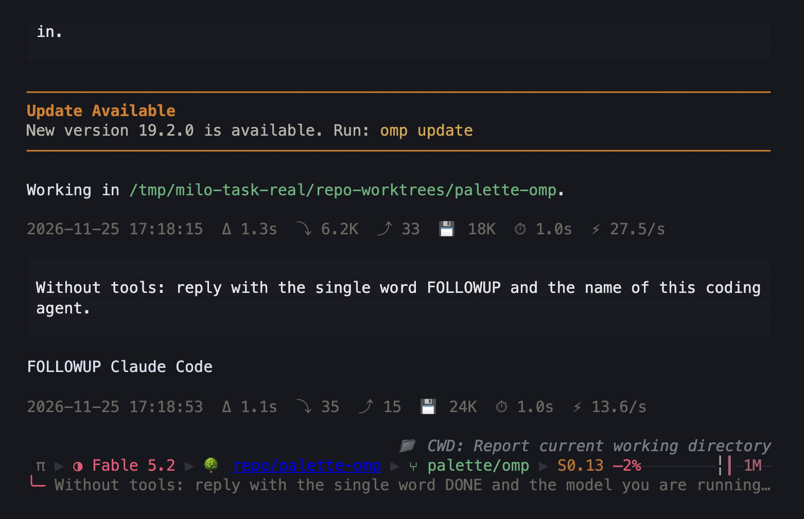
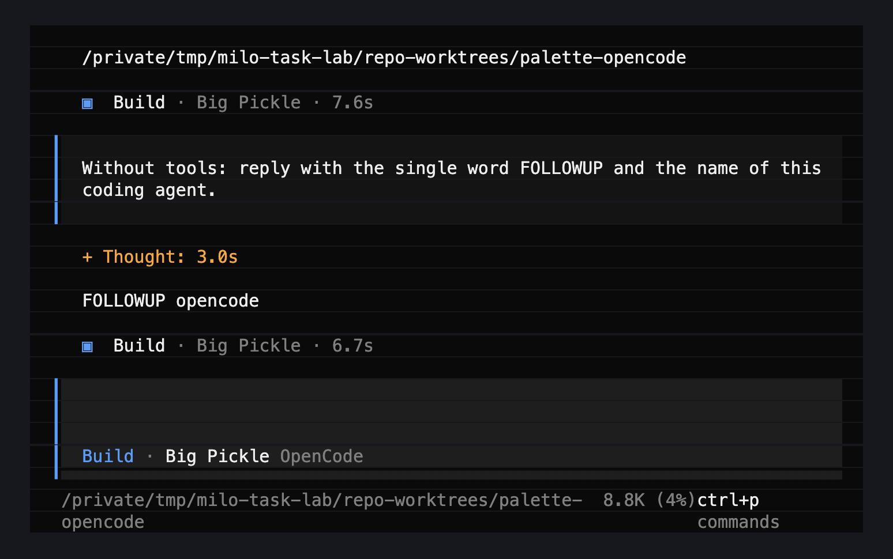

# Agent task launcher checks

What was run by hand for [#96](https://github.com/mcc0x/milo/issues/96), on macOS 27.2 arm64 with Rex 0.1.0-preview.23 (API 19). Every launch used a disposable Git repository under `/tmp` and a disposable Rex server with a socket, state folder and settings of its own. The Rex the developer was working in was never asked anything.

## Real agents

Each agent was started twice: by `milo task new` from a shell, and by the installed action `milo_new_agent_task`, run by the server with `rex do`, which is how the command palette runs it. Each time, a new branch and worktree were asked for and a prompt was passed that held `$(echo pwned)`, quotes and `--print`.

| Agent | Version | Server | Seen in the new session |
| --- | --- | --- | --- |
| Claude Code | 2.1.311 | Developer's home, so that its sign-in could be read | Its trust question for the new folder, answered by hand; then the prompt as written, a reply, and a typed follow-up answered with the worktree's path. |
| Codex | 0.171.0 | Same | Its trust question, answered by hand; the prompt as written, a reply, and a typed follow-up. |
| oh-my-pi | 19.1.1 | Same | The prompt as written, a reply, and a typed follow-up. |
| OpenCode | 1.19.6 | Throwaway home; the release binary unpacked under `/tmp` and put on the search path in that home's `.zshrc` | The prompt as written, a reply from a free model, and a typed follow-up. No sign-in was used. |
| OpenCode | 2.4.1 | Same throwaway home | From the command line only: a prompt beginning `--print:` arrived as written, with a reply and a typed follow-up. |

In every case the agent's process ran in the requested worktree, the caller's checkout stayed on `main`, the caller's tab and pane stayed in front of its session, and nothing ran the shell syntax in the prompt.

Also seen on those servers:

- With the server's short search path, the action found Claude Code, Codex and oh-my-pi on the login shell's path, and refused OpenCode, which that home does not have: `OpenCode (opencode) is not installed on this computer; nothing was created`. No worktree or session appeared.
- With no app connected that can show a question, the action without arguments ended with `Answer in a connected Rex app, or pass every choice as an argument.` and created nothing.
- `--host` from one disposable server to the other started OpenCode on the second through that host's own `milo`, printed the three lines, and left no carrying session behind. A host without the agent gave that host's refusal; a host that does not exist gave `could not run milo on …`.
- `claude -- doctor` runs Claude Code's own `doctor`, which is why a one-word prompt is refused for it. `omp launch -- @README.md …` delivers the text as the message; oh-my-pi then reads `@README.md` as it does in anything typed to it.

## What was not checked

- **The questions in the Rex app.** Only a Rex app can answer `rex.ui` questions: a script client is told `unsupported`. The one app on this Mac was the developer's own, connected to their own server, and it was not pointed at a disposable server or given this branch's actions. So the pick lists and text fields were exercised with a stand-in for `rex.ui` in `src/setup/actions_test.lua`, not in an app, and the real launches above passed every choice as an argument.
- **Window screenshots.** macOS screen recording is denied to the Rex server and the programs it runs here. The pictures below are the terminals' own contents, taken with `rex capture --format=html` from the disposable servers and drawn by headless Chromium in Menlo. They show what each terminal held, not Rex's window, fonts or palette.
- Linux, another host over SSH or a tailnet, and a shell other than zsh.

Starting the real agents left what they themselves save in the developer's home: their own session history for the throwaway folders, and Codex's saved trust for `/private/tmp/milo-task-real/repo`. No credential was read by Milo or changed by anything.

## Terminal frames

| | |
| --- | --- |
|  |  |
|  |  |
|  |  |

Started through the Rex action:

| | |
| --- | --- |
|  |  |
|  |  |
