# Agent catalog checks

What was run by hand for [#109](https://github.com/mcc0x/milo/issues/109) on 2026-11-25, on macOS 27.2 arm64 with Rex 0.1.0-preview.23 (API 19). It is the evidence behind the **Checked** column of [the agents table](../../integrations.md#agent-tasks) and behind `checked` in `src/task/harness.rs`.

Three rules held for every run:

- **Nothing was installed.** Each vendor's current macOS arm64 release was downloaded and unpacked under `/tmp`, and found by Milo through a search path that named that folder. No package manager, installer script or global folder was used.
- **Nothing was signed in to, and no paid model was asked.** The ten new agents ran under a throwaway home with no account. Where an agent accepts a model endpoint of your own, it was pointed at [`standin.py`](standin.py), a stand-in on a loopback port that answers `STANDIN heard:` and the last message it was sent, and records every request.
- **The Rex the developer works in was never asked anything.** Every session was on a disposable Rex server with a socket, state folder, settings and home of its own under `/tmp`.

## Capability matrix

*Reply* means that the agent's own screen showed the prompt as written, a reply to it, and a reply to a follow-up typed afterwards. *Sign-in* means the screen stopped at the agent's own sign-in or setup, which is as far as it goes without an account.

| Agent | Release, sha256 of the artifact | In a background Rex session (`milo task new`) | In the calling terminal (`--here`) | What limits the check |
| --- | --- | --- | --- | --- |
| Claude Code | 2.1.311, installed | Reply, the agent's own provider ([#108's notes](../agent-task-launcher/README.md)) | Opened idle at its trust question; no prompt sent | No prompt was sent with `--here`: a reply would spend the developer's paid usage |
| Codex | 0.171.0, installed | Reply, the agent's own provider (#108) | Opened idle at its update notice; no prompt sent | Same |
| oh-my-pi | 19.1.1, installed | Reply, the agent's own provider (#108) | Opened idle on its full screen; no prompt sent | Same |
| OpenCode | 1.19.6 and 2.4.1 | Reply from a free model, no sign-in (#108) | Not run | Not installed on this Mac and not downloaded again for this work |
| Pi | 1.6.1, `d8fd8e24…4d933` | Reply from the stand-in | Reply from the stand-in | No real model. `pi -- list` opened Pi and did not run `pi list` |
| GitHub Copilot CLI | 1.0.115, `f0858bbf…a12cf` | Reply from the stand-in, after its folder trust question was answered by hand | Reply from the stand-in | No GitHub sign-in: its own-provider mode was used. Copilot put a `<current_datetime>` line before each message it sent |
| Cline CLI | 3.0.75, `b70e1f0c…0bb59` | Reply from the stand-in | Reply from the stand-in | No real model. The prompt did not begin with a dash, which Milo refuses for Cline |
| Goose | 1.61.0, `d98cc4c6…f3a7a` | Reply from the stand-in | Reply from the stand-in | No real model. Goose showed the reply but not the first prompt as a line of its own |
| Qwen Code | 0.28.4, `993c1020…28f55` | Reply from the stand-in | Reply from the stand-in | No real model |
| Cursor CLI | 2026.11.22-e9042b2, `92f39e44…b75e2` | Sign-in: `Press any key to log in...` | Sign-in | No account, so the prompt was never seen on screen. `agent -- status` opened the same screen and did not run `status` |
| Antigravity CLI | 1.5.17, `94d4c475…9e764` | Sign-in: `You are currently not signed in` | Sign-in | No account. That `--prompt-interactive=TEXT` was parsed is shown only by an unknown option printing the help instead |
| Kiro CLI | 3.6.0, `6aa1f7e9…b74af` | Sign-in: `You are not logged in. Login now?` | Sign-in | No account. Without `--`, its parser refused a prompt beginning `--` |
| Factory Droid | 1.20.0, `75de88ee…986c7` | Sign-in: `Please login with your Factory account` | Sign-in | No account. Droid also opened for an option it does not have, so the screen does not show that it took the prompt |
| Amp | 0.0.1795608053-gcec25c, `b6832696…8b446` | Sign-in, started idle: `Would you like to log in to Amp?` | Sign-in | No account, and no first prompt at all: `--prompt` is refused for Amp |

The checksums in full, and where each artifact came from:

| Agent | Artifact | sha256 |
| --- | --- | --- |
| Pi | `pi-darwin-arm64.tar.gz` from the [v1.6.1 release](https://github.com/earendil-works/pi/releases/tag/v1.6.1) | `d8fd8e24c2a5054ae383d83b26f6eb6f950edf613917e434a52394f44cd4d933` |
| Amp | npm `@ampcode/cli-darwin-arm64@0.0.1795608053-gcec25c` | `b683269605fcfc79b05e520bf2981d2de09113130b5cefc298606b107c08b446` |
| GitHub Copilot CLI | `copilot-darwin-arm64.tar.gz` from the [v1.0.115 release](https://github.com/github/copilot-cli/releases/tag/v1.0.115) | `f0858bbff5e35c4fe92d97a0061cb4a2a12b06defacf5512b77ca294175a12cf` |
| Cursor CLI | `agent-cli-package.tar.gz` named by `https://cursor.com/install`, which was read and not run | `92f39e448218897538bd801cdb01d69106ab37a86aaf3dc0e6b55159c79b75e2` |
| Antigravity CLI | `agy_cli_mac_arm64.tar.gz` from the [1.5.17 release](https://github.com/google-antigravity/antigravity-cli/releases) | `94d4c4755c9edbae3feba8f7d3c7b2764e6b239326efb0477b28407635c9e764` |
| Kiro CLI | `kirocli-universal-darwin.tar.gz` from the vendor's stable manifest | `6aa1f7e98b68a16c563e649f20709cf2018e4b383b0ea58b7466061b3b7b74af` |
| Cline CLI | npm `@cline/cli-darwin-arm64@3.0.75` | `b70e1f0c013a78cce61fe311ea27c85f42cc0682a04b52a3e6e9844e7180bb59` |
| Factory Droid | `droid` 1.20.0 from `downloads.factory.ai` | `75de88eedead121c340479607a4c110887e29d03d0b286d5c242088c477986c7` |
| Goose | `goose-aarch64-apple-darwin.tar.gz` from the [v1.61.0 release](https://github.com/aaif-goose/goose/releases/tag/v1.61.0) | `d98cc4c62dada5c887830552bf39adc28d87994db1a8dd7f9ca7bd60441f3a7a` |
| Qwen Code | `qwen-code-darwin-arm64.tar.gz` from the [v0.28.4 release](https://github.com/QwenLM/qwen-code/releases/tag/v0.28.4) | `993c10208cca5f3018f14b19d6791b88fa4f5f3f401388217a1cbf517d028f55` |

## What each run was

**Background session.** From a shell in a throwaway repository, `milo task new --agent AGENT --branch task/AGENT --base main --prompt PROMPT` against the disposable server. The prompt was `--print $(echo pwned) say "hi" 'there'`, one argument; for Cline, which is refused a leading dash, `say $(echo pwned) "hi" 'there' --print`. Milo printed the worktree and the session ID. The screen was then read with `rex capture`, a follow-up was typed with `rex send` and `rex send-key enter`, and the screen was read again. For the five stand-in agents, the stand-in's record showed the first message arriving character for character, shell syntax and leading `--print` included, and then `second question from the keyboard`. Nothing named `pwned` was created. In every case the agent's process ran in the requested worktree and the caller's checkout stayed on `main`.

**Calling terminal.** The same command with `--here`, run by [`probe.py`](probe.py) in a terminal of its own, 100 by 30, with no `rex` on the search path and no `REX_SERVER`. Milo printed `worktree DIR` and the agent drew its screen in that terminal. The follow-up was written to the terminal as keys.

**Refusals, by the real binary.** `--agent amp --prompt "fix it"` gave `Amp takes no first prompt when it starts; leave out --prompt and type the task once Amp is open` and created nothing.

**How the argument forms were chosen.** Each entry is the vendor's documented interactive form. Before it went in the catalog, the release was started in the same kind of terminal with these, to see what it would misread:

| Run | Seen |
| --- | --- |
| `pi -- list` | Pi's screen, with `list` sent as a message. Not `pi list` |
| `droid -- doctor` | Droid's `doctor` ran. A one-word prompt is refused for Droid |
| `cline -i -- doctor` | Cline's `doctor` ran. A one-word prompt is refused for Cline |
| `cline -i -- "--thinking about it"` | Arrived as written at the stand-in. Milo refuses a leading dash for Cline all the same, because its source looks for some options in every argument, and a text that is exactly one of them was not tried |
| `cursor-agent agent -- status` | The sign-in screen. Not Cursor's `status` |
| `kiro-cli chat "--no-interactive say hi"` | `error: unexpected argument`. With `--` before it, the sign-in question |
| `copilot --bogus=1` | `error: unexpected argument '--bogus'`, so `--interactive=TEXT` opening the screen means the option was read |
| `agy --bogus=TEXT` | The help. `--prompt-interactive=TEXT` opened the sign-in screen |
| `goose run --interactive --text=TEXT`, `goose session` | Goose's first-run question on an empty home; its session once a provider was set |
| `qwen --prompt-interactive=TEXT`, `qwen` | `Connect a Provider` on an empty home; its session once a provider was set |
| `amp` | `No API key found. Starting login flow...` |

## How the stand-in agents were set up

Each agent was a two-line script on the search path that set that agent's own documented environment and ran the unpacked release. None of this is anything Milo does or reads: it is what a person does to choose a provider.

| Agent | Set in the throwaway home or the agent's environment |
| --- | --- |
| Pi | `~/.pi/agent/models.json` with one `openai-completions` provider at the stand-in and a placeholder key; `PI_OFFLINE=1`, `PI_TELEMETRY=0` |
| GitHub Copilot CLI | `COPILOT_PROVIDER_BASE_URL` at the stand-in, `COPILOT_MODEL=stand-in`, `COPILOT_OFFLINE=true`. No file |
| Cline CLI | `cline auth -p openai-compatible -k placeholder -m stand-in -b URL`, run once in the throwaway home; `telemetryOptOut` in its settings; `CLINE_NO_AUTO_UPDATE=1` |
| Goose | `GOOSE_PROVIDER=openai`, `GOOSE_MODEL=stand-in`, `OPENAI_HOST` at the stand-in, `GOOSE_TELEMETRY_ENABLED=false`, `GOOSE_DISABLE_KEYRING=1`, `GOOSE_CONTEXT_LIMIT=16000`, `GOOSE_DISABLE_SESSION_NAMING=true`, and a proxy setting that blocks everything but loopback. No file |
| Qwen Code | `OPENAI_API_KEY` as a placeholder, `OPENAI_BASE_URL` at the stand-in, `OPENAI_MODEL=stand-in`; updates, statistics, telemetry, memory and follow-up suggestions turned off in `~/.qwen/settings.json` |

Seen along the way, and the agents' own business: Cline 3.0.75 opened with `Auto-approve all enabled` and Qwen Code 0.28.4 with `Auto mode enabled`. Milo passes neither a flag for that. Cline showed a promotion over its first screen, closed with Escape. Copilot asked whether to trust the folder before it read the prompt.

## What was not checked

- **A reply from a real model, for any of the ten new agents.** Five replied to a stand-in. The other five were seen only as far as their sign-in, so for Cursor CLI, Antigravity CLI, Kiro CLI and Factory Droid nothing shows the prompt on the agent's screen: the entries rest on the vendor's documentation and on the release accepting the arguments. An account for each would settle it.
- **A prompt with `--here` for Claude Code, Codex and oh-my-pi.** They were opened idle in the developer's own home, which asks no model. The same arguments reach them either way, and `tests/task.rs` checks the words a program is handed in a terminal of the test's own.
- **The questions in a Rex app.** The action's list of agents and its skipping the task question for Amp are covered by the Lua fixtures with a stand-in for `rex.ui`, not in an app.
- **Any system but macOS on Apple Silicon.** Every release run here was the vendor's `darwin-arm64` artifact on one Mac. The vendors publish Linux builds, and some publish Windows builds; none was run, so none is evidence for Milo. The launcher's tests run on Linux in CI with stand-ins for the agents, which shows the words a program is handed and nothing about a vendor's Linux release. WSL2 would be the Linux side only and was not run. Milo does not build for Windows.
- Another Rex host with `--host`, and a shell other than zsh.
- **Window screenshots.** The pictures below are the terminals' contents, taken with `rex capture --format=html` from the disposable server and drawn by headless Chromium in Menlo, or the text `probe.py` printed for a `--here` run. They are not Rex's window.

The idle `--here` runs of Claude Code, Codex and oh-my-pi left what those agents themselves save about a new folder in the developer's home. Milo read and changed no credential.

## Terminal frames

`milo task agents`, with the unpacked releases on the search path:

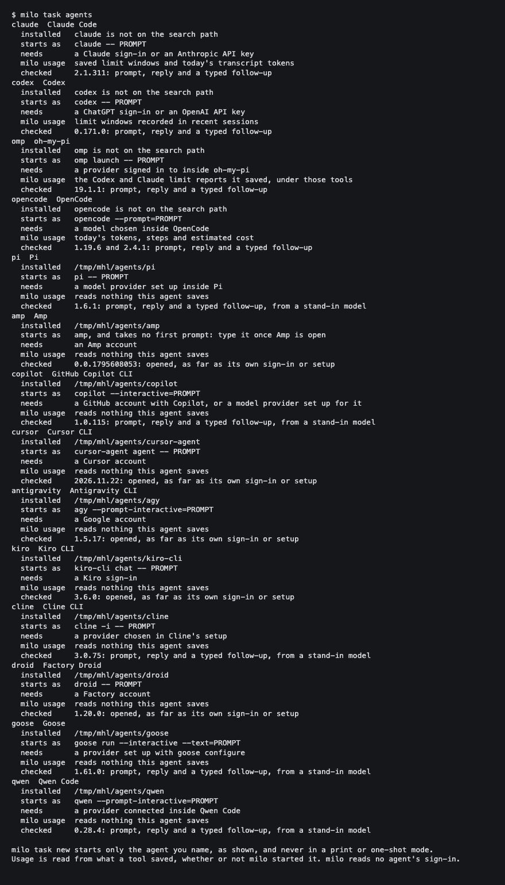

Replies from the stand-in, in background sessions:

| | |
| --- | --- |
| 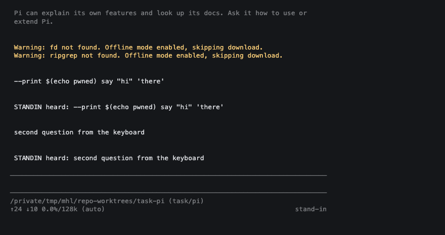 | 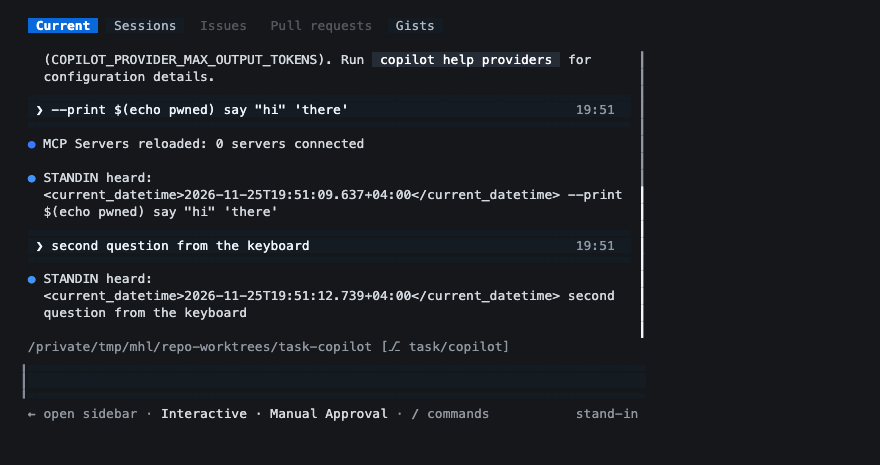 |
| 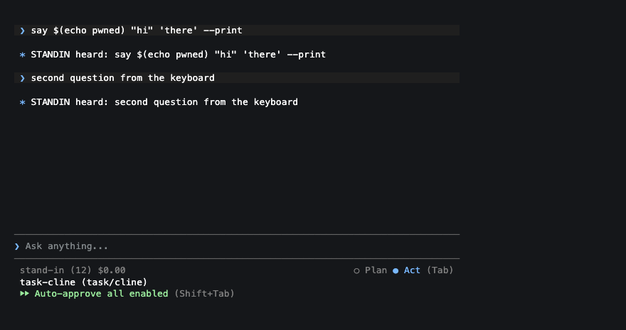 | 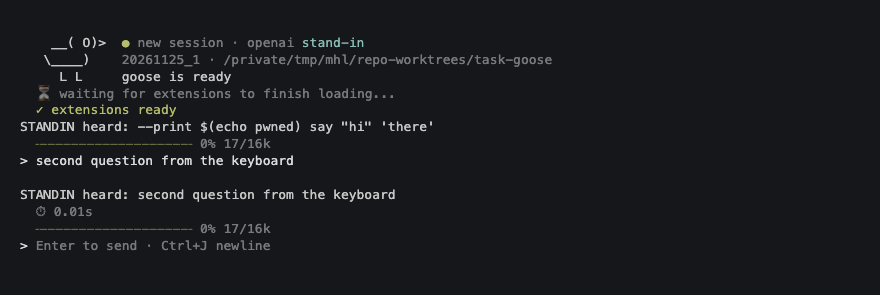 |
| 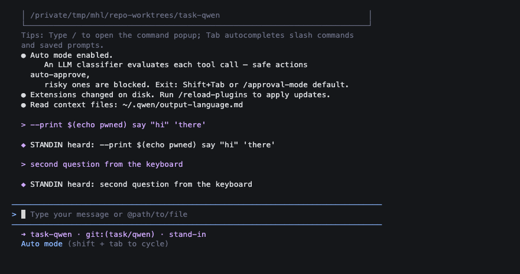 | |

As far as the agent's own sign-in, in background sessions:

| | |
| --- | --- |
| 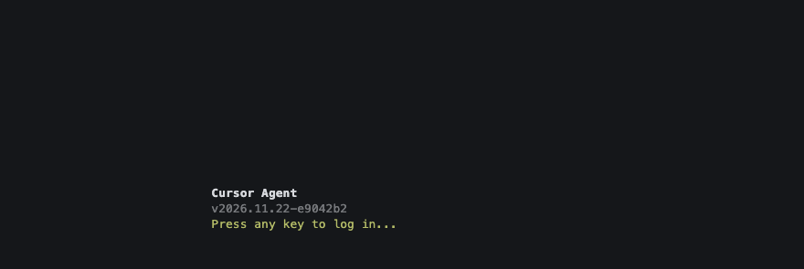 | 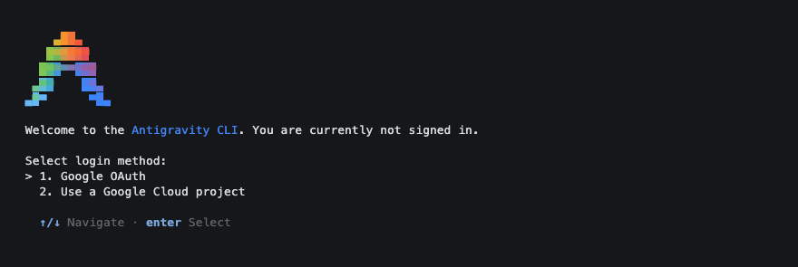 |
| 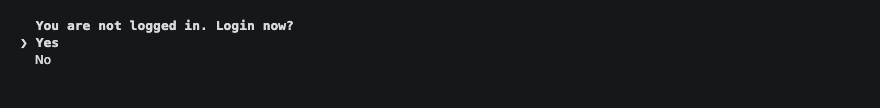 | 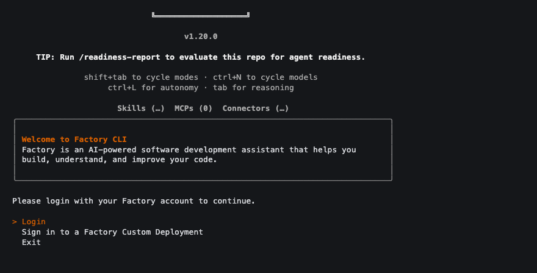 |
| 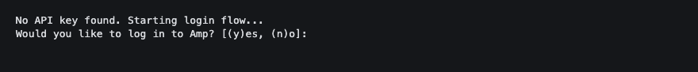 | |

With `--here`, in the calling terminal:

| | |
| --- | --- |
| 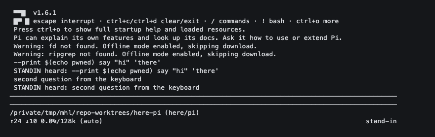 | 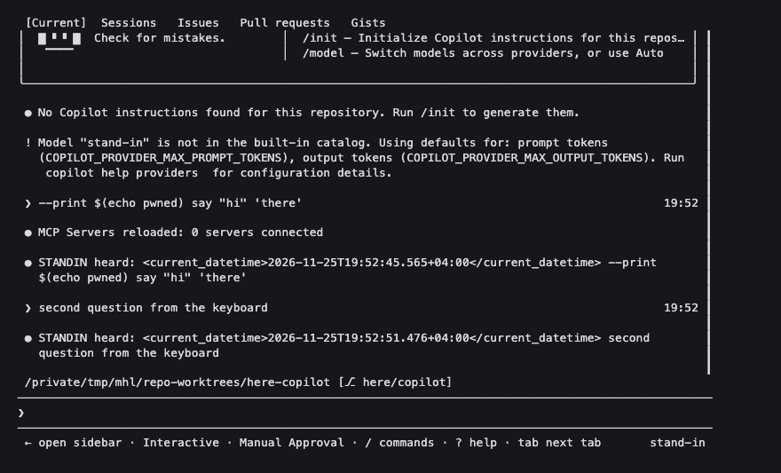 |
