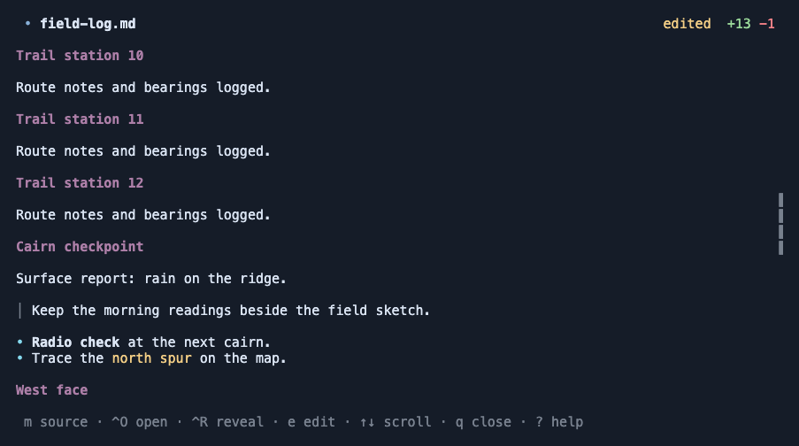
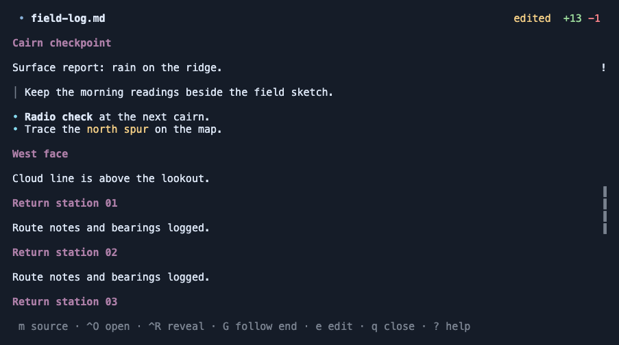
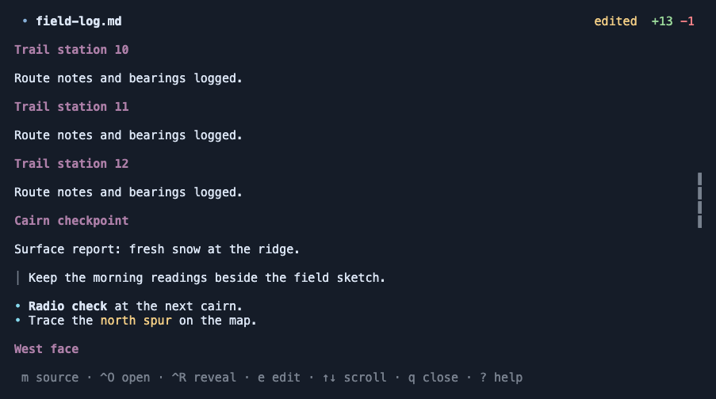
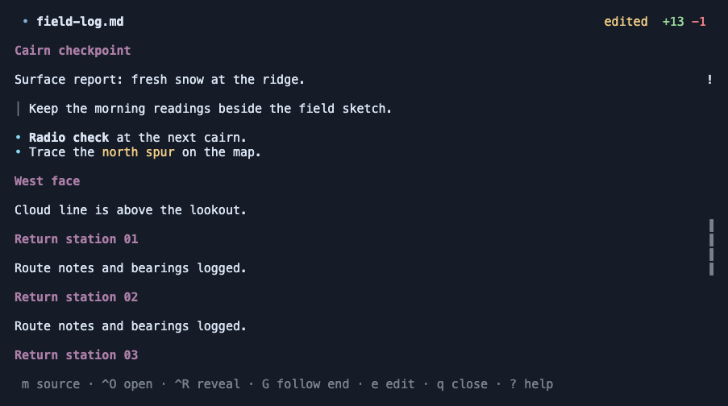

# Standalone live Markdown Reader (#89)

The fixture opens a committed `field-log.md` with `milo view field-log.md` and reads it in the built-in Markdown preview. The driver sends keys through a real PTY and saves the file from outside the running Milo process. There is no Rex, user terminal, external Markdown previewer, or installed Milo state. Each run creates a disposable Git repository and home, and Milo runs with a `PATH` containing only `/usr/bin:/bin`.

Baseline: `716a4a9`, built from `git archive` with `cargo build --release --locked` and a separate target directory. The candidate is the worktree’s release build for #89. Both captures use macOS 27.2.1 arm64, Chrome 157.0.8103.79 in headless mode, and xterm.js 6.0.0 rendering the bytes Milo actually wrote. Screenshots show the emulator, not Terminal.app or Rex.

## Reproduce

```sh
base=$(mktemp -d)
mkdir "$base/source"
git archive 716a4a9 | tar -xf - -C "$base/source"
cargo build --release --locked --manifest-path "$base/source/Cargo.toml" --target-dir "$base/target"
cargo build --release --locked

tools=$(mktemp -d)
npm install --prefix "$tools" --ignore-scripts --no-audit --no-fund --save-exact \
  @xterm/xterm@6.0.0 playwright-core@1.61.1
chrome='/Applications/Google Chrome.app/Contents/MacOS/Google Chrome'
evidence=docs/evidence/live-markdown-reader
python3 "$evidence/walkthrough.py" before "$base/target/release/milo" \
  --tools "$tools" --chrome "$chrome" --output "$tools/captures"
python3 "$evidence/walkthrough.py" after target/release/milo \
  --tools "$tools" --chrome "$chrome" --output "$tools/captures"
```

Node and the npm packages run the evidence renderer only. They are not Milo dependencies. The script checks text in xterm’s rendered cells and screenshots the same emulator. Resizes change both the PTY window size and the emulator dimensions.

## Walkthrough

1. At **96×26**, use `j` until **Cairn checkpoint** is on row 3. Save a new paragraph and insert three stations above the viewport by rewriting the same inode. Then write a second change to a sibling file and atomically rename it over the original. The baseline updates the text in both cases, but the checkpoint falls to row 15 and the changed paragraph has no gutter mark. In the candidate the heading stays on row 3 and `!` marks the changed paragraph after both saves.
2. Without input, wait for `!` to disappear while the new text and reading position stay put. The one-second quiet window after that redraw produced no additional synchronized PTY frames. This measures terminal output, not CPU use or watcher wakeups.
3. Press `G`, then append an evening entry. The Reader follows it and shows **Following end**. Resize to **48×16**, then append another entry via atomic replacement. Press `b` to page up; save again with a changed heading in the viewport and more text at the end. The changed heading is marked in place instead of jumping to the new end. Press `G` to reach it, then widen back to **96×26**.
4. Press `g` and `e`, type `Draft-only note`, then atomically save an external version containing `Disk-only note`. The draft stays visible. `Ctrl-S` asks about the conflict without writing. `c` compares the two versions; two `Esc` presses return to the intact draft. `Esc`, then `d`, discards it and returns to the external version. The driver checks the file bytes before and after the compare/discard flow.

| State | Before | After |
| --- | --- | --- |
| In-place save, 96×26 |  |  |
| Atomic replacement, 96×26 |  |  |

- [Mark expired, 96×26](after-mark-expiry-96x26.png): the gutter clears without moving the checkpoint or changing the latest text.
- [Following the end, 96×26](after-follow-96x26.png): evening entry appears at the bottom under **Following end**.
- [Following the end after resize, 48×16](after-follow-48x16.png): the night-watch entry is visible at the bottom of the narrower Reader.
- [After manual page-up, 48×16](after-manual-scroll-48x16.png): a return-station heading changes in place and the pane does not jump to the appended end.
- [Dirty draft conflict, 96×26](after-draft-conflict-96x26.png): the draft stays on screen with **Changed on disk** and the prompt to compare or go back.

This is a local keyboard and PTY resize walkthrough of one working Markdown file. It does not exercise native terminal emulators, manual mouse input, other OSes, historical or patch review, provider integration, or exact refresh latency.
