# Menu “Needs you” section (#101)

`python3 docs/evidence/menu-attention/walkthrough.py` drives the menu app against a disposable Rex server and saves these pictures and [`walkthrough.log`](walkthrough.log). Run `sh macos/build-menu.sh` first, on a Mac with a menu bar and Rex installed. It takes about two minutes and shows a second Milo in the menu bar with its popover and menus open. Leave the Mac alone while it runs: a menu will not open or stay open while you type or click in another app, and the walkthrough then stops with `the menu did not open`.

It builds a separate copy of the menu app under `target/menu-attention/`, with its own bundle identifier, from the app’s own sources and [`shots.swift`](shots.swift), and puts the Milo that `build-menu.sh` built inside it. That copy runs with a home of its own under `/tmp`. The only `rex` it can find there is a wrapper pinned to a Rex server the walkthrough starts on a socket in the same folder, so the installed Milo, your settings and the Rex you work in are not read, stopped or changed. No Rex app is connected to that server and Remote Control is never touched. Usage in the pictures is made up; the CPU and memory figures are the Mac’s own.

On arm64 macOS 27.2.1 with Rex 0.1.0-preview.23:

- **Off, as installed.** The menu was as before, the quota badge showed, and no client was connected to Rex. After **Off** was chosen again at the end, the watch and its Rex script were gone.
- **Choices.** Each choice was made in the real **More options → Needs you** menu: opened as a click opens it, moved through with arrow keys and chosen with Return, the keys put in the app’s own event queue. **In this menu** listed panes with no dot; **In this menu, with a menu bar dot** added the dot. **Finished work** and **Waiting for input** were switched on and off on their own, and the rows followed.
- **Panes.** Three terminals on the lab server reported `blocked`, `error` and `done` through Rex’s program status. A report’s message (`secret prompt`) reached neither the frames nor the menu. When the waiting program reported `working`, its row left; when it asked again, the row came back.
- **Jump.** The row of `api-refactor` was jumped to while another tab of its session was active. Rex made the pane’s tab active and the pane its focused block. With no Rex app connected to the lab server, the menu said so and left the other rows alone. This is the supported fallback; see below for what was not tried.
- **Seen.** Marking `release-notes` seen removed that row only.
- **Other indicators.** With **CPU** chosen, the bar showed the CPU reading with the dot, and **This Mac** appeared under the section.
- **Rex stopped and came back.** With the server stopped, the section said Rex wasn’t running, listed nothing, and the dot went out. With a new server started, nothing was listed until a pane on it reported.

| | |
| --- | --- |
| 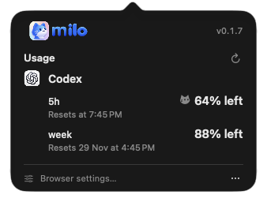 | 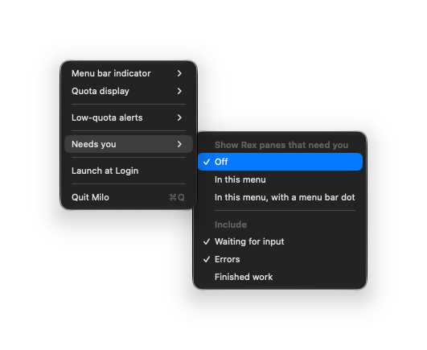 |
| 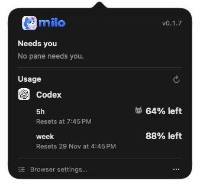 | 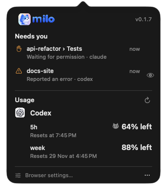 |
| 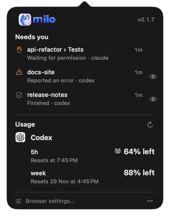 | 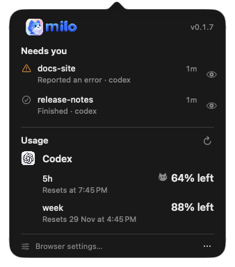 |
| 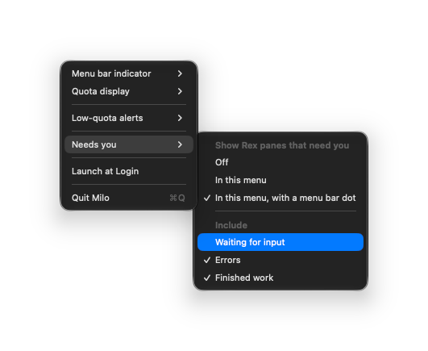 |  |
| 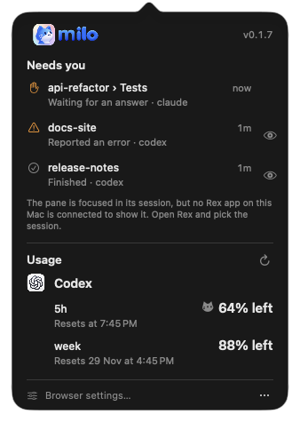 | 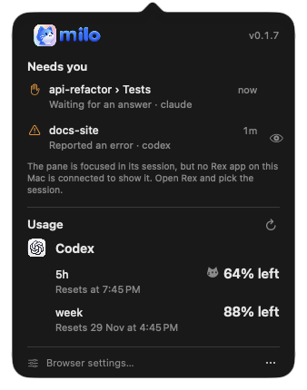 |
| 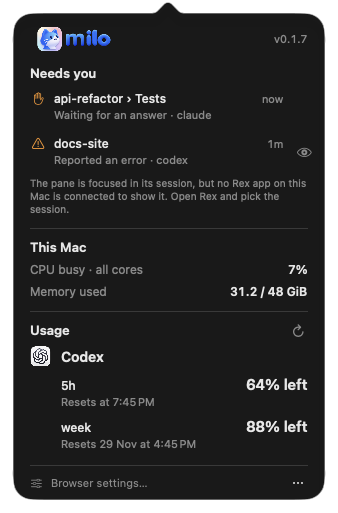 | 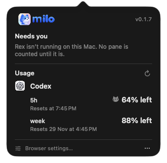 |
| 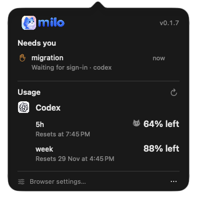 |  |

The menu bar item, drawn at twice its size:

| Section off | Menu only | With the dot | CPU indicator with the dot | Rex stopped |
| --- | --- | --- | --- | --- |
|  |  |  |  |  |

## What these pictures are, and what was not checked

- **The popover and the menus** are the app’s own windows as the system composed them, taken by the app itself. That needs no Screen Recording permission, which this session did not have: `screencapture` could not take a picture of the screen.
- **The menu bar item is not a picture of the menu bar.** macOS draws a status item in a process of its own, so the app has no window of it to take a picture of. Those five images are the image and title the app gave the item, drawn on a flat strip of the bar’s appearance. The dot’s place among other menu bar items was not looked at.
- **A row was not clicked with the pointer.** The walkthrough called the action the row’s button and its **Mark seen** button are wired to. Keys, not the pointer, worked the options menu.
- **No Rex app was switched.** Showing the pane’s session in Rex for Mac needs an app connected to the same server with Remote Control on. The lab server has no app, and Remote Control was left as it is on this Mac, so the path that ends with Rex in front was not run against a real Rex app. `tests/menu_attention.rs` runs it against a stand-in for `rex`, including Rex refusing the request, and `tests/menu-attention.swift` checks that only a pane Rex showed is marked seen and that the app Rex names is the one brought forward.
- **VoiceOver was not run.** The rows and buttons carry labels; they were not listened to.
