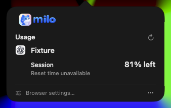
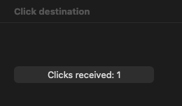

# Menu popover dismissal (#74)

On an unlocked Mac, run `sh tests/menu-bench.sh --check-popover`. This briefly brings two test apps to the foreground. They have disposable bundle identifiers and a private home; neither contains a usage reader. It does not install or replace Milo or ask for Accessibility, Input Monitoring or Screen Recording.

On arm64 macOS 27.2.1, with the production change at `a9b6ec32`:

- Posted mouse-down/up pairs into the fixture's AppKit event queue. Across 20 opens, clicking a button in a different window closed the popover and incremented the receiver exactly once per click. Another 20 opens followed immediately by clicks on the status item each left the panel closed.
- Made an attached child window key: the panel stayed open. A status click closed the panel; after reopening with a child, switching to the separate test app dismissed the panel. The second process tests real application resignation, **not** cross-process mouse injection.
- In an additional disposable GUI probe, clicked Refresh, invoked ⌘R and closed the panel with Escape. Clicked More options and observed native menu tracking; invoked **Quota display → Icon only** through the submenu's AppKit action and verified the panel stayed open. This did not physically point through the submenu. The images show only the fixture's own rendered windows, with made-up usage.
- `sh tests/menu-bench.sh --check` still passed the open/closed reset-redraw checks.

The automated clicks exercise native hit testing and control actions, not hardware input. To check the remaining WindowServer path: open Milo from another app, click a control that normally accepts that click, and check that it acts once and Milo closes. Repeat with a context click and an immediate reopen. No automation permission is necessary for the manual check.
