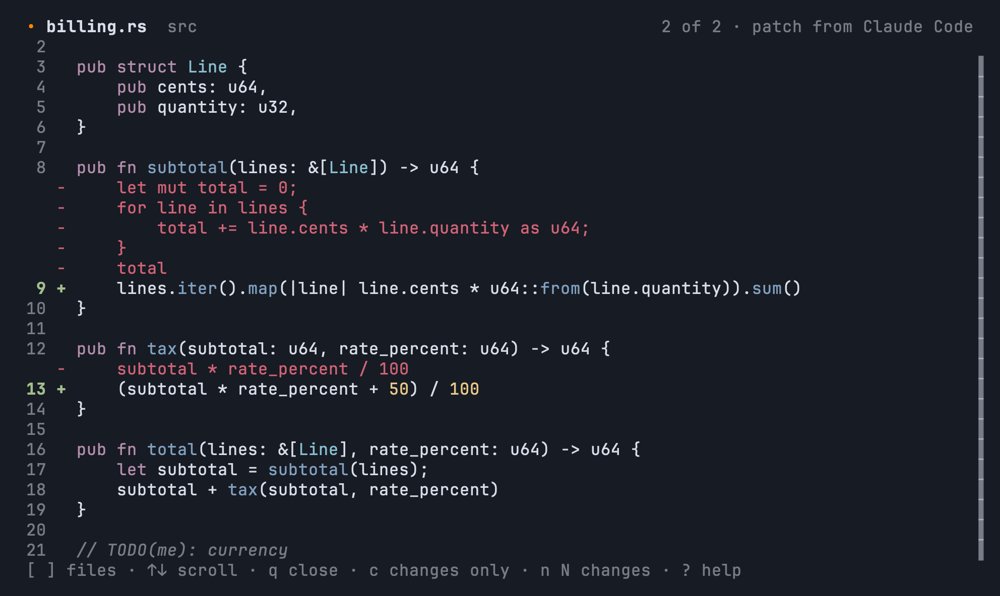
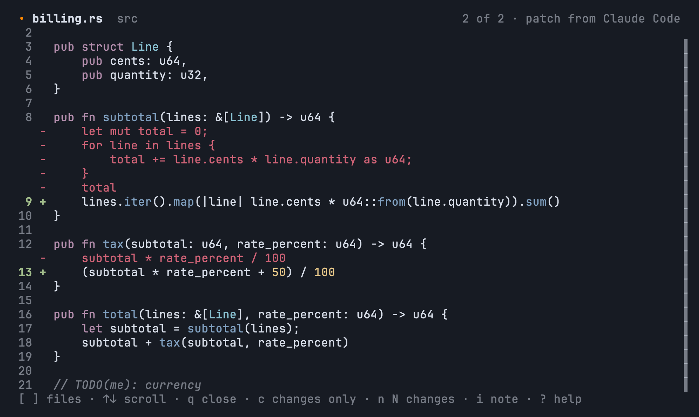
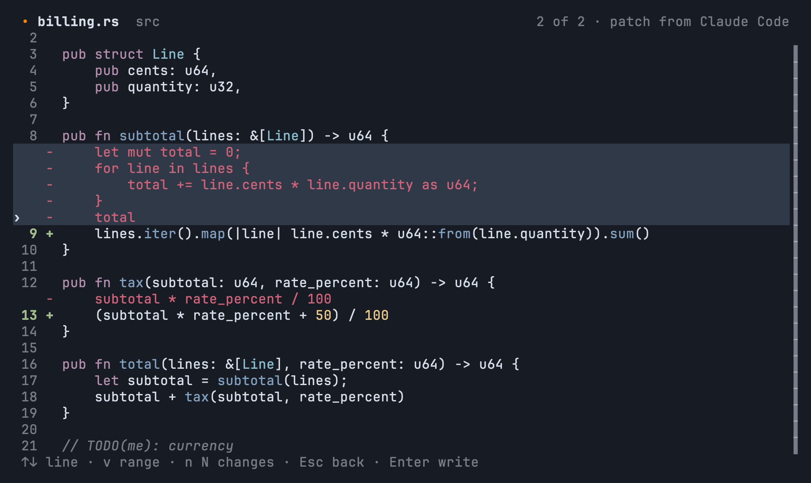
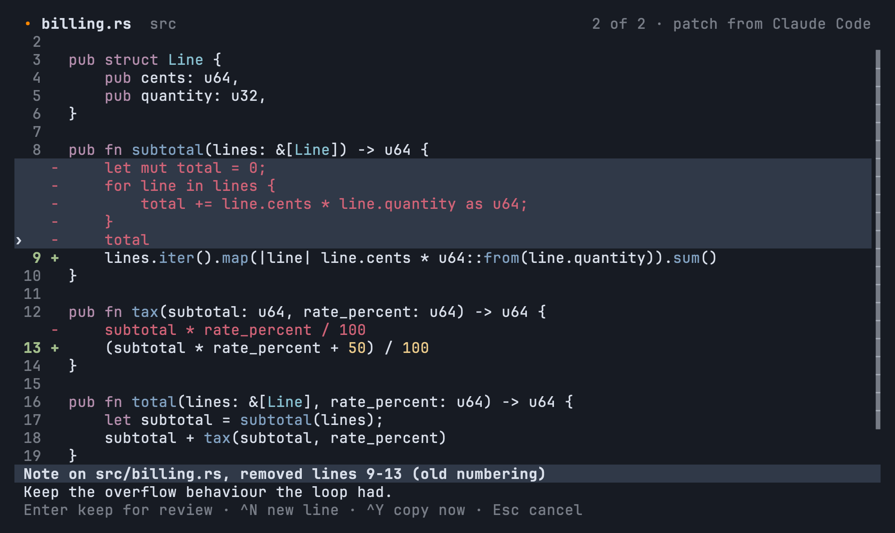
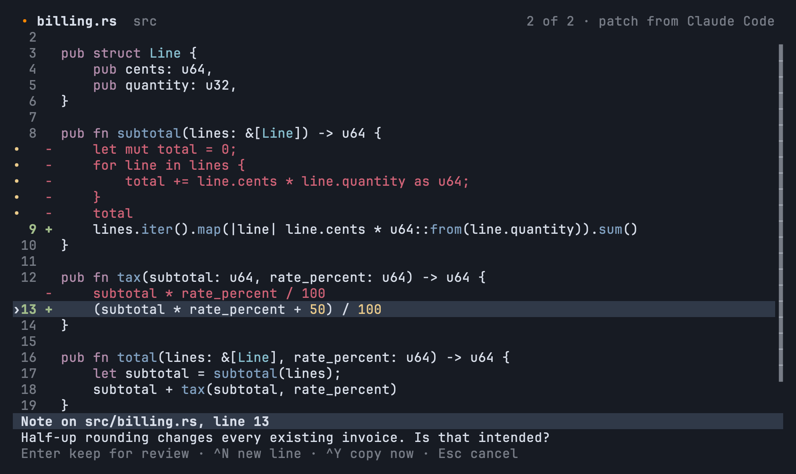
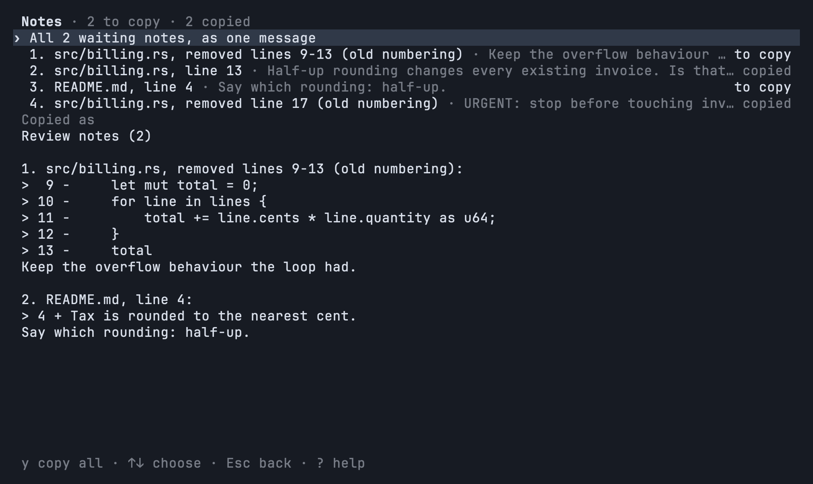
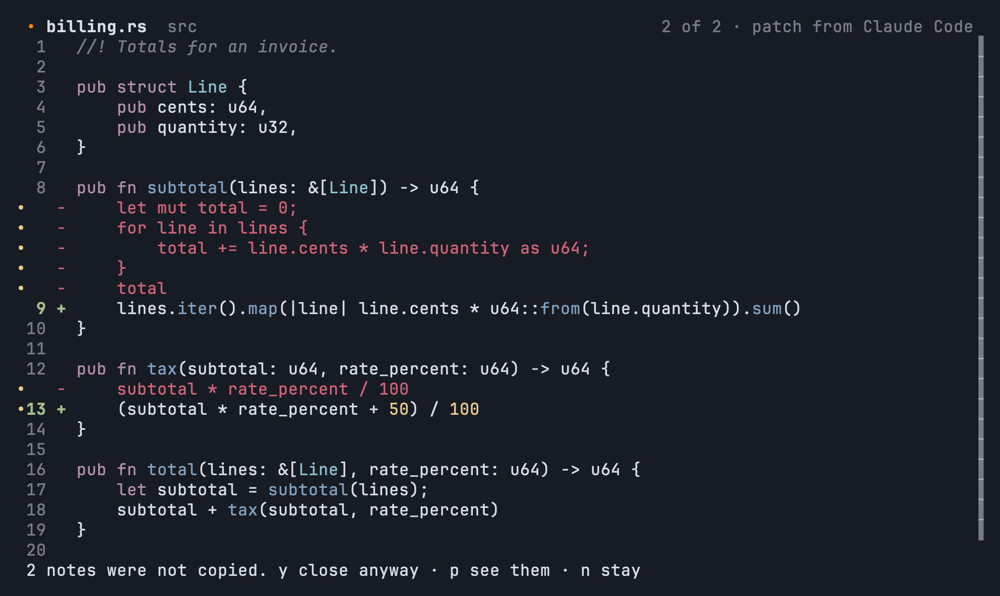
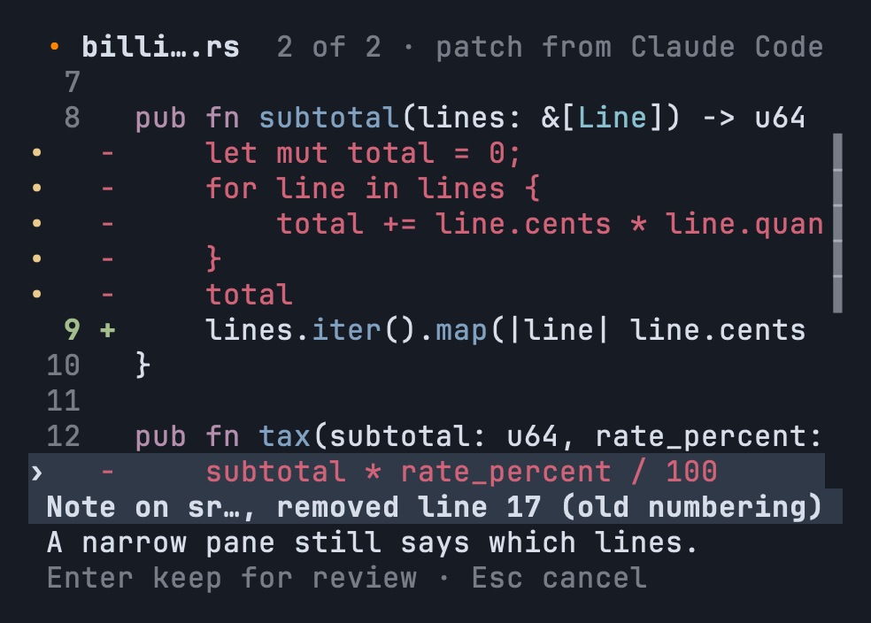
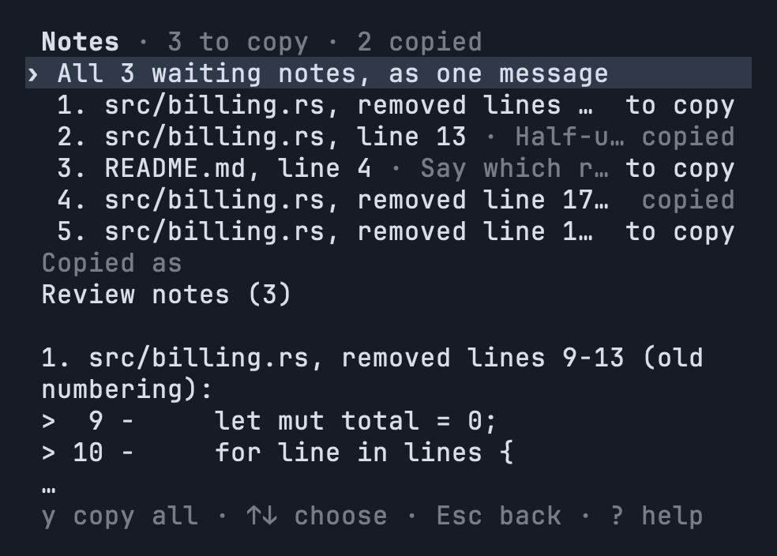

# Review notes: why they are copied and not sent

Checked on 25 November 2026 for [notes on a handed-over patch](../../panes.md#notes-on-the-patchs-lines), on macOS arm64 with Rex 0.1.0-preview.23 (server API 19), OMP 19.1.1, Claude Code 2.1.311 and Codex CLI 0.171.0 (its app-server daemon was 0.172.0).

A note could be sent straight to the agent that wrote the patch only if two things hold:

1. **The harness says who handed the patch over.** The patch, `--from`, the focused pane and a session's name are claims or guesses. The identity has to come from the harness and name an agent that is running now.
2. **The delivery cannot touch a draft.** It must not join, submit or replace words already typed at the agent's prompt, and it must not act on an agent whose pane was closed or replaced.

No route passed both, so Milo offers a copy to the clipboard and nothing else.

## What each route gave

| Route | Says who handed the patch over | Delivery that leaves a draft alone | Outcome |
| --- | --- | --- | --- |
| Rex terminal input | No. A pane's ID reached a Codex tool shell from another server altogether; a program status names whatever a program wrote. | No. Text is typed at whatever is at the prompt. | Not used |
| Codex CLI 0.171.0 | A thread ID, in the tool shell's environment. Not whether anyone has that thread open. | Yes while the TUI was open. With the TUI closed the same command ran an unattended turn. | Not used |
| Claude Code 2.1.311 | Yes: a session ID, a process ID and an inbox socket that exists while the session runs. | Not established. The documentation gives no format for a message a program other than Claude Code may post. | Not used |
| OMP 19.1.1 | Yes: a session ID, and a command that says whether a running OMP holds it. | None found for a session that is running in a terminal. | Not used |

## What was observed

Everything below ran in throwaway folders, and the Rex parts on a disposable server with its own socket, home and settings.

**Rex.** `com.superlogical.terminal.write` is described by the server as typing "as if the user had typed it", and a `paste` event does the same. A shell prompt held `words the person typed`; one `write` of ` AND A NOTE` left the prompt reading `words the person typed AND A NOTE`. No method reports what is typed at a prompt, so an empty one cannot be told from an occupied one, and Return would submit both. A program status (`OSC 7501`) carries an `app=` name that any program in the terminal can write.

**Codex CLI.** A command run by Codex saw `CODEX_THREAD_ID`. It also saw `REX_BLOCK` and `REX_SERVER` naming a pane on a different Rex server from the one its TUI was open in: the values its long-lived app-server daemon had started with. So the pane a Codex tool reports is not where the agent is shown. `codex queue --thread ID --message TEXT`, with words typed and not sent in the TUI's composer, ran the message as a turn of its own and left the composer as it was. After the TUI was quit, the same command answered `Queued message …` and one second later the daemon ran the turn with no terminal attached. Nothing in `codex --help` asks whether a thread is open in front of anyone. A note sent this way could start an agent working where its pane had been closed. The test thread was deleted afterwards.

**Claude Code.** A Bash command run by `claude -p` saw `CLAUDE_CODE_SESSION_ID`, `CLAUDE_PID`, `CLAUDE_CODE_MESSAGING_SOCKET` (`/tmp/cc-socks/PID.sock`) and `CLAUDE_CODE_MESSAGING_TOKEN`. The [documentation](https://code.claude.com/docs/en/cross-session-messaging#the-sessions-inbox-socket) says other sessions deliver to that socket and that a script may post into its own session, and gives the first line such a script may send, `{"type":"auth","token":"…"}`. It does not give the format of the message that follows; the sender it documents is Claude's own `SendMessage` tool. Milo would have to write a format taken from the program's internals, which the next release may change, so nothing was posted to the socket. This is the nearest route: it names a running session, ends when the session does, and does not go through the terminal. A message posted there arrives as one from another session, not from the person, and a session can hold or refuse it.

**OMP.** A command run by OMP saw `PI_SESSION_ID` and `PI_SESSION_FILE`. `omp session lease --json -- ID` listed that ID under `held` while the session ran, and a made-up ID under neither `held` nor `unknown`. `omp --help` lists no command that posts a prompt to a running session; `--mode rpc` is a mode a new process is started in, and `omp collab list --json` reported no hosts. A Collab link is retrieved by the person and gives control of the session, so it is not something for Milo to fetch.

## What the review does instead

A copy is a clipboard request (`OSC 52`) written to the review's own terminal. On the disposable Rex server the copy arrived as a `clipboard_written` event of the review's block with the note's exact text, and `clipboard_read` returned it. `cargo test --test rex_lab -- --ignored review_notes` repeats that, with one pane holding an unsent draft and then a pane that took a closed one's place and holds the focus: both screens were the same before and after one note was copied alone and two more as one message. The review calls Rex for nothing while it is open.

Not checked: what a Rex app, or any other terminal app, does with the request once it has it; a terminal that ignores `OSC 52`; a copy made over SSH.

## Screens

A 96 × 28 pane of a disposable Rex server, drawn from its cells by `tests/rex_lab/capture_png.swift`. The patch is from a made-up `Claude Code`; a person's own line 21 is in the same file and unmarked.

| Before: the review's keys | After: `i note` beside them |
| --- | --- |
|  |  |

| A range held with `v` | Writing about removed lines |
| --- | --- |
|  |  |

| A note on an added line, about to be copied alone | The list, with the batch still waiting |
| --- | --- |
|  |  |

| Closing with notes never copied | A 46 × 16 split |
| --- | --- |
|  |  |

