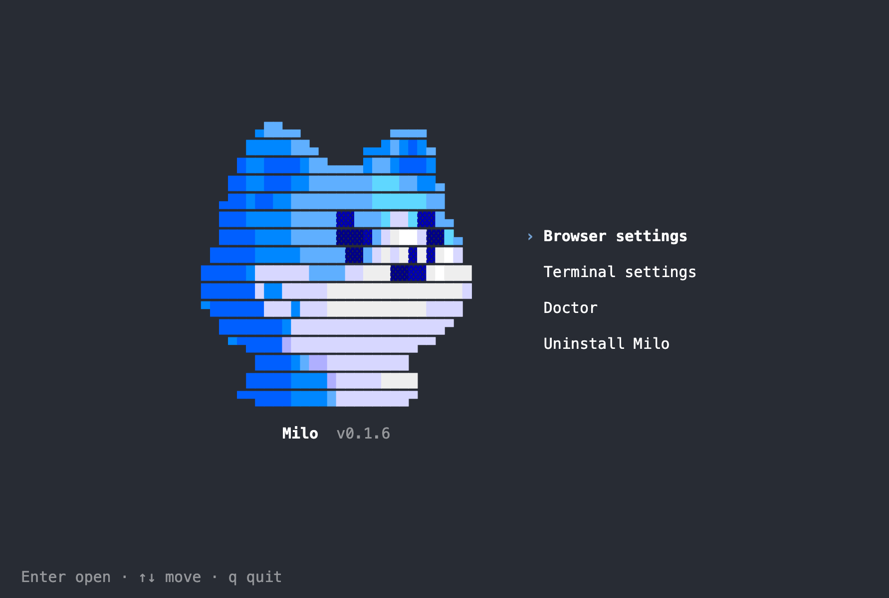
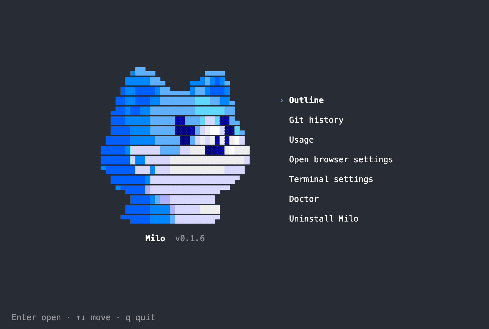
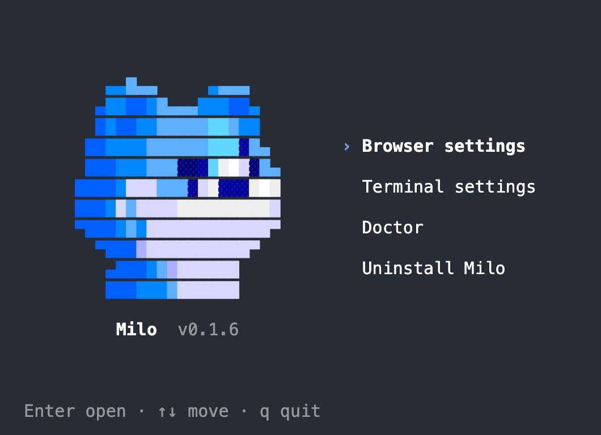
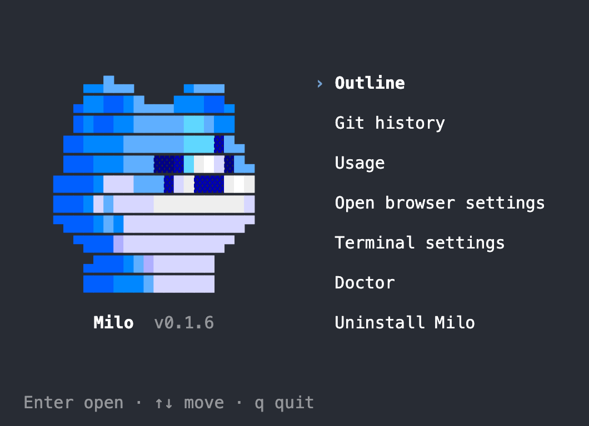

# Standalone terminal checks

Baseline: `536342f`. Direct Outline, History, working and historical readers, editing, Usage, terminal preferences and the local web editor already worked without Rex. Bare Milo led through the welcome guide to a settings/maintenance menu. The [capability matrix](../../../README.md#what-works-in-each-terminal) distinguishes the new entry point from those existing commands.

## Interaction checks

All standalone launches used disposable homes and projects, no Rex variables, and a `PATH` without `rex`. No installed app or live provider was configured.

| Environment | What was exercised | Evidence boundary |
| --- | --- | --- |
| macOS arm64, stock Terminal.app and Ghostty 1.4.0 | Bare Home; Outline → working reader → back; History → commit files; empty Usage; terminal settings; quit back to the shell. Direct `outline`, `history`, `usage`, `view`. | Native sessions with PTY-injected keys and observed output. No native window capture, manual mouse or GUI resize. |
| macOS `/bin/bash` and `/bin/zsh`, interactive PTYs | Ran `outline` from each stock shell, opened a text file and returned to the prompt; checked `stty -g` before and after. | Scripted keys, not emulator screenshots. |
| xterm.js 6.0.0 in headless Chromium, live shell and PTY | First-run Home without writing config/state. Keys and mouse through local panes, Ctrl-S save, read original text at a commit, terminal settings and Doctor. Resize Home and History from 96×32 to 56×20. | Actual emulator rendering of the binary. Screenshots below are not Terminal.app or native XTerm. |
| Debian 12 arm64 in a disposable container, tmux 3.3a | Direct Outline → inline reader; resize 80×24 → 36×12; edit, Ctrl-S, verify bytes on disk, resize back, return to Outline and exit successfully. | `sh tests/standalone-tmux.sh /absolute/path/to/milo`; reads tmux’s cell grid on a private server, not a desktop screenshot. |
| Packaged local settings, Chrome 157 on macOS | `web --no-open --port 0`; open the private link explicitly, change OpenCode visibility, save the global preference in the disposable home, verify with Doctor. | No automatic browser launch or contact with a usage provider. |
| Rex 0.1.0-preview.21, API 18, macOS arm64 | Floating files and tabs, edit and draft recovery, floating patch review, rich reader, rail arrangement and restoration, and absence of Discord activity without an app. | `cargo test --test rex_lab -- --ignored --test-threads=1` against real disposable Rex servers. No live Discord account or manual iOS client. |

| Size | Before (welcome already skipped) | After |
| --- | --- | --- |
| 96×32 |  |  |
| 56×20 |  |  |

No native Kitty, iTerm2, WezTerm, GNU screen, SSH, Windows console or mobile-client interaction was checked. Unit tests that feed terminal replies exercise the parser, not those emulators. A graphics probe is not a pixel-level check. Media decoding depends on the platform and installed decoders; see [Reader media](../../panes.md#reading-pictures-video-and-markdown).

## Matched release benchmark

`python3 tests/standalone_bench.py /path/to/base/milo /path/to/candidate/milo`. Each binary built with `cargo build --release --locked`, Rust 1.100.0, Apple M5 Pro, macOS 27.2.1. Both builds used the same 128-file, single-commit fixture and an already-skipped welcome guide. Twelve runs per build, alternating which ran first. Times are median milliseconds to a complete **PTY frame**, including process startup for the first three rows, not the time a display finished painting.

| Workload, 160×50 PTY | Baseline (ms) | Candidate (ms) |
| --- | ---: | ---: |
| Bare Home | 5.93 | 5.84 |
| History, first commit visible | 28.58 | 29.65 |
| Outline, first file visible | 28.31 | 29.06 |
| Enter on file → reader contents | 12.93 | 14.75 |

The largest observed difference was 1.82 ms slower opening the inline reader. This is a small, warm local fixture with scripted terminal replies, not a general speed comparison or a measurement of first-run onboarding, graphics, network latency or large repositories.
