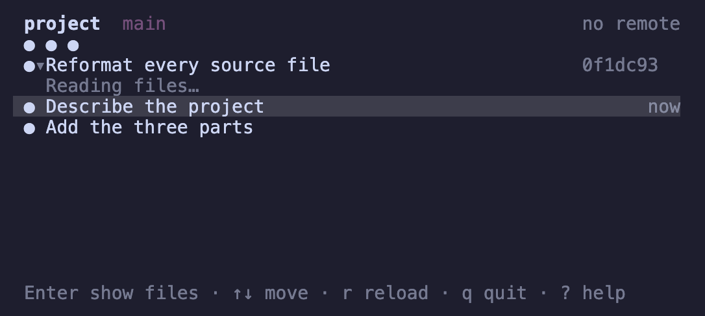
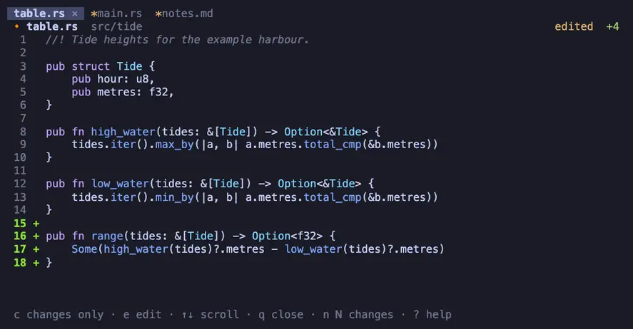

# Using the panes

Run the panes in a Unix terminal with 256 colours. Outline and history start in the current directory unless you give them a path. Inside a Git repository they use its root, even when you start in a subfolder. In a plain folder, outline shows just the files and history says it is not a Git project. To outline a directory named like a command, give its path explicitly: `milo ./history`.

If you initialize Git in that folder, open panes pick up the repository and its saved worktree choices without restarting. Switching branches does not erase remembered folder folds or mark the newly visible timeline as newly arrived.

In Follow mode, Outline and History use the local shell's working directory, even with a coding agent in the foreground and no directory report from the prompt. If the directory is missing, the pane says **Waiting for shell**; if it cannot open the reported folder, it says **Shell folder unavailable**. It keeps showing the last project and names it when space permits. Neither message changes your project preference to Pin.
If Git temporarily cannot identify the shell's project, the pane keeps the last project and retries without another `cd`.
If shell tracking itself stops, the notice changes to **Shell tracking unavailable**. Reopen the pane to reconnect.

## What fits in a pane

| Pane | Size | What you see |
| --- | --- | --- |
| Outline | 7 rows or fewer | A strip of changed files in a Git project, most recently written first, flowed across the width |
| Outline | 52 columns or more | In the tree, the type of change and how many lines each file gained and lost |
| Outline and history | 12 rows or more | A key hint |
| History | 3 rows or fewer | Recent commits without the heading, dots or divider |
| History | 52 columns and 8 rows or more | A row of dots when there is more than one commit |
| History | Narrow | A shorter summary, such as `↑2` for two commits to push or `no tracking` for a branch that does not track a remote branch |
| History | Narrow and focused | The selected commit's subject wraps so you can read it without widening the rail |
| Usage | Narrow | The limiting window takes priority; if its status does not fit, the provider name stays visible |
| Reader | 2 rows | The filename and one line of content; `n` and `N` show the changed line itself |

In narrow History, the wrapped subject uses only the room below a clicked row, so the row stays under the pointer. In a two-row pane, expanding a commit uses the second row for its first file or an empty-commit note. Collapse it to see the subject again.

The outline and history update on their own. While Git checks the project, the panes keep showing the last result and responding to keys. macOS uses file-change notifications. Where the pane needs to watch but notifications are missing, including on Linux, milo checks about every two seconds. See [keys and marks](keys.md) for colours and symbols.

In a plain folder, Outline lists the top level and the folders you expand. A partial-listing warning means Milo reached the 50,000-entry limit or couldn't read every entry. In both plain folders and Git worktrees, Outline warns and omits names that aren't valid UTF-8 rather than showing a name that could open a different file.

If Git holds the index lock for more than a moment, Outline, History and the working-file Reader show `Waiting for Git` and pause automatic updates. They update when the lock clears; Milo never removes it.

Untracked files appear before Milo counts their lines. In a wide outline, `?` means the count is not ready, not zero. The outline counts the files in view in small batches as you scroll; a folder shows `?` while any of its new files are still uncounted.

If filtering or folding hides the selected file, Outline keeps the cursor on its nearest visible folder. Press `r` to refresh counts, including offscreen files.

Press `/` and type part of a filename or path to find it without opening each folder. If the tree is showing changed files only, search uses that same filter. Use the arrow keys to choose a result and `Enter` to read it. Press `Esc` to leave the search without losing your place in the tree. [See Outline path search.](img/pane-outline-comparison.webp)

## Comparing commits

History counts commits to push against the branch's tracked remote branch. `no branch tracked` means there is no tracked branch, not that all commits have been pushed. Milo can still use the remote's default branch to mark commits for comparison. `no remote` means the project has no remote configured.

Expand a commit to see its seven-character ID beside the file count. Narrow panes keep that space for the subject instead.

History lists the latest 300 commits. If there are older ones, `G` takes you to the oldest displayed commit, with `Older commits not shown.` underneath when there is room. A subject longer than 4,096 bytes is cut there and ends with `…`.

Expanding a commit that touched thousands of files shows `Reading files…` under it while Git lists and counts them. The pane keeps taking keys meanwhile, and the files appear under their commit when they are ready, wherever the cursor has gone.

<p align="center"></p>

A shallow clone has only part of the project's history. If you expand a commit whose parent is beyond the shallow boundary, History says `Shallow history: parent unavailable.` It does not show every file as new. After fetching more history, press `r` to reload. A genuine first commit still shows its added files.

## Reading files

Open a file from the outline or history with `Enter` or a double-click. Inside Rex it opens in a floating reader, and the next file you open from that pane becomes a [tab](#tabs-in-the-floating-reader) of the same reader. Any shell you split beside the reader stays open. Outside Rex the reader takes over the pane; `q` brings you back.
History catches up with repository changes when you return from a file, keeping that file selected if it is still in the timeline.

### Tabs in the floating reader

A reader with one file looks as it always has. With a second file, a row of names appears above it: the shown tab is bold and has a `×`, and a yellow `*` before a name marks unsaved edits. Opening a file that already has a tab shows that tab; the file as of a commit is a tab of its own, named with the commit. Two files of the same name are shown with their folders.

<p align="center"></p>

| Key | Action |
| --- | --- |
| `Ctrl-N` / `Ctrl-P` | Next or previous tab |
| `Ctrl-W` | Close this tab. While editing with unsaved changes, asks first |
| `q` or `Esc`, while reading | Close this tab |
| Click a name | Show that tab |
| Click `×` | Close the shown tab |

Where every tab is shown and room is left, the right end of the strip names those keys: `^N ^P tabs · ^W close`, or `^N ^P tabs` alone. `?` lists them first.

Each tab keeps its own place in the file, and while it is being edited its cursor, draft and undo history, however long another tab is shown. A tab that was only being read shows the file as it is now when you come back to it. Closing the last tab closes the reader.

In a narrow pane the strip keeps the shown tab and as many neighbours as fit whole. `‹` and `›` at its edges stand for the tabs beyond, with a `*` when one of those has unsaved edits; click an edge to move that way. A pane under four rows tall shows the file without the strip; the keys still work. [See the strip at 34 columns.](img/reader-tabs-narrow.webp)

Tabs belong to one reader, which belongs to the pane that opened it and to that pane's project. Another Rex session, another project's outline and History beside Outline each have a reader of their own. A reader started with `milo view` in a shell takes no tabs. The reader's Rex label is the file it was last asked to show; it does not follow `Ctrl-N` and `Ctrl-P`.

On iPhone, enable [Rex → Settings → Keyboard → Open Keyboard Manually](https://www.superlogical.com/rex/docs/reference/ios-settings#setting-keyboard-open-keyboard-manually) to browse without raising the keyboard. Tap a folder to expand it, tap a file to select it, and double-tap to open it. This setting affects **all** terminal panes on that iPhone, not just Outline. Tap the keyboard button to type in a shell. If the keyboard reopens when you return to a terminal, turn off **Keep Keyboard Open** in the same settings.

For a quick look at the tree, use **Milo: Peek Outline** in Rex. It reuses one floating outline per tab. Close the peek with `Esc` or `q` rather than removing a permanent pane.

`milo view FILE` reads a working file. `milo view FILE --commit ID` reads the version from a commit. Give the file's path as it was in that commit, relative to your current directory or as an absolute path. For example, from `src`, use `milo view main.rs --commit ID`. Milo ignores `.` components and repeated slashes, but rejects `..`. Use a full or abbreviated hexadecimal commit ID, not a branch name or `HEAD`.

Committed-file lookup requires a UTF-8 path. A working file with a non-UTF-8 name can still be read directly, without a Git diff.

The reader shows the whole file with changed lines marked, and colours the languages below. Working files and files at a commit are recognised the same way, by file name, in any letter case. It uses a small scanner, not a full parser. Other files show as plain text, as does a script whose `#!` line names a different language from its extension. The working-file reader will not open a file outside the project through a linked folder.

### Languages

| Language | Files | Coloured across lines |
| --- | --- | --- |
| Rust | `.rs` | Nested block comments, strings, raw strings |
| Python | `.py`, `.pyi` | Triple-quoted strings |
| JavaScript, TypeScript | `.js`, `.mjs`, `.cjs`, `.jsx`, `.ts`, `.mts`, `.cts`, `.tsx` | Block comments, template strings |
| Go | `.go` | Block comments, raw strings |
| Java | `.java` | Block comments, text blocks |
| Kotlin | `.kt`, `.kts` | Nested block comments, raw strings |
| Scala | `.scala`, `.sc`, `.sbt` | Nested block comments, raw strings |
| Dart | `.dart` | Nested block comments, triple-quoted strings |
| C, C++ | `.c`, `.h`, `.cc`, `.cpp`, `.cxx`, `.hpp`, `.hh` | Block comments, C++ raw strings |
| C# | `.cs` | Block comments, verbatim and raw strings |
| Swift | `.swift` | Nested block comments, multiline and raw strings |
| PHP | `.php` | Block comments, strings, heredocs |
| Ruby | `.rb`, `.rake`, `.gemspec`, `.ru`, `Gemfile`, `Rakefile` | `=begin` comments, heredocs |
| Elixir | `.ex`, `.exs` | Triple-quoted strings |
| Lua | `.lua` | Long comments and long strings |
| Shell | `.sh`, `.bash`, `.zsh` | Quoted strings |
| SQL | `.sql` | Block comments |
| HTML, SVG, Vue, Svelte | `.html`, `.htm`, `.xhtml`, `.svg`, `.vue`, `.svelte` | Comments, tags, attribute values, and the JavaScript and CSS inside `script` and `style` |
| XML | `.xml` | Comments, tags, attribute values |
| CSS, SCSS, Less | `.css`, `.scss`, `.less` | Block comments |
| Markdown | `.md`, `.markdown`, `.mdx` | Fenced code blocks, comments |
| JSON | `.json`, `.jsonc` | Block comments |
| YAML | `.yaml`, `.yml` | Quoted strings |
| TOML | `.toml` | Multiline strings |
| Terraform, HCL | `.tf`, `.tfvars`, `.hcl` | Block comments, heredocs |
| Dockerfile | `Dockerfile`, `.dockerfile` | |
| Makefile | `Makefile`, `GNUmakefile`, `.mk` | |

Every language has its comments, strings, numbers and reserved words coloured. Markup has tag names, attributes and entities coloured instead, and text between tags is left plain. Markdown has headings, list marks, links, inline code, code blocks and quotes coloured; emphasis and tables stay plain, and a code block is one colour whatever language it holds. Ruby and Elixir strings in quotes are coloured one line at a time. Colour never changes the text shown, and the marks for added, removed and changed words are drawn over it.

When a removed line and the added line that replaces it look alike, the reader highlights the words that changed. A word is a run of letters, digits and underscores in any script; text written without spaces, such as Chinese or Japanese, is compared one character at a time. Highlighting only adds emphasis: the text shown is the same with or without it. Lines that share too little, lines with many separate changes and lines whose edits span more than about a hundred words keep only their red or green background, as do the remaining lines of an unusually large diff.

The reader also labels hidden differences next to the text: `[tab]` versus `[4 spaces]`, `[LF]` versus `[CRLF]`, or a mark such as `[zero-width space U+200B]`. It highlights the character affected by a changed mark, including a combining accent. Ordinary edits do not label unchanged whitespace or marks. Use the horizontal scroll keys to reach labels on long lines.

Press `n` or `N` to jump to the next or previous change. The Reader briefly shows your position (for example, `Change 2 of 5`) or `No changes` if there is nothing to jump to. Navigation wraps in both directions.

Press `c` to fold long unchanged stretches, leaving a little context around each change. Click a folded row to read just that stretch, or use `Tab` and `Enter`. Press `c` again to see the full file. [See the same diff in both views.](img/pane-reader-comparison.webp)

## Reviewing an agent's edits

`milo review PATCH` shows what a coding agent says it changed, and nothing else. `PATCH` is a unified diff made from a record of the agent’s own edits, not a diff of the whole worktree. The agent *hands it over*; Milo does not work it out.

Each file the patch names is shown as it is now, whole, with only the patch's lines marked as added or removed. Your own uncommitted work in the same file, another agent's edits, and anything staged or not yet known to Git read as plain unchanged lines. A file the patch does not name is never shown. Nothing is compared with a commit, so the review does not depend on what Git calls changed.

```sh
milo review /tmp/edits.patch --from "Claude Code"           # in your terminal
milo review /tmp/edits.patch --from "Claude Code" --float   # from an agent's shell inside Rex
```

`--from NAME` is shown in the heading as `patch from NAME`, with the file's place among the patch's files. `--float` is for a program with no terminal of its own: it opens the review in a floating pane over the Rex tab the program runs in, prints how many files are shown and a `Not shown:` line with the reason for each that is not, and exits. Without `--float` the review opens in the terminal you run it in.

| Key | Action |
| --- | --- |
| `]` / `[` | Next or previous file of the patch |
| `r` | Read the files again |
| `n` / `N`, `c`, scrolling | As in the reader |
| `q` or `Esc` | Close |

With more than one file, the last row begins with `[ ] files`. In a pane too narrow for the place in the heading, that hint carries it instead, as `[ ] file 2 of 3` or `[ ] 2/3`, and gives up the other keys first.

The review is read-only: `e` says so, and no file is written, in the project or outside it. The patch is read once when the review opens and is not copied or kept. Milo starts no program for it and asks Git nothing but where the project's top folder is, which the patch's paths are relative to.

### What Milo checks, and what it cannot

A patch is a claim. Milo cannot check who wrote a line, and `--from` is a label, not proof. What it does check is that the claim still fits the file: every hunk's lines, as the patch says it left them, must be in the file now, either where the patch says or in exactly one other place. A patch made one edit at a time can name a file several times; those edits are undone last to first, so a line the agent wrote and later rewrote shows once, from its first state to its last.

When a file does not fit, Milo shows the reason in place of the file and no diff at all. It never falls back to the project's uncommitted changes.

| Shown in place of the file | When |
| --- | --- |
| This file no longer holds the lines the patch left… | Someone changed or removed the patch's lines since, or the patch was not made from this file. |
| The patch's lines are in this file more than once… | The lines around an edit changed, and what is left of it matches several places. |
| The patch edits this file, but it is gone. / The patch removes this file, but it is here. | The file's existence contradicts the patch. |
| The patch names a path that is not a file inside the project. | An absolute path, one with `..`, one inside `.git`, or a name Git quoted. |
| This file is reached through a link… / This is a link… | Milo does not follow a link to show a patch. |
| The patch says this file is not text. / This file is not text. | A binary file, or one that is not UTF-8. |
| The patch for this file cannot be read. | A hunk is cut short or is not a unified diff. |
| Too large to show. / Placing this patch in the file would take too long. | A file over 2 MB, or a patch that matches almost everywhere. |

An empty patch, or text that names no file, opens nothing and says why. That is the right outcome when an agent has no record of its edits.

Where the lines next to an edit have changed since, Milo gives up the unchanged lines at the ends of a hunk one at a time and looks for the rest. At least one unchanged line must stay with the edit, and what is left must then be in the file exactly once. An added line whose neighbours have all changed is not looked for on its own: the same text somewhere else in the file would not be the patch's.

### Limits

- The review shows the files as they were when it opened or when you last pressed `r`. It does not follow later edits.
- A patch is at most 2 MB of text and names at most 200 files; a larger one is refused whole. Renames are shown under the new name, without the old one. A hunk with more lines than its header counts makes its file unreadable, which a hand-written patch can run into.
- An agent can hand over a patch that leaves out some of its edits, or includes someone else's. Milo shows what it was given.
- Edits an agent makes through a shell command, a formatter or a code generator are in the patch only if the agent or its harness recorded them.

### Where the patch comes from

Nothing is installed or configured for this, and no agent settings are changed. The [agent skill](../skills/milo/SKILL.md#show-the-user-your-own-edits) tells an agent how to produce the patch and when to say it cannot. These were checked on 22 November 2026 in throwaway repositories with uncommitted work by a person in the same file:

| Harness | Source of the patch | What it covers |
| --- | --- | --- |
| OMP 19.0.1 | The harness's own record of which lines each agent wrote: `commit.draft("self")`, then `diff()`. Nothing is committed. | Edits made with its edit and write tools, per agent and subagent. A person's lines and another agent's lines in the same file were left out. Files written by a shell command are listed for review and are not in the patch. |
| Claude Code 2.1.311 | The agent follows the skill: it copies a file aside before each edit and appends `diff -u` after it. | Edits the agent recorded. It depends on the agent following the instructions from its first edit. |
| Codex CLI 0.171.0 | The same instructions. | The same. In its default sandbox Codex cannot reach Rex, so `--float` fails with `Rex did not open the review.` and the agent gives you the command to run. |

Claude Code and Codex can also run a program after each edit, which could record edits without relying on the agent. Milo does not install or ship such a program: it would change your agent's configuration, and what those programs receive for an edit differs by harness and version.

## Editing files

The reader only reads until you ask it to edit. Press `e`, or open the file with `milo view FILE --edit`, and the file's text becomes a draft with a cursor. It works the same in the reader Outline opens in its own pane, in the floating reader in Rex and in `milo view`. The last row lists the main keys, `Ctrl-G` opens help, and [keys and marks](keys.md#editing-in-the-reader) has the whole list.

The draft is yours alone until you save: the file on disk is not touched by typing, pasting, undoing or formatting. While you edit, the reader shows the draft with its code colours and no change marks. When you stop, it shows the file again at the same lines, with a fresh diff, and Outline still has the file selected.

If another program edits the file before you save, choose `c` at **Changed on disk** to compare the disk version (`−`) with your unsaved draft (`+`). Comparing does not write or merge anything. Press `Esc` to return to the choice, then `Esc` again to continue editing. [See the save conflict and comparison.](img/pane-compare-comparison.webp)

The editor is for small changes. It has one cursor and no selection or search, and it edits a file that exists: it does not make a new one. The cursor moves one character at a time, so an accent written as a separate mark takes a key press of its own.

### What can be edited

A working file can be edited when it is a regular file, is reached without passing through a link, holds UTF-8 text with no NUL bytes, is no larger than 2 MiB and can be written by you. A byte-order mark is allowed. Anything else stays read-only. The last row then never has `e edit`, and `e` or help says why. A narrow pane can also lack room for `e edit` on a file that can be edited; `e` works all the same.

| It says | Because |
| --- | --- |
| `this is a commit` | The reader shows the file as of a commit, from History or `--commit` |
| `this is a link` | The file is a link; the reader shows where it points |
| `reached through a link` | A folder on the way to the file is a link |
| `the project moved` | The project's folder was renamed or replaced after the reader opened |
| `outside the project` | The path leads out of the project |
| `the file is gone` | The file was removed; the reader may still show its removed lines |
| `not a regular file` | It is a folder, a device or a pipe |
| `not text` | It holds NUL bytes or is not UTF-8, which a save could not keep, or Git treats it as binary |
| `shown as a picture` | The reader is showing it as a picture |
| `it cannot be shown` | The reader shows a note in its place, such as `Too large to show.` |
| `too large` | It is larger than 2 MiB, though the reader can show its changes |
| `no write permission` | You may read it but not write it |
| `it cannot be read` | The file or a folder on the way could not be opened |

A draft cannot grow past 2 MiB either: a key or paste that would take it there is refused.

### Saving

`Ctrl-S` writes the draft into the file that was read. Milo does not put a new file in its place, so the file keeps its permissions, owner, other names and attributes. The bytes you did not edit stay the same: a byte-order mark is kept, every line keeps its own ending when a file mixes `LF` and `CRLF`, and a file with no final line break is not given one. A new line takes the ending most of the file uses.

Before it writes, milo opens the file again and reads it. Nothing is overwritten unexpectedly:

- If the file no longer holds what your edit started from, or another file has been put in its place, nothing is written. **Changed on disk** lets you compare, explicitly overwrite, or return to editing. If the file changes again before you confirm, Milo asks again.
- If the file is gone, it is not made again.
- If the file has become a link, or a folder on the way has become a link or moved, the save is refused. Milo never writes through a link.
- If you no longer have permission to write, the save is refused.

In each case the draft stays open, and the last row says what happened. If the write itself fails part of the way, milo puts the old contents back where it can and says whether it could.

A save writes in place, not through a temporary file; that is what keeps the file's links and attributes. A crash or power loss in the middle of a save can therefore leave a partly written file.

### Leaving unsaved changes

`Esc`, `Ctrl-Q` and `Ctrl-C` stop editing. With unsaved changes they ask `Unsaved edits: s save · d discard · Esc back` first. `q` is a letter while you edit. If the terminal has stopped taking output, `Ctrl-C` ends the reader at once, as it always has; the draft is then kept as described next.

Closing a [tab](#tabs-in-the-floating-reader) that is being edited asks the same question, and the tab closes once you save or discard. `Ctrl-C` in a tab that is only being read would end the whole reader, so while another tab has unsaved changes it shows that tab and asks there instead. [See the question on closing a tab.](img/reader-tabs-close.webp)

A reader can also be ended from outside: its terminal is closed, the process is asked to stop, or Rex closes its pane. If it has unsaved changes, milo writes the draft to the `drafts` folder of its state folder (`~/.local/state/milo`, or `milo` under an absolute `$XDG_STATE_HOME`), readable only by you, and prints one line about it once the terminal is yours again: one draft and one line for each tab that had unsaved changes. The project is not written to. If milo has no state folder, because neither that variable nor `HOME` names one, the line says the edits were lost.

The next time you edit that file, the pane asks `Kept draft found: r restore · d delete · Esc later`. Restoring puts the kept text in place of the file's as one change, so `Ctrl-Z` shows the file as it is now. The kept copy is removed when you delete it or save the restored text, not before. If you defer or undo the restore and then the reader is closed from outside with new edits, both drafts are kept. After saving or deleting the offered draft, stop and start editing to see the next one. A process that is killed outright, or a machine that loses power, keeps nothing.

A kept draft remembers which text of the file it was written over. If the file holds something else by the time you restore it, because you, an agent or Git changed it meanwhile, the pane says `Draft restored over a changed file`, and the first `Ctrl-S` asks **Changed on disk** instead of writing, so you can compare the draft with what the file holds now before choosing. A draft kept by an earlier release of milo does not say what it was written over, so its first save asks too. [See the notice and the question, beside the save an earlier release made.](img/reader-draft-comparison.webp)

In Rex, a file from another project is never a tab: when the pane has followed the shell to another project, or its reader is gone, the next file opens a new floating reader in place of the old one. While the old one has unsaved changes in any tab, the pane says `The open reader has unsaved edits.` and leaves it alone.

## Formatting

While editing, `Ctrl-F` gives the draft to a formatter and puts its answer in place of the draft as one change. The file is not touched: look the result over, press `Ctrl-Z` to take it back, or discard it with the draft. Only `Ctrl-S` writes it. Keys pressed after `Ctrl-F` wait for the formatter and act on what it answered. If the formatter fails, the draft is left exactly as it was and the last row shows the first line of what the formatter said.

Milo runs a formatter you have installed. It does not install one, download one or run one through a package runner. For each kind of file, the first of these found is used:

| Files | Formatter | Run as |
| --- | --- | --- |
| `.rs` | rustfmt | `rustfmt --edition E --emit stdout` |
| `.go` | gofmt | `gofmt` |
| `.py`, `.pyi` | ruff, then black | `ruff format --no-cache --stdin-filename ./NAME -`<br>`black --quiet --stdin-filename ./NAME -` |
| `.js`, `.mjs`, `.cjs`, `.jsx`, `.ts`, `.mts`, `.cts`, `.tsx`, `.json`, `.jsonc`, `.css` | prettier, then biome, then deno | `prettier --stdin-filepath ./NAME`<br>`biome format --stdin-file-path ./NAME`<br>`deno fmt --ext EXT -` |
| `.scss`, `.less`, `.html`, `.md`, `.yaml`, `.yml` | prettier, then deno | As above |
| `.vue` | prettier | As above |
| `.toml` | taplo | `taplo format --stdin-filepath ./NAME -` |
| `.c`, `.h`, `.cc`, `.cpp`, `.cxx`, `.hpp`, `.hh` | clang-format | `clang-format --assume-filename=NAME` |
| `.sh`, `.bash` | shfmt | `shfmt --filename ./NAME` |
| `.lua` | stylua | `stylua --stdin-filepath ./NAME -` |
| `.swift` | swift-format | `swift-format format --assume-filename ./NAME` |
| `.tf`, `.tfvars` | terraform | `terraform fmt -no-color -` |

`NAME` is the file's name and `EXT` its extension. For Rust, `E` is the edition in the nearest `Cargo.toml` at or above the file within the project, or 2021; the option is left out when a `rustfmt.toml` there sets an edition. Other kinds of file, including some the reader colours such as Kotlin, Ruby, Java, C#, PHP and SQL, have no formatter: `Ctrl-F` says `No formatter for this kind of file.` and the last row does not offer it.

How a formatter is run:

- **Only when you press `Ctrl-F`.** Opening, reading and editing a file never start one. Help looks for the program so that it can name it, and does not run it.
- **By name, from where you installed it.** The program is looked for in the folders of `PATH` that are written in full. A folder written relative to where milo runs, such as `.` or `node_modules/.bin`, is skipped, so a project cannot supply the program. The formatter's own `PATH` has those folders taken out too, so a launcher that starts `node` cannot find one in the project. If none is installed, the last row says which to install, for example `Not installed: ruff or black.`
- **On the draft, not the file.** The draft goes in on standard input and the formatted text comes back on standard output. The formatter is not asked to write anything.
- **In the file's folder, with the file's name.** That is how a formatter finds the project's settings, such as `rustfmt.toml`, `pyproject.toml` or `.prettierrc`. Those settings belong to the project, and some formatters load code named in them: Prettier loads plugins and JavaScript settings files. Format files only in a project you trust, as you would in an editor.
- **For at most ten seconds.** After that the formatter and the programs it started are stopped. A formatter that leaves a helper running with its output still open is waited for just as long, and its answer is not used. An answer that is empty, is not UTF-8 text or is larger than 2 MiB is refused.
- **Without downloads.** Milo installs nothing. A `rustfmt` installed by rustup is told not to fetch the toolchain a project's `rust-toolchain.toml` names: if that toolchain is missing, the last row says so.
- **Keeping the file's line endings.** If the file uses `CRLF` and the formatter answers with `LF`, the draft gets `CRLF` back. A byte-order mark is not given to the formatter and is kept.

The pane shows `Formatting with NAME…` and does not redraw until the formatter is done.

## Reading pictures, video and Markdown

Open a working file from Outline with `Enter` or a double-click. The preview is the file's Reader tab, not a browser, dev server or external player. `milo view FILE` uses the same path. History, `--commit` and handed-over patches still show the source/diff or a binary-file note; they never substitute today's file for the requested revision.

| Working file | macOS | Linux |
| --- | --- | --- |
| PNG | Kitty bitmap where available; colored terminal cells otherwise | Kitty bitmap only; PNG must fit the 1,600-pixel side limit without resizing |
| JPEG, static WebP | Same as PNG, using the system image decoder | No conversion |
| MP4 | FFmpeg and FFprobe 8.0+ with `fd:` and `scale=…:reset_sar=1`, installed together in `/opt/homebrew/bin` or `/usr/local/bin` | Same tool capabilities, installed together in `/usr/bin` |
| `.md`, `.markdown` | Rendered terminal text; `m` for source or diff, `e` to edit | Same |

**Pictures.** The image keeps its proportions and fits between the filename and the key hints. Input is limited to 64 MiB. The macOS decoder checks the format and dimensions, caps source images at 40 million pixels and 16,384 pixels per side, and has a five-second deadline. The Kitty bitmap is at most 1,600 pixels per side and 16 MiB; the cell raster is at most 512 pixels per side. Text named like a picture can still be read as text. Active documents such as SVG and PDF aren't rasterized.

Single-image GIF, BMP without linked profiles, and single-page TIFF without nested image directories are also recognized on macOS. Animated GIF/WebP, multi-page TIFF, HEIC/HEIF, PSD, ICO/ICNS, SVG and PDF aren't passed to a general-purpose converter.

**Video.** Opens paused. `Space` plays or pauses; `←` / `→` seek five seconds in either direction. Leaving the tab or opening help pauses playback. The Reader never opens an audio device. It streams scaled frames (up to 320 × 240 at 12 fps) as colored terminal cells. Only standalone MP4 with a local H.264, HEVC or MPEG-4 Part 2 video track is accepted, up to 128 MiB and one hour. The track header must fit 8,192 pixels per side; decoding is limited to 9.5 million pixels per frame. External tracks aren't followed. Milo looks for an already-installed decoder, never installs one, and gives a reason when it can't play a file.

Leaving an image or movie tab releases its prepared pixels and private movie snapshot. Returning loads the selected working file again. An unchanged movie remembers its paused position; a replaced movie starts from the beginning.

Limits on bytes, pixels and output apply before or during decoding. The macOS helper watchdog also stops a decoder observed above 384 MiB resident memory; this is sampled, not a hard ceiling on instantaneous process memory.

**Markdown.** Headings, paragraphs, lists, quotes, emphasis and code render in the pane's own text styles. Links show text; embedded images show their labels, not fetched pixels. No HTML, scripts, URLs or file references are executed or loaded. `m` switches back and forth without losing the source diff. `e` opens the ordinary source editor; only an explicit save writes. Large previews stop at a labeled limit (512 KiB of text, 20,000 source lines or 32,000 wrapped rows); the source Reader keeps its own limits.

### Representative open times

Median of five release-build starts on an Apple M5 Pro, macOS 27.2.1, FFmpeg 9.0.2. Measured from spawning Milo to the first complete content frame on a 160 × 50 cell terminal. RSS is Milo's resident memory at that frame, not peak memory or the decoder's RSS. Release builds, terminal sizes and decoder builds affect these numbers.

| Fixture | Input bytes | First frame (ms) | Milo RSS (KiB) |
| --- | ---: | ---: | ---: |
| 1920 × 1080 PNG | 215,387 | 142.3 | 8,960 |
| 1920 × 1080 JPEG | 75,347 | 142.2 | 8,944 |
| 1920 × 1080 WebP | 46,604 | 139.3 | 8,880 |
| 1920 × 1080 H.264 MP4, 8 seconds | 5,557,338 | 142.0 | 7,824 |
| Markdown, 2,048 list items | 114,703 | 19.7 | 8,960 |

Reproduce with `python3 tests/rich_reader_bench.py target/release/milo`. Fixture generation uses local `ffmpeg` and `cwebp`; the reader doesn't need `cwebp`.
