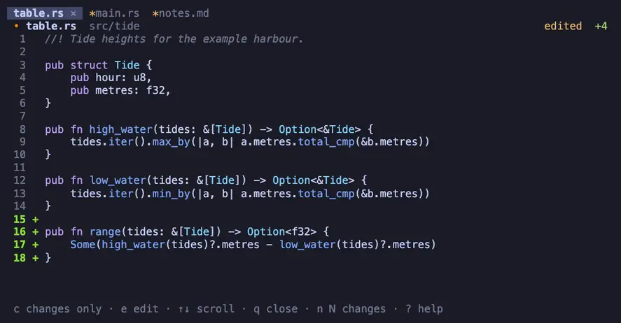

Milo v0.1.6 keeps the files you open together, gives you a way to review just the edits an agent hands you, and lets you manage several Rex hosts from one computer. Outline and History also keep taking keys while Git catches up with your work.

### Find, read and compare without leaving Rex

- Press `/` in Outline to find a file by name or path, even inside a closed folder. In Reader, press `c` to fold unchanged stretches of a diff. Expand one stretch with a click or `Tab` then `Enter`, or press `c` again to see the whole file. [Pane guide](https://github.com/mcc0x/milo/blob/v0.1.6/docs/panes.md) · [#44](https://github.com/mcc0x/milo/pull/44)
- Files opened from the same Outline or History pane now share one floating Reader in Rex. `Ctrl-N` and `Ctrl-P` switch tabs; `Ctrl-W` closes the current tab. Each tab keeps its place, draft and undo history. Opening a committed version gives it a separate tab, and closing a tab with unsaved edits still asks what to do. [Reader tabs](https://github.com/mcc0x/milo/blob/v0.1.6/docs/panes.md#tabs-in-the-floating-reader) · [#60](https://github.com/mcc0x/milo/pull/60)
- When a working file changes on disk during an edit, choose `c` at **Changed on disk** to compare disk and draft before deciding what to save. A restored draft also asks before it can overwrite changes made since it was kept, including drafts kept by an older Milo. Comparing never writes or merges anything. [Saving and recovery](https://github.com/mcc0x/milo/blob/v0.1.6/docs/panes.md#saving) · [#44](https://github.com/mcc0x/milo/pull/44), [#62](https://github.com/mcc0x/milo/pull/62)

### Review the patch an agent hands you

`milo review PATCH` opens a read-only Reader with only the supplied patch marked as changed, not the rest of your staged or unstaged work. Use `[` and `]` to move between files, or `--float` to open it over the current Rex tab. Milo needs a patch recorded by the agent or its harness. It checks that the patch still fits the files, not who wrote it or whether it includes every edit. If it no longer fits, Milo explains why and never falls back to the worktree diff. [Review guide](https://github.com/mcc0x/milo/blob/v0.1.6/docs/panes.md#reviewing-an-agents-edits) · [Agent skill](https://github.com/mcc0x/milo/blob/v0.1.6/skills/milo/SKILL.md#show-the-user-your-own-edits) · [#61](https://github.com/mcc0x/milo/pull/61)

### Manage settings across Rex hosts

- `milo doctor` and the dashboard’s **Hosts** and **Health** pages show which computer and Rex version you’re looking at. Run `milo web --host HOST` to open that host’s editor in your browser through a Rex forward. Both ends listen on loopback and the private session link is still required. Install the same Milo version on both hosts; nothing syncs automatically.
- Under **Hosts** or with `milo settings export`, `import` and `undo`, copy selected appearance, pane workflow, usage display and layout settings. Preview before applying, and undo the last import if its settings haven’t changed again. Credentials, alert destinations, account choices and integrations never travel. [Multi-host setup](https://github.com/mcc0x/milo/blob/v0.1.6/docs/setup.md#several-rex-hosts) · [#45](https://github.com/mcc0x/milo/pull/45)

### What’s faster

These are selected comparisons of release-optimised builds on an Apple M5 Pro, using generated projects, local stand-ins and the baselines linked below. They are not one v0.1.5-to-v0.1.6 test or promises for every repository. Results are rounded; each `/` separates the median and 95th percentile for the same build.

| Workload | Before → after |
| --- | --- |
| History, slowest key during a background refresh on a 50,000-file fixture, median of 15 runs | 135 → 2.6 ms. First frames improved less: on the same fixture, Outline 277 → 253 ms, History 186 → 178 ms. [Report](https://github.com/mcc0x/milo/blob/v0.1.6/tests/open_bench/baseline-7d2a6f4.tsv) · [#64](https://github.com/mcc0x/milo/pull/64) |
| History, Down while expanding a 6,000-file commit, median | 253 → 42 ms to the next frame; the full file listing still took about 250 ms. [Report](https://github.com/mcc0x/milo/blob/v0.1.6/tests/history_bench/baseline-fa34ca4.tsv) · [#50](https://github.com/mcc0x/milo/pull/50) |
| Outline, background recount after one save near the start of a 50,000-file index | 1,274 / 1,477 → 71 / 81 ms. This is worker time for that path, not a general per-save speedup. [#66](https://github.com/mcc0x/milo/pull/66) |
| Reader, opening a new working tab on a synthetic 5.72 MB file | 150 / 158 → 75 / 120 ms, from two whole-file diffs to one. Switching to a working tab with the keyboard still needs one diff. [#66](https://github.com/mcc0x/milo/pull/66) |
| Reader, one typed key in a near-limit one-line draft, median | 7.50 → 0.046 ms to finish the frame. Ordinary short-line files saw much smaller gains. [#58](https://github.com/mcc0x/milo/pull/58) |
| Browser Settings, time from private link to first complete state with a responding Rex stand-in | 29.3 / 31.7 → 16.3 / 17.7 ms. Startup only; no speedup claimed for saving or later requests. [#65](https://github.com/mcc0x/milo/pull/65) |
| Usage, reading 200,000 rows of oh-my-pi WAL history with no cached report | 408 / 417 → 218 / 223 ms; with a current cached report, the median stayed at 36 ms. [#65](https://github.com/mcc0x/milo/pull/65) |
| Usage, checking four file-backed accounts when no request is due | 41 / 48 → 10 / 11 µs per pass; provider request counts stayed the same in the scheduling fixture. [#65](https://github.com/mcc0x/milo/pull/65) |

`milo web` also prints the private link before Settings finishes loading; with a slow Rex stand-in the link appeared at a median of 11 ms instead of 222 ms, even though the first complete state still took about 222 ms in that comparison. Usage skips redundant reads for idle rollback-journal databases but still checks write-ahead logs on schedule. The macOS app skips repainting a closed usage panel on identical updates, while an open panel still redraws as reset times pass. In three synthetic menu runs with the display asleep, CPU time per repeated frame with the panel closed fell from 329–937 µs to 56–105 µs; these runs varied substantially and excluded display compositing. [Startup report](https://github.com/mcc0x/milo/blob/v0.1.6/tests/web_bench/baseline-fa34ca4.tsv) · [#50](https://github.com/mcc0x/milo/pull/50) · [#59](https://github.com/mcc0x/milo/pull/59) · [Reproduction guide](https://github.com/mcc0x/milo/blob/v0.1.6/CONTRIBUTING.md#checking-failures-and-speed)

### Fixes and reliability

- **Panes and help:** Outline holds onto its project when Git discovery briefly fails. History cancels unfinished file listings when you quit or switch projects. Help flows into columns where it fits, and narrow Reader tabs and reviews keep key hints visible when there’s room. `milo COMMAND --help` is easier to read; typos suggest a nearby command, and a pane started without a terminal explains what works without one. [#42](https://github.com/mcc0x/milo/pull/42) · [#46](https://github.com/mcc0x/milo/pull/46) · [#51](https://github.com/mcc0x/milo/pull/51) · [#63](https://github.com/mcc0x/milo/pull/63)
- **Drafts, Rex and Settings:** Deferred recovery drafts are kept separately from new edits. Rex settings commands and scripts stop waiting after 15 seconds; followed tabs retry failed title lookups without overriding manual names. The browser keeps keyboard focus through import preview, discards superseded exports and names the host in Telegram recovery. Presence changes are refused if the saved choice no longer matches what you saw; turning it off still works. [#42](https://github.com/mcc0x/milo/pull/42) · [#51](https://github.com/mcc0x/milo/pull/51) · [#62](https://github.com/mcc0x/milo/pull/62)
- **Usage:** Saved readings and retry waits follow the credential that produced them. Switching Claude accounts clears the old windows, and moving the start of today earlier makes Milo reconsider local activity. Temporary account outages can be retried sooner, with waits based on elapsed time while Milo runs. [#42](https://github.com/mcc0x/milo/pull/42) · [#50](https://github.com/mcc0x/milo/pull/50) · [#51](https://github.com/mcc0x/milo/pull/51)
- **Alert forwarding:** An unsaved settings change leaves mirroring running. Hosted Telegram retries distinguish confirmed pre-send failures from uncertain delivery, which Milo does not replay. A temporary response from in front of the relay no longer disables the saved connection. Legacy pairing recovery can remove the local Telegram credential without disconnecting Discord or claiming remote revocation. Release builds use the production relay, not a development override. The relay code also lets an in-flight Telegram send finish during graceful shutdown. [#42](https://github.com/mcc0x/milo/pull/42) · [#51](https://github.com/mcc0x/milo/pull/51) · [#62](https://github.com/mcc0x/milo/pull/62)
- **Community:** See the new [security reporting policy](https://github.com/mcc0x/milo/blob/v0.1.6/SECURITY.md) and [code of conduct](https://github.com/mcc0x/milo/blob/v0.1.6/CODE_OF_CONDUCT.md). [#49](https://github.com/mcc0x/milo/pull/49)

**Install:** `brew install mcc0x/milo/milo` or [download the installer](https://github.com/mcc0x/milo/releases/download/v0.1.6/install.sh). **Upgrade:** `brew upgrade mcc0x/milo/milo`, or run the new installer if you installed without Homebrew. Prebuilt binaries are for Apple Silicon Macs running macOS 13 or later. If you use Milo’s Rex integration, run `milo setup --repair` after upgrading.

[Full changelog: v0.1.5 → v0.1.6](https://github.com/mcc0x/milo/compare/v0.1.5...v0.1.6)
