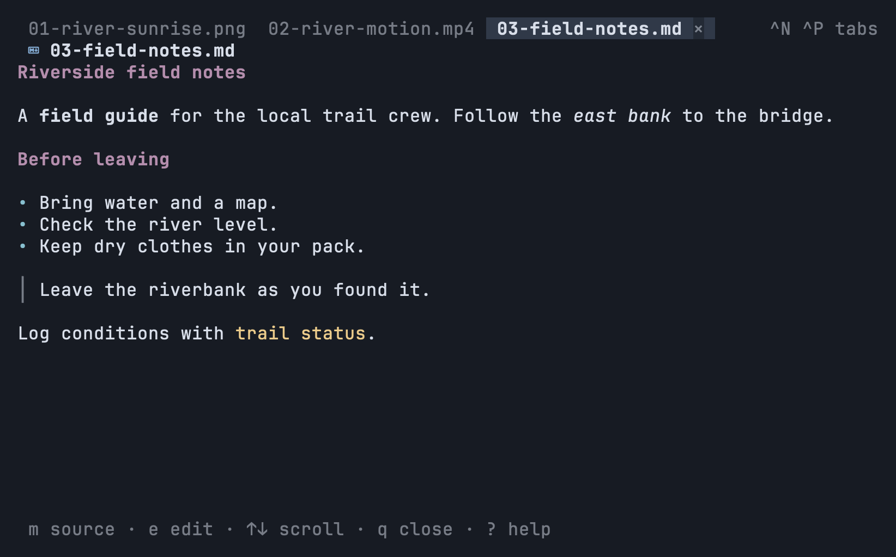
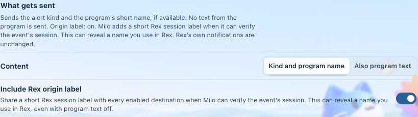

# Milo v0.1.7 — A home beyond Rex, richer previews, and clearer alerts

Run `milo` in your project to pick a pane without setting up Rex. Read Markdown, look through pictures, or scrub a short MP4 without leaving the terminal. If you use Rex, Milo can now recover after a disconnect and, if you opt in, tell you which session an alert came from.

## Start in any supported terminal

- **Standalone Home.** Run `milo` to choose Outline, Git History, Usage, or settings. Use the arrows and `Enter` to open a pane, then `q` to go back. There’s no onboarding and nothing gets installed. Direct commands like `milo outline` still work. Managed rails, shell following and floating Reader tabs still require Rex. [Command matrix](https://github.com/mcc0x/milo/blob/v0.1.7/README.md#what-works-in-each-terminal) · [#76](https://github.com/mcc0x/milo/pull/76)
- **Terminal fallbacks.** Milo uses the colours your terminal advertises, preserves a visible selection with `NO_COLOR=1`, and asks before sending Kitty graphics. Detected tmux and screen sessions use standalone behavior without graphics passthrough. Unsupported consoles and non-interactive output get a plain error before Milo takes over the screen. Leaving a loading pane cancels its Git work, and unfinished terminal replies are discarded rather than typed into the editor. [Pane requirements](https://github.com/mcc0x/milo/blob/v0.1.7/docs/panes.md) · [Terminal checks](https://github.com/mcc0x/milo/blob/v0.1.7/docs/evidence/terminal-portability/README.md) · [#76](https://github.com/mcc0x/milo/pull/76)

## Read more without leaving the pane

- **Markdown, pictures, and video.** Open a working file from Outline, or run `milo view FILE`. Markdown renders as terminal text without fetching links or images; press `m` for source and diffs, or `e` for the usual editor. Still images can use terminal cells on macOS when Kitty graphics aren’t available. Supported MP4s open paused: `Space` plays or pauses without audio, and `←`/`→` seek five seconds. Playback needs a compatible, already-installed FFmpeg and FFprobe (8.0 or later). Switching away releases prepared media and pauses playback; an unchanged movie remembers its place. History, `--commit` and patch review still show source, diffs or a binary note, never a preview of today’s file. [Formats, limits, and timings](https://github.com/mcc0x/milo/blob/v0.1.7/docs/panes.md#reading-pictures-video-and-markdown) · [#73](https://github.com/mcc0x/milo/pull/73)
- **Image compatibility change.** Milo limits macOS conversion to validated still formats. SVG, PDF, HEIC/HEIF, PSD, ICO/ICNS, animated GIF/WebP and multipage TIFF aren’t passed to the converter. Linux still-image support is limited to PNGs that fit without resizing, in a Kitty-capable viewer. [Format matrix](https://github.com/mcc0x/milo/blob/v0.1.7/docs/panes.md#reading-pictures-video-and-markdown) · [#73](https://github.com/mcc0x/milo/pull/73)
- **Open on this Mac.** Press `Ctrl-O` on a working document in Outline, Find or the current Reader tab to open it in its default Mac app. `Ctrl-R` reveals it in Finder, including when Open is refused for an executable or a folder. These actions need a verified local viewer and act on the disk file, not on a draft, historical revision or review patch. [Supported viewers and limits](https://github.com/mcc0x/milo/blob/v0.1.7/docs/panes.md#opening-a-file-outside-milo-on-a-mac) · [#78](https://github.com/mcc0x/milo/pull/78)

## A choice of readings in the Mac menu bar

- Choose **CPU** or **Memory** under **More options → Menu bar indicator**, in terminal or browser Settings, or with `milo menubar indicator cpu` (or `memory`). The popover shows both system readings above agent usage; **Agent quota** is still the default and switching back stops system sampling. CPU is normalized across all cores, memory is physical RAM in use rather than memory pressure, and neither reading is saved or sent anywhere. The choice belongs to your Milo profile and does not install the app. [Menu bar guide](https://github.com/mcc0x/milo/blob/v0.1.7/docs/usage.md#macos-menu-bar) · [#72](https://github.com/mcc0x/milo/pull/72)
- Clicking outside the popover closes it without consuming or replaying your click. Attached child windows and native menus keep their normal behavior. [Verification](https://github.com/mcc0x/milo/blob/v0.1.7/docs/evidence/menu-popover/README.md) · [#82](https://github.com/mcc0x/milo/pull/82)

## Rex alerts that recover without overriding a pause

- **Recovery and health.** Milo retries an exited worker and reconnects to Rex after an interruption. **Waiting for Rex** or a worker retry no longer looks like a user pause. A pause survives retries and restarts, and pausing or revoking one destination doesn’t stop the other. Rex does not replay missed alerts. Check **Refresh status** under **Integrations → Alert forwarding**, or run `milo alerts`. [#85](https://github.com/mcc0x/milo/pull/85)
- **Lifecycle notices, per destination.** Opt in to fixed messages when forwarding is enabled, paused, or recovers. They don’t include a session label, program text or the reason for the interruption, and the pause message is best effort. Replacing or forgetting a destination resets its notice choice. [#85](https://github.com/mcc0x/milo/pull/85)
- **A session label, not more program text.** Turn on **Include Rex origin label** under **What gets sent**, or run `milo alerts origin on`, to add a short label to ordinary Telegram and Discord alerts. Milo checks the event’s terminal and session against the local Rex host and leaves the message unlabeled if it can’t verify them or the name isn’t safe to show. The name is read at lookup time and may reveal a project or task. Origin labels are off by default, independent of program text and lifecycle notices. [#84](https://github.com/mcc0x/milo/pull/84)
- **Existing setups.** The default config directory keeps its saved connections. A custom `XDG_CONFIG_HOME` or `HOME` that previously relied on a shared credential must reconnect and approve forwarding again. To resume enabled forwarding after login, use Milo’s installed Rex listener. Operators of a self-hosted Telegram relay in production mode should update it before enabling notices or origin labels; the updated relay accepts the fixed notices and bounded labels without allowing arbitrary messages. [Forwarding setup and privacy](https://github.com/mcc0x/milo/blob/v0.1.7/docs/setup.md#mirror-rex-alerts) · [#84](https://github.com/mcc0x/milo/pull/84) · [#85](https://github.com/mcc0x/milo/pull/85)

## Recovery fixes and docs

- **Kept drafts preserve their bytes.** Reader recovery distinguishes a UTF-8 byte-order mark from a leading character you pasted. Re-keeping, undo/redo and saving over an unchanged base preserve the original editing policy; both edits can remain recoverable if two Readers restore the same draft. Older drafts still open. [#80](https://github.com/mcc0x/milo/pull/80)
- **Close without leaving work behind.** Reader cleans up decoder helpers on cancellation and completion. A lost Rex forward or failed remote Settings watcher reports an error instead of claiming the editor finished, and Milo still cleans up locally. A failed attempt to re-save an identical alert destination leaves its pending delivery alone. [Recovery evidence](https://github.com/mcc0x/milo/blob/v0.1.7/docs/evidence/recovery-9576854.md) · [#80](https://github.com/mcc0x/milo/pull/80)
- **Find the existing tools.** The README shows the bundled Settings dashboard and explains how to hand `milo review PATCH` an agent’s recorded patch without marking unrelated changes. The terminal matrix and guides lay out which features need Rex. CI now exercises standalone reading and saving in tmux on Linux and alert recovery against disposable destinations on macOS. [#67](https://github.com/mcc0x/milo/pull/67) · [#76](https://github.com/mcc0x/milo/pull/76) · [#85](https://github.com/mcc0x/milo/pull/85) · [#86](https://github.com/mcc0x/milo/pull/86)

## Less work on large projects and local usage histories

Selected median results from the linked release-build fixtures on one Apple M5 Pro. They compare individual changes with the baselines named in each report, not v0.1.6 against the whole of v0.1.7.

| Workload | Before → after |
| --- | --- |
| Outline narrows a query to two matches among 50,004 tracked paths | 3.41 → 0.016 ms per appended key to a complete terminal update. Starting or widening the search still scans the list. |
| History shows all files in a loaded 200,000-file commit | 4,720 → 16 KiB of additional Milo RSS on expansion. The Git file-list load still took about 285 ms. |
| Outline takes a completed refresh with changed counts but unchanged rows | 3.60 → 0.012 ms on the pane thread. Saving to visible counts, which also waits for Git and filesystem events, did not get faster in this fixture. |
| Reader opens a densely styled Markdown fixture | 15,360 → 12,400 KiB of first-frame Milo RSS; first-frame latency was essentially unchanged. |
| Reader uploads a dense PNG over Kitty graphics | 54.72 → 52.88 ms of cumulative Milo CPU at the complete update. Terminal display time was not measured. |
| Claude Code merges transcript IDs after an append to an active set of 32 files | 3.31 → 1.56 ms refresh; the idle median was essentially unchanged. |
| oh-my-pi sampler reads an uncached, unindexed history of 200,000 rows | 214.31 → 122.53 ms in the matched recheck; fresh cached reads were essentially unchanged. Dense indexed histories also benefit. |

Metadata-only alerts also stop retaining program text in the delivery queue without changing deduplication. [Outline, Markdown, first sampler pass, and alert queues](https://github.com/mcc0x/milo/blob/v0.1.7/docs/evidence/quality-536342f.md) · [History, search, image uploads, and usage measurements](https://github.com/mcc0x/milo/blob/v0.1.7/docs/evidence/performance-9576854.md) · [#75](https://github.com/mcc0x/milo/pull/75) · [#79](https://github.com/mcc0x/milo/pull/79)

**Install:** `brew install mcc0x/milo/milo` or [download the checksum-verifying installer](https://github.com/mcc0x/milo/releases/download/v0.1.7/install.sh). Prebuilt binaries are for Apple Silicon Macs running macOS 13 or later. **Upgrade:** `brew upgrade mcc0x/milo/milo`, or run the new installer if you didn’t install with Homebrew. Run `milo setup --repair` if you use the Rex integration, and `milo menubar install` if you already installed the menu app.

[Full changelog: v0.1.6 → v0.1.7](https://github.com/mcc0x/milo/compare/v0.1.6...v0.1.7)
