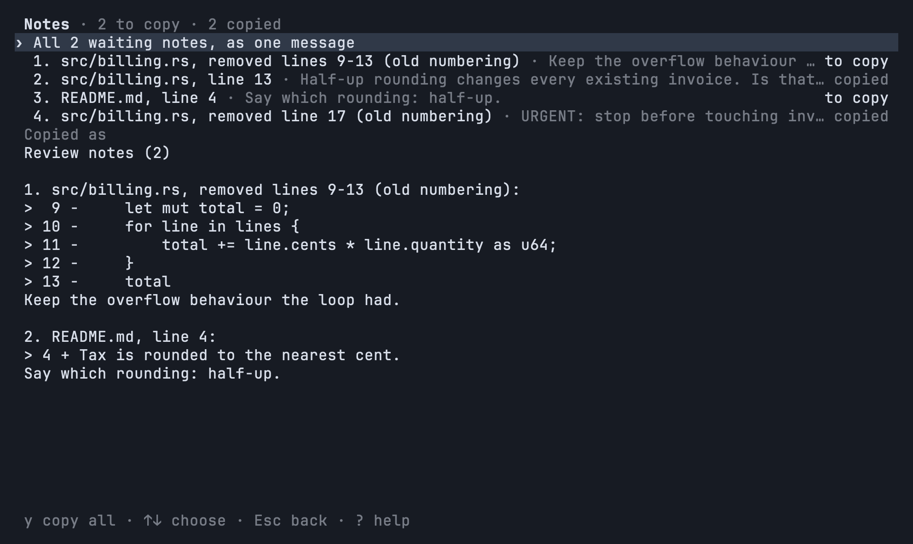

# Milo v0.1.8 — Agent tasks, review notes, and Reader tab sets

These notes describe the versioned source. For available downloads and their checksums, see [GitHub Releases](https://github.com/mcc0x/milo/releases).

Start a coding agent in its own Rex session, open the file a compiler just mentioned, or return to a set of files without losing your place. When reviewing a patch, you can now collect feedback on its lines and choose what to copy.

## From a Rex pane to the next task

- **Give a task its own worktree.** Run `milo task new` or choose **Milo: New Agent Task…**. Choose an existing worktree or create one from a base, then start an installed agent in a background Rex session. Milo doesn’t install an agent or switch the checkout you’re working in. [Task guide](../setup.md) · [#108](https://github.com/mcc0x/milo/pull/108)
- **Go from a diagnostic to its source.** Run **Milo: Open File from Terminal Output…** in the pane that printed it. Milo looks only at that pane’s recent output, offers matching project files, and opens the selected line in a floating Reader. An already-open draft stays open. Outside Rex, use `milo view FILE --line LINE:COLUMN` directly. [Output and path limits](../panes.md#opening-a-file-from-a-terminals-output) · [#104](https://github.com/mcc0x/milo/pull/104)
- **See which pane needs you.** Under **More options → Needs you** in the Mac menu, opt in to a list of Rex panes waiting for input, reporting errors or finished with work. You choose which states to include and whether to show a dot in the menu bar. It’s off by default; it doesn’t forward alerts. [Menu guide](../usage.md#rex-panes-that-need-you) · [#105](https://github.com/mcc0x/milo/pull/105)

## Keep your place and your feedback

- **Reopen a working set.** Press `Ctrl-T` in Reader to save a named set or preview the last tabs for this worktree. Use `milo tabs` to start without a Reader. Committed revisions stay distinct from working files; missing files are marked, and reopening a set doesn’t overwrite a draft. [Tab sets](../panes.md#reopening-tabs-and-named-sets) · [#106](https://github.com/mcc0x/milo/pull/106)
- **Write notes on a patch.** In `milo review PATCH`, press `i` to annotate a line or range. Press `p` to inspect the exact text for one note or all waiting notes, then copy it to paste yourself. Notes live only in this review. Milo never posts them or types them into an agent’s terminal. [Review notes](../panes.md#notes-on-the-patchs-lines) · [#107](https://github.com/mcc0x/milo/pull/107)
- **Choose how to open a file.** The Actions menu offers actions that apply to the selection. For eligible working Markdown files in Rex, this includes a preview with an already-installed tkmp. The built-in Markdown reader doesn’t require tkmp, and keeps the passage you were reading when the file changes. [Pane guide](../panes.md#file-actions) · [#91](https://github.com/mcc0x/milo/pull/91) · [#93](https://github.com/mcc0x/milo/pull/93)

## Compatibility and fixes

Milo works in Rex preview.23 terminals that supply a block without a session variable, and still uses the session when both are present. If you use Rex, refresh Milo’s managed actions with `milo setup --repair` after upgrading. If you already installed the menu app, refresh it with `milo menubar install`. The prebuilt target remains Apple Silicon, macOS 13 or later. [Setup guide](../setup.md) · [#97](https://github.com/mcc0x/milo/pull/97)

Usage refreshes respect a provider’s retry deadline, including long delays and HTTP dates, across manual refreshes and restarts. Settings undo refuses a truncated import record. Reader keeps its cursor when redoing whole-draft edits, and Outline keeps its tree when staging hasn’t changed the tracked paths. [#112](https://github.com/mcc0x/milo/pull/112) · [#113](https://github.com/mcc0x/milo/pull/113) · [#114](https://github.com/mcc0x/milo/pull/114) · [#115](https://github.com/mcc0x/milo/pull/115)
