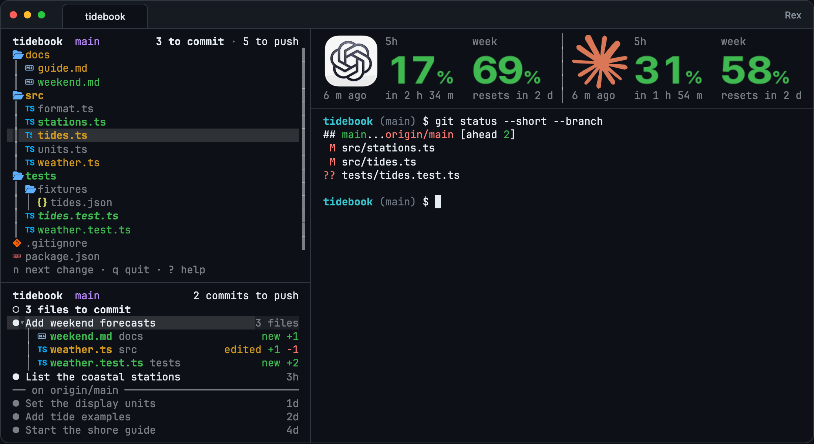

# Set up milo


## Install

The v0.1.5 prebuilt release is for Apple Silicon Macs running macOS 13 or later. Use Homebrew:

```sh
brew install mcc0x/milo/milo
```

Or download the versioned release installer from GitHub:

```sh
curl -fsSLo milo-install.sh https://github.com/mcc0x/milo/releases/download/v0.1.5/install.sh &&
  sh milo-install.sh
```

The installer checks the binary against a pinned SHA-256 checksum before placing it in `~/.local/bin`. Set `MILO_BIN_DIR` to choose a different directory. The prebuilt installer does not need a compiler, Cargo or Git.

To build from source instead, install Git and Rust 1.91 or later, then run:

```sh
git clone https://github.com/mcc0x/milo.git
cd milo
sh install.sh
```

The source installer builds the checkout containing the script, even when launched from another directory. A standalone or piped copy clones Milo from GitHub into a private temporary directory instead.

The source installer also honours `MILO_BIN_DIR` and defaults to `~/.local/bin`.

Current installers write a receipt for the binary and its install path. Use a current installer with `--uninstall` and the same `MILO_BIN_DIR` to remove it. If the binary has changed or the receipt is missing or invalid, the installer leaves the binary in place. Older installs may not have a receipt; verify the binary before removing it manually rather than running an older installer’s `--uninstall`.

## In Rex

In a Rex shell run `milo setup`. Pick **Just the tree**, **Project sidebar**, or start from the tab you already arranged. Adjust the individual panes and appearance if needed. Trying the layout does not change your saved default; undo the trial before saving if it isn't what you want.

In Home, the welcome guide and Settings, moving the pointer over a clickable control underlines it without changing your keyboard selection. **Click once** to open a menu, switch sections or change a value. Click **Save** and choose a scope to keep your changes. Terminals without mouse-motion reporting still support the arrow keys and Enter.

In narrow Settings panes, rows use shorter labels. When there's room, the full name and value of the selected setting appear below the list.

**Unsaved changes** stays visible while you edit. If you leave Settings from Home or `milo setup`, choose **Save**, **Discard**, or **Keep editing**. Save asks for a scope for each changed group: layout, then appearance and workflow together. Claude Code choices apply to the active profile and do not need a scope. Each confirmed save takes effect as you go, so going back does not undo changes you have already saved. Leaving also undoes any layout trial you haven't kept by saving it.

Save for **this worktree** to keep a project-specific setup, or save a **global default** for projects without an override. Worktrees of the same repository can have different choices. Preferences live on the machine running Milo, outside the repository. A project cannot install actions or supply a command for Milo to execute.

If the saved layout changes while Settings is open, Milo keeps the newer layout instead of overwriting it. Reopen Settings to edit that layout.

Saving appearance or workflow preferences changes only the settings you edited. A worktree still inherits global values for any settings it does not override, and saving global defaults does not copy worktree overrides.

If a worktree's preferences file is unreadable or invalid, panes keep using global preferences. If the global file is broken, panes use built-in defaults. Milo leaves the files alone and shows a notice; run `milo doctor` to find the file and the error, then correct it and reopen the panes.

Usage starts as a two-row strip in the shared sidebar. Drag a divider in an installed Milo sidebar and Milo remembers the proportions for that Git worktree automatically. To save a layout explicitly or make it the global default, use **Milo: Remember This Layout…**. Milo stores pane roles and proportions, not processes or live pane IDs. Mixed rails containing another app are left alone.



Turn on **Arrange new shell tabs** to apply the layout to new shell tabs, including the first tab of a new session. Save this switch globally; changing it alone does not replace either the global or worktree layout. If Usage is sized in rows, Milo waits for a Rex client to measure the tab, so a background tab may arrange when you first show it. Tabs opened to run a command and tabs with their own layout are left alone. Turn it off and save globally to stop arranging new tabs. The panes also work on their own outside Rex.

Use the appearance choices to preview icons, choose text change marks, and turn animated activity marks off. Usage shows Codex, Claude Code and OpenCode only while each has a figure to show; choose **Always show** or **Hide** for a tool to [decide that yourself](usage.md#which-tools-appear). Use the workflow choices to pin Outline and History to the starting project or follow the shell they were opened beside. Milo does not change Rex's font, theme, shortcuts or notification settings.

**After Rex restarts, a sidebar can come back as shells instead of Milo.** The dividers and pane labels survive, but on Rex preview.21 (server API 18) the running programs do not. To restore the sidebar, focus its tab’s working shell and run **Milo: Arrange This Tab** in the Rex app. Milo checks what’s running before it offers to rebuild. New shell tabs are arranged as before.

**Text zoom is separate from split size.** On Rex preview.21 (server API 18), Milo can read a terminal's cell dimensions, but creating or resizing a terminal does not set the font the Mac app renders. The app exposes relative font actions and an app-wide [starting font size](https://www.superlogical.com/rex/docs/reference/mac-settings.md#setting-typography-font-size), not an absolute per-pane zoom setting. Milo therefore remembers divider positions, not text zoom, for Outline, History and Usage.

Run `milo` for Home or `milo setup` to go directly to Settings. Both share the same first-run guide. To skip it in an install script, run `milo setup --skip-onboarding`; it records the skip and exits without requiring a terminal or installing integrations. `milo outline` and the other direct pane commands never show the guide. Terminal panes work without Rex; split geometry and shell-following require Rex.

## Tab titles and session names

Milo leaves tab and session names alone unless you ask. It builds a name from folder names and the name of an agent's process. It never reads what a terminal shows, a terminal's title or a program's status text, so nothing you type to an agent ends up in a name.

Turn on **Title Rex tabs** under **Workflow** in terminal Settings or **Integrations → Rex automation** in the browser to name tabs that nobody has named. A tab is titled after the Git project its shell is in: `project` in the repository's own folder and `project/worktree` in a linked worktree. While Claude Code, Codex or oh-my-pi runs in one of the tab's shells, the title ends with ` · claude`, ` · codex` or ` · omp`. A tab outside a Git project keeps the label Rex gave it. The setting is off by default. Save it globally, or for one worktree to title tabs only there or everywhere but there.

Milo titles a tab only while its label is Rex's own, such as `Window 89abcdef`, or the title Milo set last. Rename a tab yourself, in the app or with `rex window rename`, and Milo stops titling it. Clear the name to hand the tab back. Milo remembers the titles it set by Rex window ID in its state folder, so a name you chose is still respected after Rex or Milo's listener restarts.

New tabs use the current title setting. For an open tab with file-backed preferences, the listener picks up an edit on the next shell or tab-layout event, without polling. Otherwise the title is reconsidered when the directory or foreground agent changes. Turning titles off returns the tab to Rex's label. Agents are recognised by their program name: one started under another name, such as `node`, is not shown.

The listener starts Milo to ask about a directory once, and with titles on once more for each agent that runs there. After that it asks again when your global preferences or that worktree's own have changed, or when a folder outside any project has gained a repository. So with titles off, other tabs in a directory and later visits to it normally start no further process. Milo is asked every time about a directory it cannot vouch for: one outside a project with a folder above it that other users can write to, such as `/tmp`, one reached through a link, or one where Git could not run.

**Milo: Name Session from This Project** renames the session you run it in after the project of its shell: `project`, or `project/worktree` in a linked worktree, without the agent. It is the only way Milo names a session, and it happens only when you run the action: from the command palette, with a key you bound to it, or with `rex do milo_name_session`. It creates no session and switches to none. Outside a Git project it changes nothing and says so. Milo does not remember the name or keep it up to date, so rename the session again whenever you like. The action does not depend on **Title Rex tabs**.

Both need the installed Rex integration. After upgrading Milo, run `milo setup --repair` so Rex loads the current actions and listener.

## Browser editor

Run `milo web` from the project you want to configure, or choose **Browser settings** from Milo Home. Milo opens the editor through a short-lived private file so it doesn’t pass the session key to the launcher. If the editor doesn’t open, use the private link printed in the terminal. `milo web --no-open` prints that link without opening a browser. Keep the command running while you edit. The page is served by the Milo executable on this machine, not by usemilo.net. No account, network service, or separate frontend install is needed. Don’t share the link.


On macOS, the optional [Milo menu app](usage.md#macos-menu-bar) also opens this editor from **Browser settings…**. To configure a particular worktree, run `milo web` from that project.

The editor listens on `127.0.0.1:6110` by default. Use `milo web --port 7000` to choose another port, or `--port 0` for an available port when running a second editor.

Use **Layout** for pane order and sizes, **Panes** for Outline, History and shared appearance, and **Usage** for tools, accounts and display. In Rex, the layout actions menu lets you copy the current tab’s layout or try the draft in that tab. Undo a trial to restore the previous layout. Save explicitly for the current worktree or as the global default; Claude Code choices apply to the active profile. Outside Rex you can still edit and save settings.

**Integrations** groups Rex automation, Discord presence and alert forwarding. Rex automation uses drafts; presence and forwarding apply immediately. **Menu Bar** manages the optional macOS app, and **Health** checks for problems.

After saving, the confirmation names the destination: global defaults, the current worktree, or the active Claude profile. If open panes still use the old preferences, the browser keeps **Reopen panes to apply** in the project bar after the confirmation fades. Editing again clears the reminder.

Terminal Settings and the browser editor check for intervening changes before saving preferences or removing a worktree override. If another editor saved first, reopen the settings and review the current values rather than overwriting them. In terminal Settings, save or discard layout and Claude drafts before repairing or removing integrations.

In **Health**, run a check of saved settings and the live layout. If the original Rex tab is no longer available, Health warns unless it finds a more serious issue. Saving settings or changing the live layout clears the old result; run the check again for an updated verdict.

While the page is open, it periodically keeps the local session alive only if it has unsaved changes, an active layout trial, or queued edits. This does not save your work, and the session can still time out if the browser suspends the page.

**Done** closes the editor only after undoing any active layout trial. If undo fails, the editor stays open so you can retry. Stopping Milo with `Ctrl-C` or letting it time out only attempts to undo the trial. Closing the browser tab alone leaves the private link usable until Milo stops or the session is idle for 15 minutes. When the session ends, unsaved drafts are discarded; saved settings stay as they are.

The dashboard ships inside `milo`: using it needs no Node runtime, account, or internet connection. For UI development, use Node 26 and Bun: `cd dashboard && bun install --frozen-lockfile && bun run dev`. Open the private URL printed in the terminal. Next.js Fast Refresh updates the interface against a real local Milo session. `MILO_BIN` selects the backend executable (default `milo` on PATH); `MILO_PROJECT` selects the project to edit; `PORT` selects the development port (default `6110`). Stop the development server with `Ctrl-C`.

## Rex actions

Saving installs these actions in the Rex command palette:

| Action | Name for a key binding |
| --- | --- |
| Milo: Arrange This Tab | `milo_layout` |
| Milo: Add the Outline | `milo_outline` |
| Milo: Add the History | `milo_history` |
| Milo: Add the Usage | `milo_usage` |
| Milo: Close Panes in This Tab | `milo_close` |
| Milo: Peek Outline | `milo_peek_outline` |
| Close the outline peek | `milo_close_peek` |
| Remember the current rail | `milo_remember_layout` |
| Reset a remembered layout | `milo_reset_layout` |
| Name the session after this project | `milo_name_session` |

Milo does not install key bindings. For an optional shortcut, check Rex's shortcut settings and `rex keymap` first; the latter lists config bindings, not every Mac app shortcut. If the chord is free, put a binding such as `rex.bind("cmd+shift+m", "milo_peek_outline")` in your own Rex `init.lua`. Actions also work directly in the palette without any binding.

Peek opens a floating outline and takes focus. Invoking it again raises the same peek. Dismiss it to return to the originating pane. Adding the docked Outline instead keeps the shell focused. Your existing custom actions remain yours.

Setup adds two marked lines at the top of `~/.config/rex/init.lua` (after the interpreter line, if it has one) and asks Rex to reload. The actions live in `~/.config/milo/rex.lua`. `~/.config/milo/listener.lua` watches for divider changes even when arranging new shell tabs is off, and titles tabs when you have chosen that. If `$XDG_CONFIG_HOME` is an absolute path, both folders live there instead. `$REX_CONFIG` can point directly to a different settings file. Milo keeps its saved state in `~/.local/state/milo` or under an absolute `$XDG_STATE_HOME`.

Setup does not rewrite your actions or key bindings. It refuses to change read-only settings files or use a linked milo configuration folder. The settings file itself may be a symbolic link: setup edits the target and keeps the link.

## Claude Code limits

**Show Claude Code limits** adds milo to `~/.claude/settings.json` only if you do not already have a status line. Turning it off removes milo's entry, not one you added yourself. If the option is unavailable because you already have a status line, milo leaves it alone; [other sources](usage.md#where-the-figures-come-from) may already provide limits.

If you set `CLAUDE_CONFIG_DIR`, Milo uses that profile's `settings.json` instead and tracks its installation separately.

New setups use the full path to Milo, so Claude Code does not need `milo` on its `PATH`. If Doctor reports an old launcher, turn limits off, save, then turn them back on and save.

## Mirror Rex alerts

Milo can send the same Rex alert to Telegram, Discord, or both. Forwarding is off until you enable it. Rex's own tab marks, sounds and notifications stay as they are: Milo listens to `rex events` and changes no Rex setting.

```sh
milo alerts telegram -1001234567890   # asks for the bot's token; or: milo alerts discord
milo alerts                           # what is saved, whether it is running, what would be sent
milo alerts test                      # one message written by Milo
milo alerts on                        # starts, and says again what is sent
milo alerts on discord                # enable just Discord, leaving Telegram as configured
milo alerts on telegram               # now send to both
milo alerts test telegram             # test only Telegram
milo alerts off                       # ends it at once
```

The same choices are under **Integrations → Alert forwarding** in `milo web`, and under **Workflow → Mirror Rex alerts…** in `milo setup`; both say what will be sent and ask before turning it on. The setup screen switches between saved destinations but never takes a secret: save one with `milo alerts` or the browser editor.

In the browser, choose **Set up destination** (or **Manage destinations**). For Telegram, enter the bot token and look for a chat in its recent updates. If your chat isn’t listed, message the bot there and try again, or enter the chat ID or public `@channel` yourself. Bots already using a webhook need manual entry; Milo doesn’t disconnect their webhook. Looking for chats doesn’t save a destination or turn on forwarding.

Each saved destination has its own forwarding switch and test button. Turn on both switches to send each alert to both places, or test either destination without enabling forwarding. Forgetting one leaves the other connected.

Changing the recipient or replacing its credential turns off forwarding to that provider until you approve it again. Re-saving identical manual credentials leaves forwarding unchanged. If another editor changes what will be sent while confirmation is open, review the updated details. An old preview Telegram credential without a verifiable chat identity must be paired again; Milo will not guess which DM it belongs to.

If Milo cannot disconnect a saved Telegram credential using the current relay (for example, one from the old production preview), use its original relay if possible. Otherwise, choose **Forget on this Mac** in Telegram’s destination settings, or run `milo alerts forget telegram --local-only`, before reconnecting. This stops Telegram forwarding and removes its credential on this device only; it does not revoke the old connection remotely or change Discord. To revoke all Milo connections to that chat, send `/stop` to Milo’s bot in the original chat while the issuing relay is available.

See the [Telegram recovery screen](img/telegram-recovery.webp) and the [local-only removal confirmation on mobile](img/telegram-recovery-mobile.webp).

**Connect with Milo (requires the hosted service).** The official endpoint is `https://connect.usemilo.net`; the settings dashboard still runs on your device. If the service is not available, use manual setup. For Telegram, confirm in a private DM with Milo’s bot. For Discord, authorize a webhook for your channel. Copy the finish code from the bot’s reply or the confirmation page, then paste it **only in the Milo dashboard where you started pairing**. Pasting or selecting browser autofill opens the destination review. If you type the code, choose **Check connection**. Never send the code to someone who shared a pairing link. The destination is saved only when you choose **Save**; forwarding is enabled separately.

Telegram alerts use the relay; Discord alerts go directly from your device to your channel. Manual setup works without the hosted service. For local development or deployment requirements, see the [relay guide](../hosted/README.md).

<picture>
  <source media="(max-width: 600px)" srcset="img/web-alerts-mobile.webp">
  
</picture>


**What counts as an alert.** A program that reports through Rex's [program status protocol](https://www.superlogical.com/rex/docs/build/program-status) that it is `blocked`, failed (`error`) or finished (`done`); a program that asks for a desktop notification (OSC 9 or OSC 777); and the terminal bell. The first three are mirrored unless you choose otherwise with `milo alerts events blocked,error,done,notification,bell`. Working and idle reports, progress, exits, titles and everything else in a session are never sent, and neither is anything Milo itself shows.

**What is sent.** By default only the kind of alert and the program's short name, such as `Rex: claude-code is waiting for permission`: no text from the program and no session, tab, folder or file name. `milo alerts content text` adds up to 300 characters of the line the program gave Rex, which can name files or quote a prompt. Both the name and that line come from the program, so they are sent marked as code, where neither Telegram nor Discord makes a link, a mention or formatting of them. The line is also cut to one line with every `@` broken, Discord is told to notify no user, role or `@everyone`, and link previews are turned off.

Discord sends one Milo card per alert, with the Milo icon beside the status, inline code for program names and optional text, a localized send time, and a colored edge: amber for attention, red for errors, green for completion, and Milo blue for notifications, bells and connection tests. Telegram keeps its compact text format.

**Destinations and secrets.** For Telegram, create a bot with BotFather, add it to the chat or channel, and give Milo the chat's number or a public channel's `@name`. For Discord, create a webhook in the channel's **Integrations** settings and give Milo its link; only `discord.com` webhook links are accepted. The bot token or webhook link is asked for without being shown, or read from standard input, never taken as an argument. On macOS it is kept in your Keychain; elsewhere in `alerts-secrets` in Milo's state folder, readable only by you. Settings pages show whether a secret is saved, never the secret. Saving a second destination while alerts are being mirrored does not move them: switch with `milo alerts use`. `milo alerts forget telegram` or `forget discord` removes one, and `milo setup --remove` removes both and ends mirroring.

**Once, not twice.** One background process mirrors, whatever number of tabs, panes and Rex apps are open. Rex repeats a status each time a program reports it; Milo sends it when a terminal enters a state or changes what it is waiting for. A terminal's bell is sent at most once in 30 seconds, and so is a notification that repeats that terminal's last one.

**When things go wrong.** Messages are spaced about a second apart and limited to 20 a minute; a burst beyond that is not sent, and the next message says how many were left out. If the destination asks Milo to slow down, Milo sends nothing until the time it gives has passed, and tries the waiting alert again if that is within a minute. An unreachable or failing destination is tried three times before the alert is dropped. If the destination refuses the secret, or turns down five messages in a row, Milo stops asking until you save the destination again, change a choice or run `milo alerts on`. `milo alerts` shows the last outcome.

**Limits.** Mirroring needs `/usr/bin/curl`, and follows the Rex server on this machine only. It starts with `milo alerts on`, and again whenever Rex starts Milo's listener, which Rex does each time its server loads a [saved layout](#in-rex); without a saved layout, run `milo alerts on` after restarting the machine. Alerts raised while Rex or the mirroring process is not running are not sent later, because Rex does not replay events. Rex decides in each app whether to show its own notification (for example only in the background, or not for a muted tab) and does not report that decision, so Milo mirrors what programs reported, not what Rex showed. A terminal's notifications through OSC 99 do not appear in Rex's event stream and are not mirrored.

## Remove milo

The menu app and CLI uninstall separately. If you want both gone, run `milo menubar uninstall` **before** removing the CLI. This stops the app and unregisters launch at login. Skip this step if you want to keep using the menu bar.

If [Discord presence](presence.md) is on, **Uninstall Milo** in Home turns it off and takes the activity down. Before removing the binary any other way, run `milo presence disable`.

From Home, choose **Uninstall Milo** to review and confirm removal of the CLI and its managed integrations. **Health → Remove integration** and `milo setup --remove` only disconnect the managed integrations; they do not remove the executable. For manual removal:

1. To diagnose a setup before changing it, run `milo doctor`. To fix the managed integration after an upgrade or executable move, run `milo setup --repair` with the binary you intend to keep.
2. Before deleting the binary, run `milo setup --remove` to disconnect the managed Rex and Claude Code integrations. It also ends [alert mirroring](#mirror-rex-alerts) and removes its saved destinations and secrets. Saved preferences and user-edited files are not an uninstall target. Close any live Milo panes separately.
3. Remove the binary with `brew uninstall milo` if you installed with Homebrew. If you used the release installer, run `sh milo-install.sh --uninstall` with your downloaded copy. If you built from source, run `sh install.sh --uninstall` from the checkout. For either script, use the same `MILO_BIN_DIR` you installed to if you set one. Removing the binary does not change Rex or Claude Code settings or remove milo's saved state.

If Rex cannot reload during removal, Milo still removes the managed files and tells you to restart Rex. If Milo cannot safely remove its Claude Code status line, correct the reported settings problem and retry before deleting the executable.

If you set `XDG_STATE_HOME` when installing the integration, use the same value for repair and removal. Milo won’t guess which listener or Claude settings entry belongs to an installation it can’t verify.

`milo setup --remove` disconnects only the active Claude Code profile. Before removing the binary, repeat it for any alternate profiles where you enabled limits, using the same `CLAUDE_CONFIG_DIR` as when you enabled them.

## Troubleshooting

Choose **Doctor** in Home or **Read diagnostics** in Settings to check the installation. Press `Esc` to go back without waiting for the checks to finish. For a report to copy from the shell, run `milo doctor`.

- **`milo` is not found:** for Homebrew, check that Homebrew is on `PATH`. The scripts put milo in `~/.local/bin` unless you set `MILO_BIN_DIR`. Add the install directory to `PATH`, or run the binary by its full path.
- **Doctor reports a Rex loader conflict, or setup says Milo's Rex lines were moved, copied or changed:** Milo leaves your Rex settings and listener alone. In the Rex settings file named by Doctor, restore a single copy of Milo's original two lines at the top, just after any interpreter line. Then run Doctor again.
- **Doctor reports an unreadable saved layout profile:** restore a known-good copy of the named file, or back it up and move it aside. Then reopen Settings to use the fallback layout or save a new one. Integration repair does not replace layout profiles.
- **A save was interrupted or actions are missing:** run `milo doctor`. It checks the managed `rex.lua` and `listener.lua` on disk separately from the actions Rex has loaded. If it reports an out-of-date managed file, a stale launcher, a pending reload or missing managed actions, run `milo setup --repair` with the binary you intend Rex to use. If Doctor identifies a custom file, review it yourself. The **Health** section in setup offers the same diagnostics, repair and removal.
- **The sidebar opens at a different size:** run `milo doctor` from that Rex tab to compare the saved sidebar width and Usage height with what's live. If the sizes differ, check [Autobalance splits](https://www.superlogical.com/rex/docs/reference/mac-settings.md#setting-splits-focus-autobalance-splits) under **Settings → Interface → Splits & Focus**. If it is on, turn it off, then close and re-add the Milo panes to apply the saved sizes.
- **Another setup is saving:** only one setup can save at a time. Wait for it to finish before retrying.
- **New shell tabs are not arranged:** enable **Arrange new shell tabs** under **Customize panes**, then save globally. The listener is an account setting, not a per-project switch. `milo doctor` checks whether it is actually running.
- **After Rex restarts, the sidebar shows shell prompts:** Doctor can identify when the sidebar contains restored shells. Finish any work in them and run **Milo: Arrange This Tab**. When Milo can verify the shells are idle, **Keep shells** leaves them untouched; confirming **Rebuild sidebar** closes them, discards their input and scrollback, and opens Milo’s panes with the worktree’s layout. Milo won’t type into a shell or automatically rebuild on restart. If it can’t verify the panes or show a confirmation, inspect them yourself, close only shells you no longer need, and run Arrange again.
- **A tab is not titled:** `milo doctor` shows whether **Rex tab titles** is on for this worktree and whether the listener is running. The listener runs while the saved layout has at least one pane or arranges new tabs. A tab with a name of its own is left alone: clear the name in Rex to let Milo title it. For an already-open tab, change shell directories to trigger a fresh title check.
- **Icons appear as boxes:** choose plain symbols or no icons in setup, or override one launch with `MILO_ICONS=plain` or `MILO_ICONS=off`. Choose a Nerd Font in Rex only if you want one for all of your terminals.
