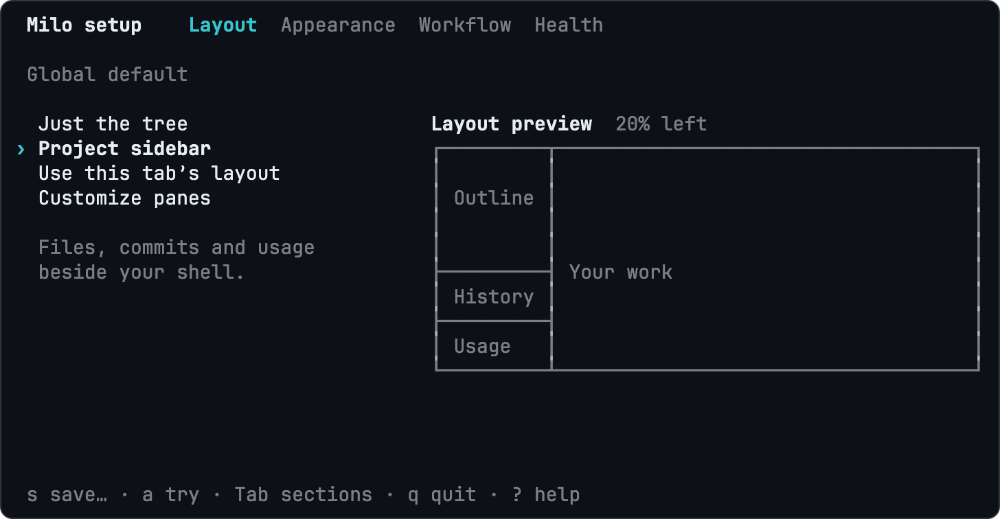

# Set up milo

## In Rex

Run `milo setup` inside a Rex tab. Use Up and Down to select a row and `Space` or `Enter` to change it. You can choose the outline, history and usage panes and the width of the left column. Press `a` to try your choices in this tab without saving, or `s` to save them. The added panes leave the keyboard in your shell.

Turn on **Arrange new shell tabs** to apply the layout to new shell tabs. Tabs opened to run a command and tabs with their own layout are left alone. Turn it off and save to stop arranging new tabs. The panes also work on their own outside Rex.

Bare `milo` offers setup once in an unconfigured Rex. Use `milo outline` to skip the offer. Outside Rex, `milo setup` only offers the Claude Code option.

## Rex actions

Saving installs these actions in the Rex command palette:

| Action | Name for a key binding |
| --- | --- |
| Milo: Arrange This Tab | `milo_layout` |
| Milo: Add the Outline | `milo_outline` |
| Milo: Add the History | `milo_history` |
| Milo: Add the Usage Strip | `milo_usage` |
| Milo: Close Panes in This Tab | `milo_close` |

Milo does not add key bindings. To add your own, put something like `rex.bind("cmd+shift+m", "milo_layout")` in Rex's `init.lua`.

Setup adds two marked lines to `~/.config/rex/init.lua` and asks Rex to reload. Milo's generated file is `~/.config/milo/rex.lua`; `~/.config/milo/listener.lua` is added only while **Arrange new shell tabs** is on. If `$XDG_CONFIG_HOME` is set to an absolute path, both configuration directories live there instead; `$REX_CONFIG` can point directly to a different `init.lua`. Milo remembers setup and listener state in `~/.local/state/milo` (or `$XDG_STATE_HOME/milo`). It does not rewrite your existing actions or bindings, and it will not replace a file of the same name that it did not write.

## Claude Code limits

**Show Claude Code limits** adds milo to `~/.claude/settings.json` only if you do not already have a status line. Turning it off removes milo's entry, not one you added yourself. If the option is unavailable because you already have a status line, milo leaves it alone; [other sources](usage.md#where-the-figures-come-from) may already provide limits.

## Remove milo

1. To remove the Rex setup, run `milo setup` inside Rex. Turn off **Outline**, **History**, **Usage** and **Arrange new shell tabs**, then press `s`. This removes milo's lines from Rex's settings, deletes the files milo generated and stops the listener. A generated file you have edited by hand is left where it is. To close panes already open, use **Milo: Close Panes in This Tab** before removing the actions, or close the panes yourself.
2. To remove milo from the Claude Code status line too, turn off **Show Claude Code limits** and save. You can also do this outside Rex.
3. From the milo checkout, run `sh install.sh --uninstall` to remove the binary. Use the same `MILO_BIN_DIR` you installed to if you set one. This command does not change Rex or Claude Code settings or remove milo's saved state.

## Troubleshooting

- **`milo` is not found:** the installer puts it in `~/.local/bin` unless you set `MILO_BIN_DIR`. Add the install directory to your `PATH`, or run the binary by its full path.
- **Actions are missing:** run `milo setup` inside Rex and press `s`. If setup reports that it could not check or reload the layout, resolve that error before trying again. `rex actions` lists the server's actions; look for `milo_layout` to check whether it loaded.
- **New shell tabs are not arranged:** check **Arrange new shell tabs** and save inside Rex. Setup normally starts and stops the listener. `milo listen` and `milo listen --stop` are the listener commands, not panes.
- **Icons appear as boxes:** install a [Nerd Font](https://www.nerdfonts.com) and select it in the terminal, or set `MILO_ICONS=plain` for ordinary symbols or `MILO_ICONS=off` to hide them.
