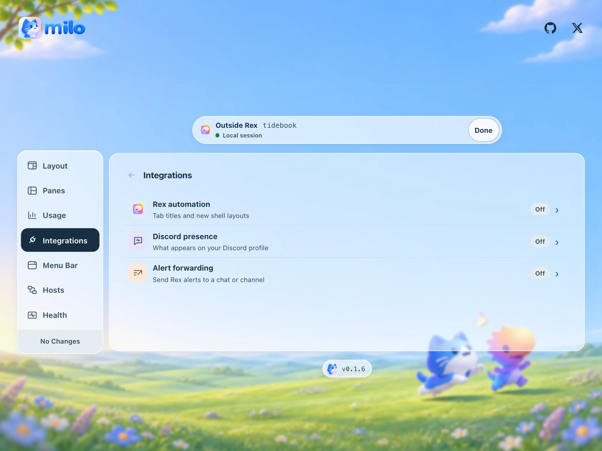
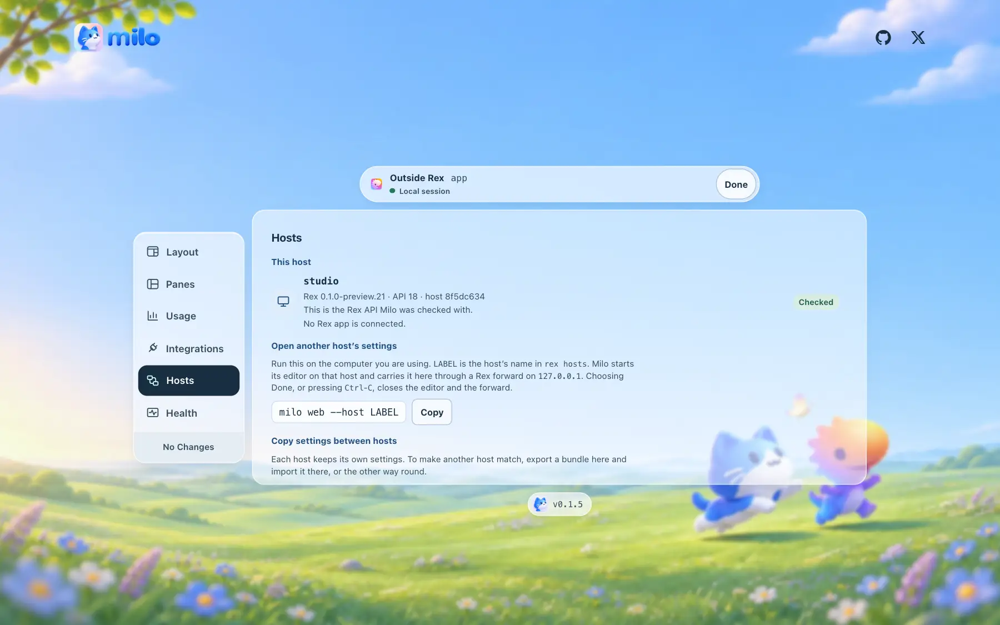
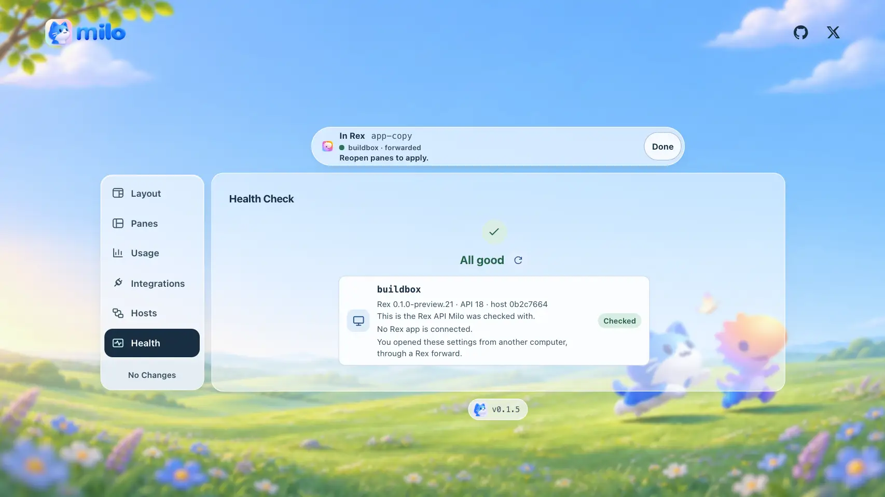
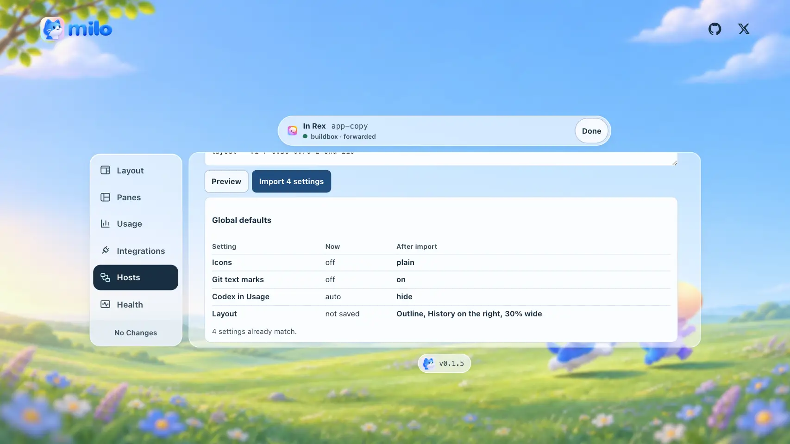
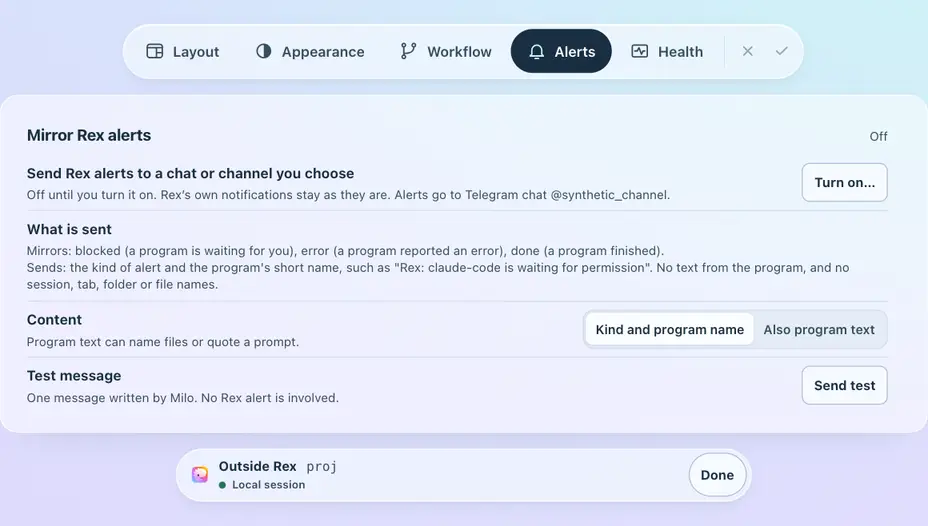
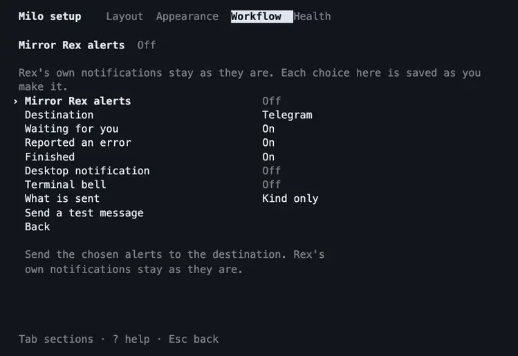

# Set up milo


## Install

The [v0.1.8 prebuilt release](releases/v0.1.8.md) is for Apple Silicon Macs running macOS 13 or later. Use Homebrew:

```sh
brew install mcc0x/milo/milo
```

Or download the versioned release installer from GitHub:

```sh
curl -fsSLo milo-install.sh https://github.com/mcc0x/milo/releases/download/v0.1.8/install.sh &&
  sh milo-install.sh
```

The installer checks the binary against a pinned SHA-256 checksum before placing it in `~/.local/bin`. Set `MILO_BIN_DIR` to choose a different directory. The prebuilt installer does not need a compiler, Cargo or Git.

To upgrade, run `brew upgrade mcc0x/milo/milo` for a Homebrew install, or download and run the new version’s installer for a script install. If you installed the Rex integration, run `milo setup --repair` after upgrading so Rex loads the current actions and listener. If you installed the macOS menu app, run `milo menubar install` again to update it.

To build from source instead, install Git and Rust 1.91 or later, then run:

```sh
git clone https://github.com/mcc0x/milo.git
cd milo
sh install.sh
```

The source installer builds the checkout containing the script, even when launched from another directory. A standalone or piped copy clones Milo from GitHub into a private temporary directory instead.

The source installer also honours `MILO_BIN_DIR` and defaults to `~/.local/bin`.

Current installers write a receipt for the binary and its install path. Use a current installer with `--uninstall` and the same `MILO_BIN_DIR` to remove it. If the binary has changed or the receipt is missing or invalid, the installer leaves the binary in place. Older installs may not have a receipt; verify the binary before removing it manually rather than running an older installer’s `--uninstall`.

## Without Rex

From the directory you want to browse, run `milo outline`, `milo history` or `milo usage`. Use `milo view FILE --edit` for a working text file. Or run `milo`, choose a pane with the arrow keys and `Enter`, and return to the picker with `q` after closing the reader. Standalone Home does not record a welcome choice or install anything.

Choose **Terminal settings** for local preferences; you do not need to arrange a layout to save them. To use the browser editor without launching anything externally, run `milo web --no-open` and open its private link yourself. See the [command and feature matrix](../README.md#what-works-in-each-terminal).

## Anonymous usage counts

Standard builds have no reporting endpoint. In a reporting-enabled build, the first eligible interactive launch explains the counts and offers to turn them off. Continuing leaves them on for *later* launches. The launch that shows the notice sends nothing. To opt out before opening Milo, set `MILO_TELEMETRY=0` in your environment. To save a choice for all your projects, run `milo web` and open **Integrations → Anonymous usage counts**. Neither a worktree preference nor a settings import can change this choice.

An active installation is a user-level Milo installation that opens an eligible interactive pane. Standalone pane launches count; in Rex only opening Home or terminal Settings counts, so automatically started sidebars don't. Milo can report once per UTC day; the report contains the date and two yes/no values: first reporting install, and first active day this calendar month. It contains no identifier, version, OS, repository, account, prompt or agent usage. CI, background helpers and noninteractive commands don't report. Leaving a pane open overnight doesn't count another day. The receiver keeps daily new and active totals and calendar-month active totals. Monthly active is **not** the sum of daily active.

Milo remembers the last day it attempted locally and marks it *before* sending. Offline launches, crashes and lost requests can undercount; Milo doesn't queue missed days or retry an uncertain delivery. If the clock goes back, or a launch had its clock set far into the future, counting waits for a day later than the saved day. Turning counts off stops new attempts without forgetting an earlier one; a request already started cannot be recalled. Replacing the binary does not start a new install if you keep your Milo state. Deleting that state can count the install again; copying it to another account can undercount. Cumulative new installs are not the number still installed.

The receiving application stores aggregate counters, not individual requests. Like other HTTPS connections, a report exposes network metadata to infrastructure along its route. For example, Railway's public edge logs source IP and exact request time independently of the application. Direct public collection there doesn't meet the project's requirements. See the [operator's pre-deployment privacy checks](../hosted/counts/README.md) before configuring an endpoint.

## In Rex

In a Rex shell run `milo setup`. Pick **Just the tree**, **Project sidebar**, or start from the tab you already arranged. Adjust the individual panes and appearance if needed. Trying the layout does not change your saved default; undo the trial before saving if it isn't what you want.

In Home, the welcome guide and Settings, moving the pointer over a clickable control underlines it without changing your keyboard selection. **Click once** to open a menu, switch sections or change a value. Click **Save** and choose a scope to keep your changes. Terminals without mouse-motion reporting still support the arrow keys and Enter.

In narrow Settings panes, rows use shorter labels. When there's room, the full name and value of the selected setting appear below the list.

**Unsaved changes** stays visible while you edit. If you leave Settings from Home or `milo setup`, choose **Save**, **Discard**, or **Keep editing**. Save asks for a scope for each changed group: layout, then appearance and workflow together. Claude Code choices apply to the active profile and do not need a scope. Each confirmed save takes effect as you go, so going back does not undo changes you have already saved. Leaving also undoes any layout trial you haven't kept by saving it.

Save for **this worktree** to keep a project-specific setup, or save a **global default** for projects without an override. Worktrees of the same repository can have different choices. Preferences live on the machine running Milo, outside the repository. A project cannot install actions or supply a command for Milo to execute.

If the saved layout changes while Settings is open, Milo keeps the newer layout instead of overwriting it. Reopen Settings to edit that layout.

Saving appearance or workflow preferences changes only the settings you edited. A worktree still inherits global values for any settings it does not override, and saving global defaults does not copy worktree overrides.

If a worktree's preferences file is unreadable or invalid, panes keep using global preferences. If the global file is broken, panes use built-in defaults. Milo leaves the files alone and shows a notice; run `milo doctor` to find the file and the error, then correct it and reopen the panes.

Usage starts as a two-row strip in the shared sidebar. Drag a divider in an installed Milo sidebar and Milo remembers the proportions for that Git worktree automatically. To save a layout explicitly or make it the global default, use **Milo: Remember This Layout…**. Milo stores pane roles and proportions, not processes or live pane IDs. Mixed rails containing another app are left alone.


Turn on **Arrange new shell tabs** to apply the layout to new shell tabs, including the first tab of a new session. Save this switch globally; changing it alone does not replace either the global or worktree layout. If Usage is sized in rows, Milo waits for a Rex client to measure the tab, so a background tab may arrange when you first show it. Tabs opened to run a command and tabs with their own layout are left alone. Turn it off and save globally to stop arranging new tabs. The panes also work on their own outside Rex.

Use the appearance choices to preview icons, choose text change marks, and turn animated activity marks off. Usage shows Codex, Claude Code and OpenCode only while each has a figure to show; choose **Always show** or **Hide** for a tool to [decide that yourself](usage.md#which-tools-appear). Use the workflow choices to pin Outline and History to the starting project or follow the shell they were opened beside. Milo does not change Rex's font, theme, shortcuts or notification settings.

**After Rex restarts, a sidebar can come back as shells instead of Milo.** The dividers and pane labels survive, but on Rex preview.23 (server API 19) the running programs do not. To restore the sidebar, focus its tab’s working shell and run **Milo: Arrange This Tab** in the Rex app. Milo checks what’s running before it offers to rebuild. New shell tabs are arranged as before.

**Text zoom is separate from split size.** On Rex preview.21 (server API 18), Milo can read a terminal's cell dimensions, but creating or resizing a terminal does not set the font the Mac app renders. The app exposes relative font actions and an app-wide [starting font size](https://www.superlogical.com/rex/docs/reference/mac-settings.md#setting-typography-font-size), not an absolute per-pane zoom setting. Milo therefore remembers divider positions, not text zoom, for Outline, History and Usage.

Inside Rex, run `milo` for Home or `milo setup` to go directly to Settings. Both share the same first-run guide. To skip it in an install script, run `milo setup --skip-onboarding`; it records the skip and exits without requiring a terminal or installing integrations. `milo outline` and the other direct pane commands never show the guide. Terminal panes work without Rex; split geometry and shell-following require Rex.

## Tab titles and session names

Milo leaves tab and session names alone unless you ask. It builds a name from folder names and the name of an agent's process. It never reads what a terminal shows, a terminal's title or a program's status text, so nothing you type to an agent ends up in a name.

Turn on **Title Rex tabs** under **Workflow** in terminal Settings or **Integrations → Rex automation** in the browser to name tabs that nobody has named. A tab is titled after the Git project its shell is in: `project` in the repository's own folder and `project/worktree` in a linked worktree. While Claude Code, Codex or oh-my-pi runs in one of the tab's shells, the title ends with ` · claude`, ` · codex` or ` · omp`. A tab outside a Git project keeps the label Rex gave it. The setting is off by default. Save it globally, or for one worktree to title tabs only there or everywhere but there.

Milo titles a tab only while its label is Rex's own, such as `Window 89abcdef`, or the title Milo set last. Rename a tab yourself, in the app or with `rex window rename`, and Milo stops titling it. Clear the name to hand the tab back. Milo remembers the titles it set by Rex window ID in its state folder, so a name you chose is still respected after Rex or Milo's listener restarts.

New tabs use the current title setting. For an open tab with file-backed preferences, the listener picks up an edit on the next shell or tab-layout event, without polling. Otherwise the title is reconsidered when the directory or foreground agent changes. Turning titles off returns the tab to Rex's label. Agents are recognised by their program name: one started under another name, such as `node`, is not shown.

The listener starts Milo to ask about a directory once, and with titles on once more for each agent that runs there. After that it asks again when your global preferences or that worktree's own have changed, or when a folder outside any project has gained a repository. So with titles off, other tabs in a directory and later visits to it normally start no further process. Milo is asked every time about a directory it cannot vouch for: one outside a project with a folder above it that other users can write to, such as `/tmp`, one reached through a link, or one where Git could not run.

**Milo: Name Session from This Project** renames the session you run it in after the project of its shell: `project`, or `project/worktree` in a linked worktree, without the agent. It is the only way Milo names a session, and it happens only when you run the action: from the command palette, with a key you bound to it, or with `rex do milo_name_session`. It creates no session and switches to none. Outside a Git project it changes nothing and says so. Milo does not remember the name or keep it up to date, so rename the session again whenever you like. The action does not depend on **Title Rex tabs**.

Both need the installed Rex integration. After upgrading Milo, run `milo setup --repair` so Rex loads the current actions and listener.

## Start an agent task

`milo task new` starts a coding agent on a task from a shell in your project. It adds a Git worktree for the task, or uses one the project already has, and opens the agent in a new Rex session named after it, `project/worktree`. The session starts in the background: your pane keeps the focus, and no app is asked to show the new session. Visit it whenever you like. It shows the agent's own full screen, so you can read along, answer its questions and type a follow-up.

```sh
milo task new --branch perf/reader-scroll --base origin/main --agent claude --prompt "Speed up scrolling in large files"
milo task new --worktree ../milo-worktrees/perf-reader-scroll --agent codex
```

On success it prints two lines for a script to read, the worktree's folder and the session's ID:

```
worktree /Users/you/dev/milo-worktrees/perf-reader-scroll
session session:01a212ce-82f4-7ed0-bdb4-88aa2edd12fa
```

**Where the agent works.** Name one of two things, and Milo uses exactly that:

- `--branch NAME` adds a worktree on that branch. A new branch needs `--base REF`, the commit it starts from: a branch, a tag or a commit ID. Milo never picks one for you, and the new branch tracks no remote branch. A branch that already exists and is checked out nowhere gets a worktree as it is and takes no `--base`. The worktree goes in `--path DIR`, or else beside the project's main folder in `PROJECT-worktrees/NAME`, with each `/` of the name as a `-`. A branch that is already checked out is refused, with the folder to pass to `--worktree`.
- `--worktree DIR` uses a worktree the project already has, with whatever is in it. A folder that is not one of this project's worktrees is refused.

The checkout you run the command from is never switched or changed. `--project DIR` names the project when the current folder is not in it.

**Which agent.** `--agent` is `claude`, `codex`, `omp` or `opencode`. Milo starts each the way its own documentation starts an interactive session with a first message, never a print or one-shot mode:

| Agent | `--agent` | Started as | Checked with |
| --- | --- | --- | --- |
| Claude Code | `claude` | `claude -- PROMPT` | 2.1.311 |
| Codex | `codex` | `codex -- PROMPT` | 0.171.0 |
| oh-my-pi | `omp` | `omp launch -- PROMPT` | 19.1.1 |
| OpenCode | `opencode` | `opencode --prompt=PROMPT` | 1.19.6 and 2.4.1 |

The agent must be installed: its program is looked for by that name on your shell's search path. If it is not there, Milo says which agent is missing and stops before any worktree or session exists. It never starts a different agent in its place. Online usage accounts such as OpenRouter are not agents and cannot be started.

**The prompt.** `--prompt TEXT` is the agent's first message. It reaches the agent as one argument, exactly as written: no shell reads it, so quotes, `$(…)`, backticks and a leading dash are only text. The agent then reads it as it reads anything you type to it, so a slash command or an `@file` mention means what it means there. Without `--prompt` the agent opens idle. One limit: Claude Code runs a prompt that is a single bare word, such as `doctor`, as its own command of that name, so Milo refuses a one-word prompt for it and asks for a few words.

**What it does when something fails.** Everything that can be refused is checked first: the project, the agent, the branch, the base, the folder, and that a Rex server answers. Until then nothing has been created. If a later step fails, the message says exactly what exists, for example `Created worktree … on new branch …; it was not removed`. Milo never deletes a worktree, a branch or a session it made, and never pushes, opens a pull request, merges or cleans up. Remove a worktree you no longer want with `git worktree remove`. An agent may ask whether it should trust the new folder before it reads your prompt; that question is the agent's, and Milo does not answer it.

The agent runs with the environment of a new shell tab: your login shell's, with its interactive startup files read. An agent that starts and then exits within a moment is reported as a failure, and its session stays open so that you can read why.

**From the command palette.** **Milo: New Agent Task…** asks the same questions in Rex's own prompts and then runs the same `milo task new`. It uses the project of the shell you run it from. It lists the agents installed on that host and skips the question when only one is; it offers the project's worktrees and **New worktree…**, which asks for a branch and where it starts; then it asks for the task. Closing any question ends the action with nothing created. From `rex do` or a key binding, pass any of `agent`, `worktree`, `branch`, `base` and `prompt` to skip that question: `rex do milo_new_agent_task agent=codex branch=fix/typo base=main prompt="Fix the typo in the README"`. The action answers with the worktree and the session ID. Rex starts actions with a short system search path, so here the agents are looked for on the path your login shell sets up, including what `~/.zshrc` or its like adds.

**On another Rex host.** `--host HOST` starts the task on another host: a label from `rex hosts` or a server address, as for `rex -S`. The project, its worktree and the agent are all on that host, so write `--project`, and `--worktree` or `--path` if you pass them, in full as they are there. The host runs its own `milo task new`, so it needs this version of milo on the search path of its login shell, and the agent installed there. The result adds a third line, `host HOST`.

## Browser editor

Run `milo web` from the project you want to configure, or choose **Open browser settings** from Milo Home. Milo opens the editor through a short-lived private file so it doesn’t pass the session key to the launcher. If the editor doesn’t open, use the private link printed in the terminal. `milo web --no-open` prints that link without opening a browser. The link is printed at once; a page opened from it waits the moment Milo takes to read your settings. Keep the command running while you edit. The page is served by the Milo executable on this machine, not by usemilo.net. No account, network service, or separate frontend install is needed. Don’t share the link.



On macOS, the optional [Milo menu app](usage.md#macos-menu-bar) also opens this editor from **Browser settings…**. To configure a particular worktree, run `milo web` from that project.

The editor listens on `127.0.0.1:6110` by default. Use `milo web --port 7000` to choose another port, or `--port 0` for an available port when running a second editor.

Use **Layout** for pane order and sizes, **Panes** for Outline, History and shared appearance, and **Usage** for tools, accounts and display. In Rex, the layout actions menu lets you copy the current tab’s layout or try the draft in that tab. Undo a trial to restore the previous layout. Save explicitly for the current worktree or as the global default; Claude Code choices apply to the active profile. Outside Rex you can still edit and save settings.

**Integrations** groups Rex automation, Discord presence and alert forwarding. Rex automation uses drafts; presence and forwarding apply immediately. **Menu Bar** manages the optional macOS app. **Hosts** names the computer these settings belong to and copies settings to or from [another Rex host](#several-rex-hosts). **Health** checks for problems and shows the host and its Rex version.

After saving, the confirmation names the destination: global defaults, the current worktree, or the active Claude profile. If open panes still use the old preferences, the browser keeps **Reopen panes to apply** in the project bar after the confirmation fades. Editing again clears the reminder.

Terminal Settings and the browser editor check for intervening changes before saving preferences or removing a worktree override. If another editor saved first, reopen the settings and review the current values rather than overwriting them. In terminal Settings, save or discard layout and Claude drafts before repairing or removing integrations.

In **Health**, run a check of saved settings and the live layout. If the original Rex tab is no longer available, Health warns unless it finds a more serious issue. Saving settings or changing the live layout clears the old result; run the check again for an updated verdict.

While the page is open, it periodically keeps the local session alive only if it has unsaved changes, an active layout trial, or queued edits. This does not save your work, and the session can still time out if the browser suspends the page.

**Done** closes the editor only after undoing any active layout trial. If undo fails, the editor stays open so you can retry. Stopping Milo with `Ctrl-C` or letting it time out only attempts to undo the trial. Closing the browser tab alone leaves the private link usable until Milo stops or the session is idle for 15 minutes. When the session ends, unsaved drafts are discarded; saved settings stay as they are.

The dashboard ships inside `milo`: using it needs no Node runtime, account, or internet connection. For UI development, use Node 26 and Bun: `cd dashboard && bun install --frozen-lockfile && bun run dev`. Open the private URL printed in the terminal. Next.js Fast Refresh updates the interface against a real local Milo session. `MILO_BIN` selects the backend executable (default `milo` on PATH); `MILO_PROJECT` selects the project to edit; `PORT` selects the development port (default `6110`). Stop the development server with `Ctrl-C`.

## Several Rex hosts

Each Rex host has its own Milo: its own binary, settings, state and integrations. Nothing is shared or synchronised on its own. Three things make several hosts feel like one setup: Milo says which host you are looking at, you can open another host’s settings from the computer you are using, and you can copy the settings you choose from one host to another. With a single host nothing changes.

Several Rex apps attached to one server, such as a Mac and a phone, are one host: they share one Milo and one set of settings.

### Which host this is

`milo doctor`, **Health** and **Hosts** in the browser editor name the computer Milo runs on, the first part of Rex’s ID for that host, the version and API revision of its Rex server, and whether a Rex app is open on that computer:

```
Host: studio (Rex host d4744373)
Rex server: 0.1.0-preview.23, API 19; rex command: the same
Rex compatibility: checked with API 19. This is the Rex API Milo was checked with.
Rex apps: open on this computer
```

Milo’s Rex files are checked against API revision 19, which is Rex Server & CLI 0.1.0-preview.23. A newer server is noted and is no warning, because Rex keeps older calls working. Health warns in two cases: the server is older than that revision, or the `rex` command and the server are different versions. In the second case, restart or update Rex before saving a layout, because Milo validates its Rex files with the command and the server is what reads them.

Milo acts on the pane it was run in, never on whichever pane has focus. It knows that pane from `REX_BLOCK`, which Rex sets in every terminal, and lets Rex find the session that holds it. Rex before preview.23 also set `REX_SESSION`; where a terminal still has it, Milo uses that session as before.

The computer’s name stays on that computer and in the pages its editor serves. It is not sent to Telegram, Discord or the relay.

<picture>
  <source media="(max-width: 600px)" srcset="img/web-hosts-mobile.webp">
  
</picture>

### Open another host’s settings

On the computer you are using, run:

```sh
milo web --host studio                       # a label from `rex hosts`, or an address as for `rex -S`
milo web --host studio --project /home/you/src/app   # that worktree's settings; the path is on the host
```

Milo checks that the host answers, starts `milo web` there in a Rex session of its own named `milo-settings`, and carries it to your computer with `rex forward`. It then prints the private link and opens it. The page says `studio · forwarded` in its session bar, and **Hosts** and **Health** show that host, so you can tell which settings you are editing.



The protections are the same as for a local editor:

- The editor on the host listens only on the host’s `127.0.0.1`, and the forward listens only on your computer’s `127.0.0.1`. Nothing listens on a network address. Milo waits for Rex to confirm that its forward is listening before opening or printing the private link.
- The host’s editor is told the one address the page will have on your computer before it starts. It accepts that exact `Host` and `Origin` and no other, including its own port on the host.
- Every settings request still needs the session key in the link. Don’t share the link.

**Done** in the page, `Ctrl-C` in the terminal, or 15 minutes without use ends the editor on the host. Milo closes the forward and removes the `milo-settings` session. If the watcher fails or the tunnel closes before the editor confirms it ended, `milo web --host` reports an error and still cleans up locally. If the host cannot confirm remote cleanup, Milo names the session to look for.

The host needs the same version of `milo` on the search path of its login shell, and you need to be able to reach it with `rex -S`. If `milo web` runs on a host where every connected Rex app is on another device, it opens no browser there and prints this command instead.

### Copy settings to another host

Choose what travels. Nothing is exported unless you name it:

```sh
milo settings export appearance,layout --output milo-settings.txt   # or workflow, usage, all
milo settings export all --scope all --output milo-settings.txt     # global defaults and this worktree's own
```

Move the file however you like. On the other host:

```sh
milo settings import milo-settings.txt           # shows every change; saves nothing
milo settings import milo-settings.txt --apply   # makes those changes
milo settings undo                               # takes the last import back
```

The same steps are under **Hosts** in the browser editor: tick the groups, **Create bundle**, paste it into **Import** on the other host, **Preview**, then **Import**. With `milo web --host` you can do both ends from one computer.



| Group | What it carries |
| --- | --- |
| `appearance` | Icons, Git text marks, static or animated activity marks |
| `workflow` | Project following, changed files only, follow writes, follow new commits |
| `usage` | Whether Codex, Claude Code and OpenCode show, and large figures |
| `layout` | Panes, side, order and proportions of the saved rail |

**What never travels.** Tokens, webhook links, alert destinations, provider account keys and their on/off choices, Discord presence, the menu app, Claude Code status-line setup, **Title Rex tabs**, **Arrange new shell tabs**, the Rex integration files and everything in the state folder. A bundle that names any of these is imported without them, and the preview lists each line it left out. Set those up on each host.

**Projects at different paths.** A bundle holds no path from the host it came from. For a worktree it records the folder name, the folder below your home if it is there, and the ID of the commit the repository’s history starts from. An import applies a project’s settings to a worktree only when that worktree starts from the same commit: the one you run the command in, or the one at the same place below your home. A folder with the same name is never enough. To choose a worktree yourself, use `--map NAME=DIR`, or **Apply to** in the browser preview. A shallow clone has no starting commit to compare, so map it by hand.

**Conflicts.** The global defaults are replaced setting by setting; settings you did not export, comments and unknown lines in the file stay. A layout is replaced whole. An import is all or nothing: if a settings file changes between the preview and the import, nothing is written and you are asked to preview again.

**Undo.** `milo settings undo`, or **Undo import** under **Hosts**, restores exactly the files the last import replaced. If a setting it changed has been changed again since, nothing is undone and Milo says so. Only the last import is kept.

**Limits.** One worktree’s settings travel per export, the one you run it in. Importing a layout saves the layout; it does not install the Rex integration on a host that has none, so run `milo setup` there once. Panes that are open read the new settings when you reopen them. A bundle written by a newer Milo is refused with a request to update.

### Follow a shell to another computer over SSH

In a Rex tab, `milo ssh HOST` logs in to HOST with your own `ssh` and lets the Outline and History beside that shell follow it there. As you change folders on HOST they show HOST’s files and commits, with HOST’s name at the foot of each pane. When you log out, or the connection drops, they come back to this computer’s worktree as you left them, with any unsaved reader draft still open. Other tabs are not affected.

```sh
milo ssh dev@build-box
milo ssh -F ~/.ssh/work-config build-box
```

- **What it needs on HOST.** Milo on HOST’s search path, in `~/.local/bin` or in `~/.cargo/bin`. Milo installs nothing there and changes no SSH or shell setting on either computer. Without Milo on HOST you are still logged in as plain `ssh` would log you in, and the panes say they can’t follow you.
- **Your keys stay here.** `milo ssh` uses your ssh configuration, keys and prompts, and keeps one connection for the tab: the panes reuse it instead of logging in again. Agent forwarding is off for it. `-F CONFIG` uses another configuration file, as `ssh -F` does.
- **Usage stays local until you choose.** Usage keeps showing this computer’s accounts and tools, and says so. Press Tab in it to see HOST’s usage, read by Milo on HOST from HOST’s own files; Tab again comes back. Nothing is copied between the computers.
- **Read only.** The reader in a pane that follows HOST shows HOST’s files but does not edit them.
- **Where the folder comes from.** HOST’s system reports the shell’s folder to Milo on HOST. Prompts, window titles and other terminal output are never read for it.

This first version follows one hop. A shell that goes on from HOST to another computer, a plain `ssh` you did not start with `milo ssh`, and tmux on HOST are not followed. Panes opened with a pinned project don’t follow at all.

## Rex actions

Saving installs these actions in the Rex command palette:

| Action | Name for a key binding |
| --- | --- |
| Milo: Arrange This Tab | `milo_layout` |
| Milo: Add the Outline | `milo_outline` |
| Milo: Add the History | `milo_history` |
| Milo: Add the Usage | `milo_usage` |
| Milo: Close Panes in This Tab | `milo_close` |
| Milo: Peek Outline | `milo_peek_outline` |
| [Milo: Reopen Last Reader Tabs…](panes.md#reopening-tabs-and-named-sets) | `milo_reopen_tabs` |
| [Milo: Open a Reader Tab Set…](panes.md#reopening-tabs-and-named-sets) | `milo_tab_sets` |
| Close the outline peek | `milo_close_peek` |
| Remember the current rail | `milo_remember_layout` |
| Reset a remembered layout | `milo_reset_layout` |
| Name the session after this project | `milo_name_session` |
| Milo: New Agent Task… | `milo_new_agent_task` |
| Milo: Open File from Terminal Output… | `milo_open_output` |

Milo does not install key bindings. For an optional shortcut, check Rex's shortcut settings and `rex keymap` first; the latter lists config bindings, not every Mac app shortcut. If the chord is free, put a binding such as `rex.bind("cmd+shift+m", "milo_peek_outline")` in your own Rex `init.lua`. Actions also work directly in the palette without any binding.

Peek opens a floating outline and takes focus. Invoking it again raises the same peek. Dismiss it to return to the originating pane. Adding the docked Outline instead keeps the shell focused. Your existing custom actions remain yours.

Open File from Terminal Output reads the recent output of the pane you run it in, once, and opens a project file it names in the reader. [Opening a file from a terminal's output](panes.md#opening-a-file-from-a-terminals-output) says what it reads and what it refuses. An installation keeps the actions it was saved with, so after updating Milo, save the layout again to get an action added since; until then `milo doctor` reports `Server actions: not current`.

Setup adds two marked lines at the top of `~/.config/rex/init.lua` (after the interpreter line, if it has one) and asks Rex to reload. The actions live in `~/.config/milo/rex.lua`. `~/.config/milo/listener.lua` watches for divider changes even when arranging new shell tabs is off, and titles tabs when you have chosen that. If `$XDG_CONFIG_HOME` is an absolute path, both folders live there instead. `$REX_CONFIG` can point directly to a different settings file. Milo keeps its saved state in `~/.local/state/milo` or under an absolute `$XDG_STATE_HOME`.

Setup does not rewrite your actions or key bindings. It refuses to change read-only settings files or use a linked milo configuration folder. The settings file itself may be a symbolic link: setup edits the target and keeps the link.

## Claude Code limits

**Show Claude Code limits** adds milo to `~/.claude/settings.json` only if you do not already have a status line. Turning it off removes milo's entry, not one you added yourself. If the option is unavailable because you already have a status line, milo leaves it alone; [other sources](usage.md#where-the-figures-come-from) may already provide limits.

If you set `CLAUDE_CONFIG_DIR`, Milo uses that profile's `settings.json` instead and tracks its installation separately.

New setups use the full path to Milo, so Claude Code does not need `milo` on its `PATH`. If Doctor reports an old launcher, turn limits off, save, then turn them back on and save.

## Mirror Rex alerts

Milo can send the same Rex alert to Telegram, Discord, or both. Forwarding is off until you enable it. Rex's own tab marks, sounds and notifications stay as they are: Milo listens to `rex events` and changes no Rex setting.

```sh
milo alerts telegram -1001234567890   # asks for the bot's token; or: milo alerts discord
milo alerts                           # what is saved, whether it is running, what would be sent
milo alerts test                      # one message written by Milo
milo alerts on                        # starts, and says again what is sent
milo alerts on discord                # enable just Discord, leaving Telegram as configured
milo alerts on telegram               # now send to both
milo alerts test telegram             # test only Telegram
milo alerts notices on discord        # let Milo announce forwarding changes in this channel
milo alerts notices off discord       # silence those notices, without pausing Rex alerts
milo alerts off                       # ends it at once
```

In `milo web`, open **Integrations → Alert forwarding** to manage destinations, forwarding switches and lifecycle notices. In `milo setup`, **Workflow → Mirror Rex alerts…** controls global mirroring, event kinds and content, and can test a saved destination. Both ask before turning on forwarding. The terminal setup panel never takes a secret: save one with `milo alerts` or the browser editor.

In the browser, choose **Set up destination** (or **Manage destinations**). For Telegram, enter the bot token and look for a chat in its recent updates. If your chat isn’t listed, message the bot there and try again, or enter the chat ID or public `@channel` yourself. Bots already using a webhook need manual entry; Milo doesn’t disconnect their webhook. Looking for chats doesn’t save a destination or turn on forwarding.

Each saved destination has its own forwarding switch and test button. Turn on both switches to send each alert to both places, or test either destination without enabling forwarding. Forgetting one leaves the other connected.

**Lifecycle notices** are optional for each saved destination and off by default. Under **Manage destinations**, turn on **Lifecycle notices** for the chat or channel where you want them. Milo can send a short message there when forwarding is enabled, explicitly paused, or recovers after an interruption. A notice contains only the forwarding state, not the Rex alert, program, host, chat name or reason for the interruption. Milo does not announce each retry. The final pause notice is best effort: turning forwarding off does not wait for the destination to answer. Forgetting or replacing the destination resets its notice choice.

Changing the recipient or replacing its credential turns off forwarding to that provider until you approve it again. Re-saving identical manual credentials leaves forwarding unchanged. If another editor changes what will be sent while confirmation is open, review the updated details. An old preview Telegram credential without a verifiable chat identity must be paired again; Milo will not guess which DM it belongs to.

Alerts use separate credentials for each config directory. The default config directory keeps its existing saved connections. A custom `XDG_CONFIG_HOME` or `HOME` that previously used a shared credential must reconnect the destination in that profile and turn forwarding back on. Milo cannot tell which old profile approved the shared credential, so it does not copy it into another profile.

If Milo cannot disconnect a saved Telegram credential using the current relay (for example, one from the old production preview), use its original relay if possible. Otherwise, choose **Forget on this host** (or **Forget on “HOST”** in forwarded settings) in Telegram’s destination settings, or run `milo alerts forget telegram --local-only` on the affected host before reconnecting. This stops Telegram forwarding and removes its credential on that host only; it does not revoke the old connection on the relay or change Discord. To revoke all Milo connections to that chat, send `/stop` to Milo’s bot in the original chat while the issuing relay is available.

See the [Telegram recovery screen on a forwarded host](img/telegram-recovery-host.webp) and the [local-only removal confirmation on mobile](img/telegram-recovery-host-mobile.webp).

**Connect with Milo (requires the hosted service).** The official endpoint is `https://connect.usemilo.net`; the settings dashboard still runs on your device. If the service is not available, use manual setup. For Telegram, confirm in a private DM with Milo’s bot. For Discord, authorize a webhook for your channel. Copy the finish code from the bot’s reply or the confirmation page, then paste it **only in the Milo dashboard where you started pairing**. Pasting or selecting browser autofill opens the destination review. If you type the code, choose **Check connection**. Never send the code to someone who shared a pairing link. The destination is saved only when you choose **Save**; forwarding is enabled separately.

Telegram alerts use the relay; Discord alerts go directly from your device to your channel. Manual setup works without the hosted service. For local development or deployment requirements, see the [relay guide](../hosted/README.md).

<picture>
  <source media="(max-width: 600px)" srcset="img/web-alerts-mobile.webp">
  
</picture>



**What counts as an alert.** A program that reports through Rex's [program status protocol](https://www.superlogical.com/rex/docs/build/program-status) that it is `blocked`, failed (`error`) or finished (`done`); a program that asks for a desktop notification (OSC 9 or OSC 777); and the terminal bell. The first three are mirrored unless you choose otherwise with `milo alerts events blocked,error,done,notification,bell`. Working and idle reports, progress, exits, titles and everything else in a session are never sent, and neither is anything Milo itself shows.

**What is sent.** By default only the kind of alert and the program's short name, such as `Rex: claude-code is waiting for permission`: no text from the program and no session, tab, folder or file name. `milo alerts content text` adds up to 300 characters of the line the program gave Rex, which can name files or quote a prompt. Both the name and that line come from the program, so they are sent marked as code, where neither Telegram nor Discord makes a link, a mention or formatting of them. The line is also cut to one line with every `@` broken, Discord is told to notify no user, role or `@everyone`, and link previews are turned off.

**Which run finished?** Turn on **Include Rex origin label** under **What gets sent**, or run `milo alerts origin on` on the host running Milo. Telegram might then show `Rex: amp finished · release-review` instead of `Rex: amp finished`; Discord adds the same label to its card. The label can reveal a project or task name. It is off on new and existing installations. `milo alerts origin off` removes it without changing program text or pausing forwarding.

Milo uses the full session and block IDs from the [Rex event](https://www.superlogical.com/rex/docs/reference/events) to check that the terminal still belongs to that session on the local host. It uses the session’s name **at lookup time**: a rename can change what you see, and a closed or missing block produces the ordinary unlabeled alert. Two tabs in one session, or sessions with identical names, can still look alike. Rex does not report the originating tab on these events, so Milo does not use tab names.

A label must fit in 64 ASCII characters, start and end with a letter or digit, and contain only letters, digits, spaces, `_` or `-`. From a session named like `project/worktree · codex`, Milo can take just `worktree`, not the path. It omits unsafe or overlong names rather than sending a misleading fragment. It never infers an origin from focus, terminal output, shell commands, prompt text, OSC terminal titles or another host. The existing `content text` choice alone controls whether the program’s own status title and message are sent.

The same label choice applies after a worker or Rex restart. It does not change which destinations are paused. Lifecycle notices are a separate choice per destination: an enabled, paused or recovered notice carries only Milo’s fixed forwarding-status text, never a session label or program text.

If Rex cannot confirm the local server’s identity when Milo subscribes, alerts on that subscription stay unlabeled. Milo tries to verify the host again on the next subscription; it never attaches labels retroactively.

Discord sends one Milo card per alert, with the Milo icon beside the status, inline code for program names and optional text, a localized send time, and a colored edge: amber for attention, red for errors, green for completion, and Milo blue for notifications, bells and connection tests. Telegram keeps its compact text format.

**Destinations and secrets.** For Telegram, create a bot with BotFather, add it to the chat or channel, and give Milo the chat's number or a public channel's `@name`. For Discord, create a webhook in the channel's **Integrations** settings and give Milo its link; only `discord.com` webhook links are accepted. The bot token or webhook link is asked for without being shown, or read from standard input, never taken as an argument. On macOS it is kept in your Keychain; elsewhere in `alerts-secrets` in Milo's state folder, readable only by you. Settings pages show whether a secret is saved, never the secret. Saving a second destination while alerts are being mirrored does not move them: switch with `milo alerts use`. `milo alerts forget telegram` or `forget discord` removes one, and `milo setup --remove` removes both and ends mirroring.

**Once, not twice.** One background process mirrors, whatever number of tabs, panes and Rex apps are open. Rex repeats a status each time a program reports it; Milo sends it when a terminal enters a state or changes what it is waiting for. A terminal's bell is sent at most once in 30 seconds, and so is a notification that repeats that terminal's last one.

Deduplication lasts for one continuous Rex subscription. Changing the label or content setting opens a new subscription. If the program reports the same state again after that, Milo can send it again; it does not replay old events. Changing a disclosure does not reset a destination’s rate limit.

**When things go wrong.** Ordinary alerts are spaced about a second apart and limited to 20 a minute. Milo drops excess alerts and says how many were omitted in the next message. If a destination asks it to slow down, Milo waits and retries the alert if the requested wait is within a minute. A failing destination gets up to three attempts per alert. After a confirmed credential refusal, Milo stops automatic sends to that destination, including notices. Check the connection, then re-save it or turn that provider off and on to retry. A refusal by Telegram does not pause Discord, or vice versa. `milo alerts` reports the last outcome.

**When Rex goes away.** Milo keeps your forwarding choices. One worker listens for fresh events; if it exits unexpectedly, Milo retries it, and if Rex disconnects, Milo waits and reconnects. Repeated failures increase the wait up to 30 seconds. When Rex starts again and starts Milo’s [saved layout listener](#in-rex), a waiting worker reconnects within a few seconds instead of finishing that wait; without the layout integration it reconnects at its next retry. Rex does not repeat an alert raised before Milo reconnects. `milo alerts` and Settings distinguish waiting for Rex or retrying the worker from a user pause. `milo alerts off` pauses both destinations, even during a retry. Use `milo alerts off discord` (or `telegram`) to pause just one. Reconnecting Rex or starting the login listener does not undo a pause.

Use **Refresh status** in the browser or `r` in the setup panel to check again without changing forwarding. See [Waiting for Rex and per-destination lifecycle notices](img/alert-forwarding-after.webp) in desktop and mobile Settings.

**Limits.** Mirroring needs `/usr/bin/curl` and follows only the local Rex server. After a machine restart, Milo resumes enabled forwarding when Rex starts Milo’s [saved layout listener](#in-rex). If the layout integration is missing, disabled, or too old to start the listener, run `milo alerts on` yourself. Rex does not replay alerts raised during an interruption. Rex decides in each app whether to show its own notification (for example only in the background, or not for a muted tab) and does not report that decision, so Milo mirrors what programs reported, not what Rex showed. A terminal's notifications through OSC 99 do not appear in Rex's event stream and are not mirrored.

## Remove milo

The menu app and CLI uninstall separately. If you want both gone, run `milo menubar uninstall` **before** removing the CLI. This stops the app and unregisters launch at login. Skip this step if you want to keep using the menu bar.

If [Discord presence](presence.md) is on, **Uninstall Milo** in Home turns it off and takes the activity down. Before removing the binary any other way, run `milo presence disable`.

From Home, choose **Uninstall Milo** to review and confirm removal of the CLI and its managed integrations. **Health → Remove integration** and `milo setup --remove` only disconnect the managed integrations; they do not remove the executable. For manual removal:

1. To diagnose a setup before changing it, run `milo doctor`. To fix the managed integration after an upgrade or executable move, run `milo setup --repair` with the binary you intend to keep.
2. Before deleting the binary, run `milo setup --remove` to disconnect the managed Rex and Claude Code integrations. It also ends [alert mirroring](#mirror-rex-alerts) and removes its saved destinations and secrets. Saved preferences and user-edited files are not an uninstall target. Close any live Milo panes separately.
3. Remove the binary with `brew uninstall milo` if you installed with Homebrew. If you used the release installer, run `sh milo-install.sh --uninstall` with your downloaded copy. If you built from source, run `sh install.sh --uninstall` from the checkout. For either script, use the same `MILO_BIN_DIR` you installed to if you set one. Removing the binary does not change Rex or Claude Code settings or remove milo's saved state.

If Rex cannot reload during removal, Milo still removes the managed files and tells you to restart Rex. If Milo cannot safely remove its Claude Code status line, correct the reported settings problem and retry before deleting the executable.

If you set `XDG_STATE_HOME` when installing the integration, use the same value for repair and removal. Milo won’t guess which listener or Claude settings entry belongs to an installation it can’t verify.

`milo setup --remove` disconnects only the active Claude Code profile. Before removing the binary, repeat it for any alternate profiles where you enabled limits, using the same `CLAUDE_CONFIG_DIR` as when you enabled them.

## Troubleshooting

Choose **Doctor** in Home or **Read diagnostics** in Settings to check the installation. Press `Esc` to go back without waiting for the checks to finish. For a report to copy from the shell, run `milo doctor`.

- **`milo` is not found:** for Homebrew, check that Homebrew is on `PATH`. The scripts put milo in `~/.local/bin` unless you set `MILO_BIN_DIR`. Add the install directory to `PATH`, or run the binary by its full path.
- **Doctor reports a Rex loader conflict, or setup says Milo's Rex lines were moved, copied or changed:** Milo leaves your Rex settings and listener alone. In the Rex settings file named by Doctor, restore a single copy of Milo's original two lines at the top, just after any interpreter line. Then run Doctor again.
- **Doctor reports an unreadable saved layout profile:** restore a known-good copy of the named file, or back it up and move it aside. Then reopen Settings to use the fallback layout or save a new one. Integration repair does not replace layout profiles.
- **A save was interrupted or actions are missing:** run `milo doctor`. It checks the managed `rex.lua` and `listener.lua` on disk separately from the actions Rex has loaded. If it reports an out-of-date managed file, a stale launcher, a pending reload or missing managed actions, run `milo setup --repair` with the binary you intend Rex to use. If Doctor identifies a custom file, review it yourself. The **Health** section in setup offers the same diagnostics, repair and removal.
- **The sidebar opens at a different size:** run `milo doctor` from that Rex tab to compare the saved sidebar width and Usage height with what's live. If the sizes differ, check [Autobalance splits](https://www.superlogical.com/rex/docs/reference/mac-settings.md#setting-splits-focus-autobalance-splits) under **Settings → Interface → Splits & Focus**. If it is on, turn it off, then close and re-add the Milo panes to apply the saved sizes.
- **Another setup is saving:** only one setup can save at a time. Wait for it to finish before retrying.
- **New shell tabs are not arranged:** enable **Arrange new shell tabs** under **Customize panes**, then save globally. The listener is an account setting, not a per-project switch. `milo doctor` checks whether it is actually running.
- **After Rex restarts, the sidebar shows shell prompts:** Doctor can identify when the sidebar contains restored shells. Finish any work in them and run **Milo: Arrange This Tab**. When Milo can verify the shells are idle, **Keep shells** leaves them untouched; confirming **Rebuild sidebar** closes them, discards their input and scrollback, and opens Milo’s panes with the worktree’s layout. Milo won’t type into a shell or automatically rebuild on restart. If it can’t verify the panes or show a confirmation, inspect them yourself, close only shells you no longer need, and run Arrange again.
- **A tab is not titled:** `milo doctor` shows whether **Rex tab titles** is on for this worktree and whether the listener is running. The listener runs while the saved layout has at least one pane or arranges new tabs. A tab with a name of its own is left alone: clear the name in Rex to let Milo title it. For an already-open tab, change shell directories to trigger a fresh title check.
- **Icons appear as boxes:** choose plain symbols or no icons in setup, or override one launch with `MILO_ICONS=plain` or `MILO_ICONS=off`. Choose a Nerd Font in Rex only if you want one for all of your terminals.
