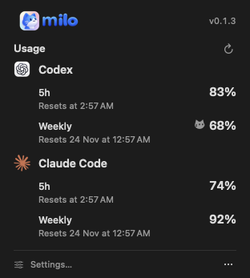

# Usage limits

`milo usage` shows how much of a reported limit is **left**, not how much has been used. It shows the tools that have something to show, and gives the whole pane to them. The two-row rail gives each of two tools one line for its most constrained window, and a tool on its own both rows. When there's room, it adds the reset countdown for a recent reading or when an older reading was last seen. Wide panes can show large figures and provider marks. Choose large figures in setup if you prefer them in a taller rail too.

A fresh **0% left** means the tool actually reported no remaining capacity. An older reading is marked as historical; once its reset time passes, Milo shows **reset elapsed**, not a fresh percentage. A missing reading is neither zero nor 100%. Run `milo doctor` to see which local source supplied a reading.

## macOS menu bar

With a menu-enabled CLI on macOS 13 or later, run `milo menubar install` to install and open `~/Applications/Milo.app`. Run it again to reopen or upgrade. `milo menubar uninstall` stops the app, unregisters launch at login if enabled, and removes only the app. Neither command needs sudo or a download.

If you have the older `Milo Usage.app`, run the install command again. It migrates the app to `Milo.app`; you don’t need to uninstall first.

You can also manage the menu app from Home (`milo`), under **Workflow** in terminal Settings (`milo setup`), or in the **Menu Bar** tab in web Settings (`milo web`). On current source builds, **Open or update** reopens the installed app or applies the CLI’s bundled update. Removal is a separate, confirmed action. It keeps the Milo CLI, your settings, and any unsaved Settings draft.

The Apple Silicon Homebrew and release binaries include the app starting with v0.1.4. If you prefer to build it from source:

```sh
sh macos/build-menu.sh
./target/local-menu/milo menubar install
```

For a source build, use `./target/local-menu/milo` for subsequent menu commands. On `main`, both build modes omit personal paths. Run `milo menubar install` from the shell whose provider and configuration paths you want the menu to use; run it again if they change. These paths live in a private file beside the installed app, not in the signed bundle. The app has its own reader and does not require Rex.

If the CLI that installed the app has changed or moved, **Browser settings…** opens the bundled editor instead. Run `milo menubar install` from the new CLI to restore menu management from that editor. The published v0.1.4 release predates install-time profile capture and uses default provider paths.

Click the menu bar item to see the same local usage windows as the pane. The menu uses **global** provider visibility, not the preferences of whichever worktree happens to be focused. Automatic display picks the lowest fresh remaining percentage; when none is fresh it shows just Milo. Options lets you pin a provider, show only the mascot, or opt into launch at login. Quitting the app also stops its reader.

Hover over the percentage to see which provider and limit it represents, how much is left, and when it resets if known. Open the menu to see that same window first. Icon-only mode keeps the usual provider order.

Low-quota notifications are **off by default**. In **More options → Low-quota alerts**, choose 10%, 20%, or 30% remaining and allow notifications when macOS asks. Milo alerts only when a visible provider’s fresh reading moves from above your threshold to at or below it, at most once for that provider and reset time. Starting below the threshold is silent. Stale, elapsed, hidden, and unknown-reset readings do not trigger alerts. Choose **Off** to stop them.



Choose **Browser settings…** to open the [local browser editor](setup.md#browser-editor). To change a specific worktree instead, run `milo web` from that project.

## Which tools appear

Milo gives a tool a place once it has a figure, and no place before that. If you use Codex and Claude Code but not OpenCode, the pane has two places and nothing for OpenCode: no label, no dash and no empty row. Each tool has its own choice under **Appearance** in `milo setup` or **Usage** in `milo web`, saved globally or for a worktree like the other pane preferences. Reopen the pane to apply a change.

| Choice | What the pane does |
| --- | --- |
| Auto, the default | Gives the tool a place while it has a figure saved on this Mac: a limit window for Codex or Claude Code, or tokens OpenCode recorded today. Without one the tool takes no room. |
| Always show | Keeps the tool's place even without a reading. Milo says what it knows, such as `no sessions found` or `could not read saved limits`, instead of inventing a percentage. A pane too small for every tool gives its rows to limits first. |
| Hide | Never shows the tool and does not look for it: its folders are not walked or watched, and its database is not opened. With Codex and Claude Code both hidden, oh-my-pi's database is not opened either. |

Whether a tool is in use here is read from files the tool itself saved. Milo does not run the tool, read its sign-in or use the network to find out.

| Tool | Found when |
| --- | --- |
| Codex | A session file `~/.codex/sessions/YYYY/MM/DD/rollout-*.jsonl` has something in it, or oh-my-pi has saved a Codex report. |
| Claude Code | `~/.claude.json` has something in it, or a session written today is under `~/.claude/projects`, or the status line or oh-my-pi has saved a limit report. |
| OpenCode | The file where it keeps its database is a SQLite database. |

Empty folders, empty files, another kind of file under the same name and a Claude Code directory that holds only settings do not count. Links to individual sources or within the session trees are not followed. A report oh-my-pi saved for a tool does count, even when nothing else of the tool is on disk. The looks are the bounded reads described under [Where the figures come from](#where-the-figures-come-from).

Milo uses `$CODEX_HOME/sessions` instead of `~/.codex/sessions` when Codex has an explicit home. With `CLAUDE_CONFIG_DIR` set, it looks for `.claude.json`, `projects/` and `settings.json` inside that directory, not in the default profile. Run Milo and Claude Code with the same override to see and configure that profile's usage.

A tool that is found but has no figure yet stays out of the way of the tools that have one. When no tool has a figure, the pane shows one quiet block instead of empty places: what each found tool is waiting for, such as `Claude · no saved limits found` and `Run milo setup`, or `No usage to show yet` and the tools Milo looks for when it found none.

The frame closes up around what is shown:

- **Two tools with limits** share the pane: side by side when it is wide, one above the other on a rail.
- **One tool with limits** has the pane to itself. A rail lists its other windows under the tightest one, and a wide pane keeps its windows together at the left.
- **OpenCode with one of them** takes the second place: the other half of a wide pane, or the lower half of a rail.
- **OpenCode with both** has one row beneath them, from the third row of a rail or in a wide pane at least nine rows tall. Two rows go to the two limits.
- **OpenCode alone** fills the two-row rail with today's tokens, then its cost and steps. A larger pane draws the tokens large.

`milo doctor` follows the same rule. It reports a tool that was found or is always shown, and says nothing of one that is absent or hidden beyond the choice itself.

## Where the figures come from

| Source | What milo reads |
| --- | --- |
| oh-my-pi | Limits the harness saves for Codex and Claude in `~/.omp/agent/agent.db` (or `$PI_CODING_AGENT_DIR/agent.db`). Milo reads only the usage data, using `/usr/bin/sqlite3` in read-only mode. Automatic reads are at least 20 seconds apart per pane. |
| Codex | Limit reports in recent Codex session files under `~/.codex/sessions` |
| Claude Code | Its own saved limits in `~/.claude.json`, or limits sent through the status line if you turn it on in setup. |
| OpenCode | Today's activity, not limits, from its session database. See [OpenCode activity](#opencode-activity). |

For each tool, milo uses the newest report it can read. When there is room, it also shows **tokens today** from Claude Code's local session files under `~/.claude/projects`. This is local activity since midnight, not a limit. It counts new input, output and cache writes, not cache reads. A `+` after the number means the total may be incomplete.

A report dated more than five minutes ahead of this machine's clock is not used, whichever source it came from. Otherwise one report written while a clock was wrong would outrank every later one. Milo shows the newest of the remaining sources instead. A deferred Codex or Claude Code report becomes eligible as the clock catches up, even if the source file has not changed. For the status-line save, the next report from Claude Code replaces the misdated file.

Milo checks the tails of recent Codex logs, then resumes near the previous end as those logs grow. Ordinary session activity does not clear the last limit report. A new or replaced log, a truncation, or a large burst of new data calls for another bounded tail check.

While a Codex log has been active in the last five minutes, Milo checks known logs about every two seconds, even if the writer keeps the file open. With a native watcher, Milo groups notifications so it doesn’t walk the session directories on every write. Without a watcher, it looks for new Codex and Claude Code sessions on the roughly two-second fallback checks. Press `r` to check immediately.

Milo labels reports as older after five minutes, or ten minutes for oh-my-pi to allow for its provider refresh cadence. This uses the time the provider's window was last observed, not the time Milo read the file.

**Show Claude Code limits** in `milo setup` adds a status line if you do not already have one. Claude Code calls `milo claude-status` to show a short line and save the reported limits to `~/.local/state/milo/claude-limits.json` (or under an absolute `$XDG_STATE_HOME`). It does not save prompts or replies. You do not need to enable it if Claude Code or oh-my-pi already saves a report.
Each explicit `CLAUDE_CONFIG_DIR` has its own `claude-limits.json` under Milo's `claude-profiles/` state directory, so a reading from another profile is not used as a fallback.

An unchanged status-line reading confirms the same window, but Milo saves that confirmation at most once a minute per window. A lower figure for the same window or an older reset does not replace or refresh the saved figure.
If an update leaves out the reset time, it can update a nondecreasing figure without discarding the last known reset.

## OpenCode activity

OpenCode saves no limits on this machine, so Milo shows none for it. What it does save is each step's token counts and its own cost estimate. Beneath two tools with limits Milo gives it one line, such as `OpenCode · 48.2k tokens today · $1.37 est.`. A narrower pane drops the cost first, then shortens the rest. Beside one tool, or alone, it also shows the number of steps, when the last one was recorded and the cache reads. [Which tools appear](#which-tools-appear) says where it goes at each size.

| Figure | What it means |
| --- | --- |
| Tokens today | New input, output, reasoning and cache writes of the assistant steps OpenCode recorded since local midnight, in every project. Cache reads are left out, as they are for Claude Code. It is activity, not a share of any limit. |
| Cost | The sum OpenCode recorded for those steps, in US dollars. It is OpenCode's estimate from model prices, not a bill: a subscription or an unpriced model records zero, and Milo shows nothing rather than `$0`. A `+` means some steps recorded no cost. |
| Limits | Unknown. OpenCode asks its own servers for allowances and budgets when you open them, and does not save the answer. Milo does not ask and does not use OpenCode's saved sign-in. |

Milo reads `~/.local/share/opencode/opencode.db`, or the same file under an absolute `$XDG_DATA_HOME`, or the file `$OPENCODE_DB` names. It uses `/usr/bin/sqlite3` in read-only mode for at most a second, at least 20 seconds apart. The queries return sums and times only: message text never leaves the database, and the tables that hold OpenCode's sign-in are not read. The line can lag OpenCode by about half a minute; press `r` to read now.

The figures were checked against databases written by OpenCode 1.2.0, 1.19.6, 2.2.0 and 2.3.2. They match `opencode stats --days 0`, except that Milo does not count a forked session's copied steps again on the day OpenCode 1 is upgraded to 2. Milo shows nothing, and `milo doctor` reports OpenCode's activity as unknown, when the database has other tables, when a step from today is malformed, when one of today's sessions was created by a version other than 1.x or 2.x, or when OpenCode 1 is still writing to a database OpenCode 2 has upgraded. Title requests are not counted, nor are OpenCode 2's compaction requests, because OpenCode does not record them as steps. [Usage sources](usage-sources.md) has the evidence, the limits of this reading, and why Amp and Gemini CLI are not read.

## Accounts asked online

Some figures exist only on a provider's servers. Milo can ask for four of them, and asks for none until you turn that account on. Each is hidden by default: with the choice left at **Hide**, Milo does not read the key, does not contact the provider and shows nothing, whatever keys are in your environment.

| Account | What the provider reports | What it is not |
| --- | --- | --- |
| DeepSeek | The prepaid API **balance**, in yuan or dollars, and the part of it that was granted | A limit, or what you spent |
| OpenRouter | What is **left of the key's spending limit** in dollars, or what the key has used when it has no limit; and its spend today and this month | Your account's credit balance, which needs a management key Milo does not ask for |
| Devin | **ACUs** your organization consumed in Devin's current billing day, which starts at 08:00 UTC | What is left of a plan. Enterprise plans only |
| Copilot | GitHub **AI credits** your personal account consumed this calendar month | What is left of the monthly allowance, which the API does not report. Not for seats billed to an organization |

These are money and counts, so they are written out in words, such as `DeepSeek · ¥110.00 balance` or `Devin · 12.5 ACUs today`. They are never drawn as a percentage or a large figure, never pick the menu bar badge and never raise a low-quota alert. An answer older than two refreshes is marked with its age; one older than a day, or from a billing day or month that has ended, is dropped.

**Turn an account on** under **Usage** in `milo web`, or in `~/.config/milo/preferences.conf` (a worktree can have its own choice, like the tools):

```
usage_deepseek = auto
usage_openrouter = always
usage_devin = hide
usage_copilot = hide
```

**Auto** asks the provider and gives the account a place once it has a figure. **Always show** also keeps the place to say why there is none, such as `no key set`, `key was refused` or `rate limited`. Terminal Settings (`milo setup`) does not list accounts yet.

**Give Milo a key of its own.** Milo reads only these names, from the environment of the shell that starts the pane, or from `~/.config/milo/usage-accounts.conf`:

| Account | Settings | The key |
| --- | --- | --- |
| DeepSeek | `MILO_DEEPSEEK_API_KEY` | An API key from the DeepSeek platform |
| OpenRouter | `MILO_OPENROUTER_API_KEY` | An ordinary API key; one with its own spending limit shows what is left of it |
| Devin | `MILO_DEVIN_API_KEY`, `MILO_DEVIN_ORG` (`org-…`) | A service user key or personal access token with the `ViewOrgConsumption` permission |
| Copilot | `MILO_GITHUB_TOKEN`, `MILO_GITHUB_USER` | A fine-grained personal access token with read access to the account's **Plan** |

```
# ~/.config/milo/usage-accounts.conf — chmod 600
MILO_DEEPSEEK_API_KEY = sk-…
```

The file must be a plain file of yours that no one else can read, or Milo ignores it and says so. The environment wins over the file. The macOS menu bar app does not inherit your shell's environment, so it needs the file. Milo does not look at `DEEPSEEK_API_KEY`, `GH_TOKEN` or any key another tool keeps: a key reaches a provider only because you named it for Milo. Prefer a key made for this, with the least access the provider offers. A DeepSeek key can also spend the balance, so treat the file like the key itself.

**What is sent and kept.** One `GET` over HTTPS to the provider's own host, through `/usr/bin/curl`, with the key passed on curl's standard input rather than its command line. Redirects are not followed. Milo normally asks DeepSeek and OpenRouter every 5 minutes, Devin and Copilot every 15, and asks again when the billing day or month their count covers ends. If a provider cannot be reached, Milo can retry after one minute instead of waiting the full interval. `r` asks again, but no sooner than 30 seconds after the last request and never inside a rate limit the provider announced. A refused key is not offered again for 30 minutes unless you press `r`. The figures and times of the last answer are saved under `~/.local/state/milo/accounts/` so that panes and the menu using the same credentials can share an answer; the key is never written there.
Each provider, key and organization or user has its own saved answer and retry timing. Panes, the menu and `milo doctor` use only the entry for the credentials they read. Changing a key in the private settings file clears the old figure on the next check, even if its refresh was still pending.

**Where it appears.** Limits keep their rows first, then OpenCode, then accounts: one row each at the foot of the pane, or the whole pane when no tool has a place. The menu lists each account with its figure in words.

Using DeepSeek or OpenRouter through OpenCode shows two different things: OpenCode's estimate of what today's steps cost, and what the provider says is left. Milo shows each under its own name and does not combine them.

## What milo does not do

For the tools above, the usage pane reads local data. It does not call their providers, run the tools, sign in, read their saved credentials, guess limits from token counts or work out a cost from them. Figures can be old or missing if no tool has saved a report on this machine recently. The status-line helper writes its own limit readings, not the session logs.

The one exception is an [account you turn on](#accounts-asked-online). For that account alone Milo sends one request to the provider's documented endpoint, with a key you set for Milo. It never turns a balance, a spend or a count of credits into a percentage, never adds figures from different accounts together, and never uses a key another tool saved.

## If a figure is missing

- A tool that is not there at all has no figure saved on this Mac, or is hidden. Run `milo doctor` to see what Milo found, or choose **Always show** for it in setup to keep its place and see what it is waiting for.
- Make the pane taller and wider to see labels, reset times and hints. Where the terminal can show pictures, including in Rex, milo draws the logos and large figures as pictures. Otherwise it draws with text. Short panes use text either way.
- Press `r` to check local data immediately. Milo reuses any oh-my-pi check already in progress and updates the pane when it finishes. Existing figures stay visible; `checking` means a lookup is in progress and there is no figure yet. For a tool, reload does not ask a provider for a fresh reading; for an account you turned on, it asks again at most every 30 seconds.
- A tool that is always shown, or found while no tool has a figure, says why it has none. `no sessions found` means no Codex sessions were found; `no limits to show` means there are sessions but no usable limits, or that a saved report has no windows. `no saved limits found` means milo has no saved Claude Code reading. `no tokens recorded today` means OpenCode's database has nothing from today. A narrow pane may shorten these hints.
- For oh-my-pi, check that `/usr/bin/sqlite3` is available and the harness has saved a report. For Claude Code, see [setup](setup.md#claude-code-limits) if neither saved source has a reading.
- An account that is turned on but missing has no figure yet and is set to Auto. Run `milo doctor`: it names the setting each account reads, where it found the key, and what the last answer or failure was, without asking the provider again. Choose **Always show** to see the reason in the pane. On a two-row rail with two limits, raise **Usage height** to give an account a row.
